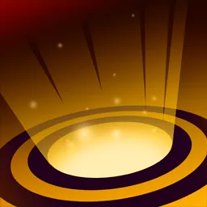

# Countermagic

Countermagic is the art of magical defence, weaving opposing spellcraft to negate the spell being cast by an opponent. Constructing a proper [[Counterspell]] requires a degree of magical knowledge and an ability to process that knowledge in an asymmetric way, as you may not always have all the information needed to build your opposition correctly. Someone with a deep understanding of magic may be able to easily identify the telltale signs of specific Runes being used, identify a gesture, or interpret an inflection and glean the purpose of a spell. Someone practiced in Countermagic may find unique ways to disrupt a spell being cast, including sapping the magical energies from it at inception.

      ## Counterspell

  Presence 2 Intellect 2 Arcana +1   You immediately react to a spell being cast and compose a rune and gesture designed to unravel and negate the spellcraft of an enemy mage.

  ### Actions

     #### Counterspell

 Single 301A1F1 Hand   ReactionHarmlessIntellect/Dexterity **Condition:** *Another creature which you can see is casting a spell.*

 You form arcane energy into a countervailing spellcraft, targeting a spellcaster you can see within **30 feet**.

Designate a **Rune** and **Gesture** which you know to attempt to counter the spell. Choosing a **Rune** which is opposed to one used in the spell grants **+2 Boons** to your attempt. Selecting the identical **Gesture** as the one being cast also adds **+2 Boons** to your attempt.

Perform a **Harmless** **Spell** attack against your target's **Willpower** defense. If your roll exceeds their defense, the spell is countered and its magic is nullified, producing no effects.
