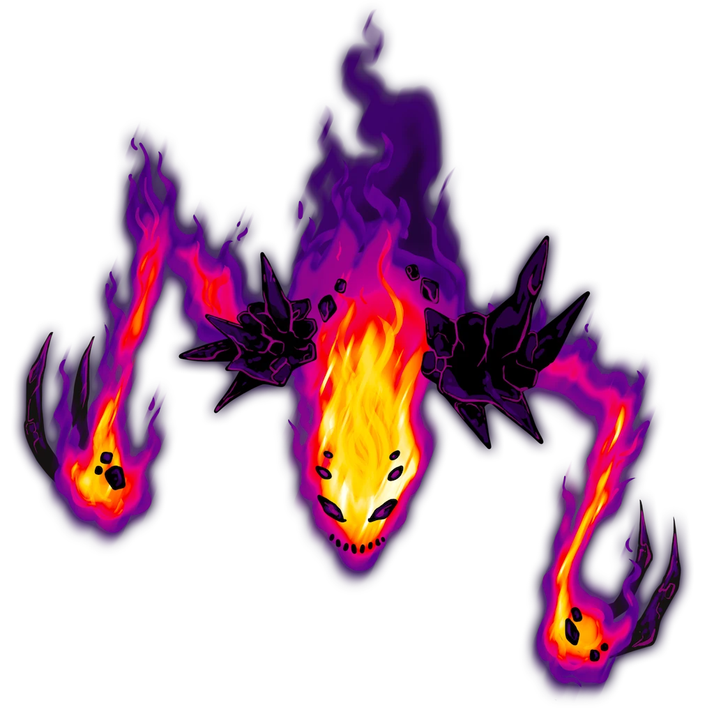
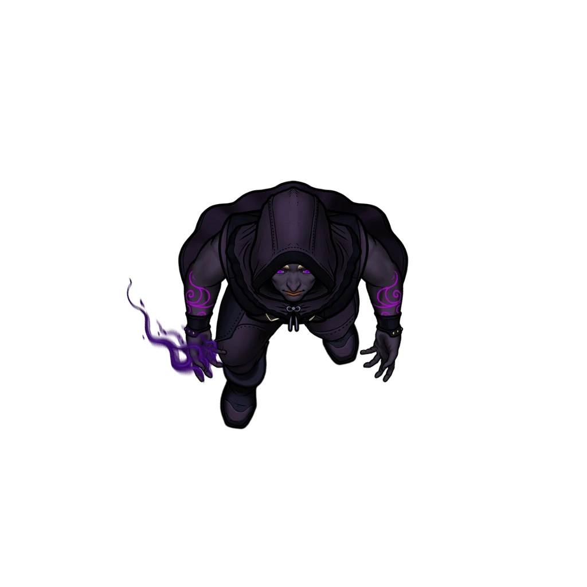
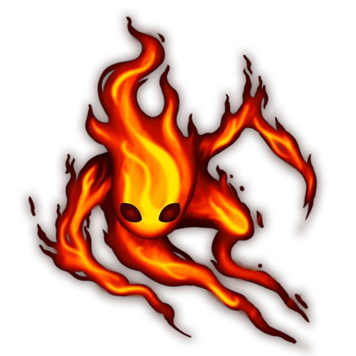

# Caldera Rim

> [!quote] Read Aloud
> The doors open onto the rim of a vast volcanic caldera, its basin filled wall to wall with churning fire. Black stone statues jut from the molten surface like islands, each wreathed in heat and smoke. At the center, a large fire elemental twists against magical restraints while robed cultists chant from the surrounding ledges, their voices nearly swallowed by the roar below.

### Hazards and Traps

The lava center of the area is extremely dangerous and serves as a natural hazard.

> [!danger] Hazard
> #### Falling Off the Rim
>
> A character pushed into the caldera below can make a `[[/save Dexterity 12]]` saving throw to grasp the rim's edge and avoid falling into the lava. They can expend 10 feet of movement to climb back onto the rim.
>
> A creature that falls into the caldera lands &reference[prone], taking `[[/damage average 10d10 Fire]]` damage. A creature that starts its turn in lava takes `[[/damage average 10d10 Fire]]` damage.

Several sections of the area conceal fire traps beneath the volcanic floor.

> [!danger] Hazard
> #### Spinning Fire Traps
>
> Each trap consists of a cylindrical mechanism hidden beneath a fitted stone plate.
>
> When a creature enters a trapped area, the cylinder rises from the floor and begin spinning rapidly, projecting gouts of flame in every direction. Each creature within 10 feet of the trap as it activates must make a `[[/save Dexterity 15]]` saving throw, taking `[[/damage 4d6 Fire]]` damage on a failed save, or half as much damage on a successful one.
>
> The trap continues spinning until the end of the next round; it sinks into the volcanic floor and remains inactive for 1 minute. A creature that enters the affected area for the first time on a turn or begins its turn there must repeat the saving throw.
>
> #### Detecting a Fire Trap
>
> A character that carefully examines the floor around them can detect a trap within 30 feet with a successful **Awareness (DC 15)** check; on a success, the character notices a circular seam in the volcanic rock and scorch marks radiating outward from it.
>
> #### Disabling a Fire Trap
>
> A detected trap can be disabled with a successful **`[[/skill sleightofhand 15]]`** check using a [[Unknown]] or similar implement to jam the mechanism in place, or by placing at least 100 pounds on top of the stone plate.

### Cultists and Elementals

As the characters arrive, several [[Fiyaran Cultist]] are in the process of transforming an [[Ignarch]] into a Voidfire abomination. The cultists are guarded by a number of elemental servants.

> [!abstract] Vexan
> **[[Vexan]]**
>
> Level 1 · Unknown Unknown
>
> 

> [!abstract] Fiyaran Cultist
> **[[Fiyaran Cultist]]**
>
> Level 1 · Unknown Unknown
>
> 

> [!abstract] Pyreling
> **[[Pyreling]]**
>
> Level 1 · Unknown Unknown
>
> 

> [!warning] Gamemaster
> #### Token Reveal: Elementals
>
> The [[Pyreling]] begin the encounter **Hidden** in the Scene. To better see these Hidden tokens, hold down the Left Alt Key with Token Controls active. When combat begins, **Reveal** the **Hidden** Elementals to represent them emerging from the caldera.

> [!danger] Hazard
> #### Vexan Tactics
>
> At the start of combat, the [[Vexan]] will use its [[Kindle Hatred]] or [[Mind Screech]] Action to disrupt its enemies.
>
> Over the course of combat, the Vexan will prioritize the following actions and abilities:
>
> - In melee, the Vexan will use its [[Multiattack]] Action.
> - From range, the Vexan will use its [[Kindle Hatred]] or [[Mind Screech]] Action before closing the distance.
> - If the Vexan is attacked, it can use its [[Void Shift]] Reaction to impose **-2 Banes** on the attack roll.
>
> The Vexans fight until destroyed.
>
> #### Fiyaran Cultist Tactics
>
> At the start of combat, the [[Fiyaran Cultist]] will use its [[Dark Flame Eruption]] Action to damage enemies, debilitate them, and create a patch of magical &reference[Darkness]; the Fiyaran Cultist can see into magical &reference[Darkness] through its [[Void Sight]] feature.
>
> Over the course of combat, the Fiyaran Cultist will prioritize the following actions and abilities:
>
> - In melee, the Fiyaran Cultist will use its [[Multiattack]] Action to make two [[Voidfire Blade]] attacks.
> - From ranged, the Fiyaran Cultist will use its [[Multiattack]] Action to make two [[Voidfire Bolt]] attacks.
>
> The Fiyaran Cultists fight to the death.
>
> #### Pyreling Tactics
>
> At the start of combat, the [[Pyreling]] will use its Fly speed to engage a spellcaster or ranged attacker, if possible. Any enemies it passes through is subjected to its [[Fiery Form]], though it can still suffer &reference[Opportunity Attacks].
>
> If it cannot reach an enemy, the Pyreling will instead use its [[Flame Burst]] Action.
>
> Over the course of combat, the Pyreling will prioritize the following actions and abilities:
>
> - In melee, the Pyreling will use its [[Multiattack]] Action.
> - From range, the Pyreling will use its [[Flame Burst]] Action whenever able.
>
> The Pyrelings fight until destroyed.

### The Bound Elemental

The bound elemental is exhausted and in obvious pain, but remains lucid. The cultists summoned it into the caldera and have been attempting to corrupt its form with Voidfire. It has resisted the transformation so far, though it can feel its strength fading.

If the characters approach the elemental, read or paraphrase the following:

> [!quote] Read Aloud
> The elemental's flames gutter and surge against its bonds. When it speaks, its voice is like the crackling of burning timber.
>
> > I am … Sathyr. They called me here … bound me … and now they pour their hatred into my vessel. Free me, if you can … and if you cannot … extinguish me before I am overwhelmed by the Mistress' rage …

> [!info] Social
> #### Speaking with the Elemental
>
> Sathyr can share the following information:
>
> - **The Cultists:** The cultists' binding ritual is slowly poisoning Sathyr's form with Voidfire, filling it with anger and impulses that are not its own.
> - **The Bonds:** Sathyr does not understand how the binding was created. However, it has sensed powerful elemental magic elsewhere in the citadel that may provide some means of disrupting or shielding it from the corruption — see [[Elemental Forge]].
> - **Freedom:** Sathyr asks the characters to free it if they can.
> - **Mercy:** If the characters cannot free it, Sathyr asks them to destroy it before the corruption is complete. It would rather be extinguished than become one of Fiyara's abominations.

Sathyr is held within the caldera by several magical bonds originating from carved Cinderspar statues positioned around its rim. The statues are magically reinforced and cannot be meaningfully damaged by conventional weapons or spells.

> [!tip] Exploration
> #### Freeing Sathyr
>
> A character who examines the bonds from afar with a `[[/skill 16 arcana passive format=long]]` or who makes a successful **`[[/skill 14 arcana]]`** check can determine that destroying the statues would sever the bonds, but doing so would require a weapon capable of breaking the enchanted Cinderspar.
>
> The [[Elemental Forge]] — what Sathyr sensed — can be used to create such a weapon, but it requires three components found elsewhere in the citadel:
>
> - [[Everburning Coal]], recovered from the [[Vestibule of Fire]], is a chunk of [[Ragen]] brought to Ember. It can provide the elemental heat necessary to work otherwise unyielding Cinderspar.
> - [[Crystallized Spite]], taken from the[[Vestibule of Spite]], is Voidfire turned to glass; the same corruptive magic is woven through Sathyr's restraints, allowing the finished weapon to disrupt the enchantment.
> - [[Conjunction Prism]], recovered from the [[Crystalline Conjunction]], can focus the opposed elemental energies into a single stable form.
>
> Each component requires special care to identify and extract. Refer to their respective area descriptions for more information.
>
> Once brought to the Elemental Forge, they can be fashioned into [[Cinderbreaker]], a magical maul capable of shattering the Cinderspar statues anchoring Sathyr's bonds.

### Shattering the Bonds

Each statue anchoring Sathyr's restraints can be destroyed with a strike from [[Cinderbreaker]]. Whenever one is shattered, its magical bond tethered to Sathyr visibly snaps.

When the final bond is broken, read or paraphrase the following:

> [!quote] Read Aloud
> Cinderbreaker crashes through the statue's head, splitting the black stone from brow to jaw. The last strand of magic stretched across the caldera snaps with a sound like breaking glass. Sathyr's flames surge upward, suddenly bright and clean, and it tears free of the remaining fragments of its restraints with a roar that shakes the rim.
>
> After a moment, the great elemental turns to face you.
>
> > You have rekindled my flame … I will remember this. But this form has suffered greatly … I must withdraw before it fails entirely. Should our paths cross again … I will remember you.
>
> Sathyr bows its blazing head; its immense body begins unraveling into streaming ribbons of fire, each one curling upward and fading into sparks until nothing of it remains.
