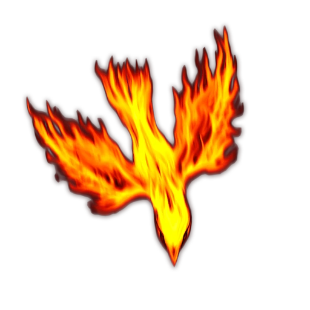

# Elemental Forge

> [!quote] Read Aloud
> Heat hangs thick in this forge chamber, its volcanic stone floor traced with glowing channels of fire. A massive anvil dominates the center; upon it rests the unfinished head of a heavy maul, its black Cinderspar roughly shaped around a pale crystalline core. An enormous furnace burns fiercely against the northern wall — the furnace suddenly roars, its flames surging against the grate. A sharp-winged shape bursts from the blaze, resolving into a great hawk formed entirely of living fire. Its wings shed sparks with every beat as it wheels toward you.

> [!abstract] Sirohawk
> **[[Sirohawk]]**
>
> Level 1 · Unknown Unknown
>
> 

> [!abstract] Voidfire Cinder
> **[[Voidfire Cinder]]**
>
> Level 1 · Unknown Unknown
>
> 

> [!warning] Gamemaster
> #### Token Reveal: Elementals
>
> The [[Sirohawk]] and [[Voidfire Cinder]] begin the encounter **Hidden** in the Scene. To better see these Hidden tokens, hold down the Left Alt Key with Token Controls active. When combat begins, **Reveal** the **Hidden** Elementals to represent them emerging from the forge.

> [!danger] Hazard
> #### Sirohawk Tactics
>
> At the start of combat, the [[Sirohawk]] will use its Fly speed to engage a spellcaster or ranged attacker, if possible. Any enemies it passes through is subjected to its [[Fiery Form]], though it can still suffer &reference[Opportunity Attacks].
>
> Over the course of combat, the Sirohawk will prioritize the following actions and abilities:
>
> - In melee, the Sirohawk will use its [[Multiattack]] Action, prioritizing its [[Talons]] Action if it currently has no creature &reference[Grappled]. A creature Grappled by the Sirohawk is subjected to its [[Fiery Form]] at the beginning of each of its turns.
> - When reduced to 0 Hit Points, the Sirohawk may return to life through its [[Rebirth]] feature.
>
> The Sirohawk fights until destroyed.
>
> #### Voidfire Cinder Tactics
>
> At the start of combat, the [[Voidfire Cinder]] will move toward the closest enemy and [[Detonate]].
>
> Over the course of combat, the Voidfire Cinder will prioritize the following actions and abilities:
>
> - If the Voidfire Cinder is attacked, it can use its [[Flicker]] Reaction to impose **-2 Banes** on the attack roll and potentially move toward the closest enemy in preparation to [[Detonate]].
>
> The Voidfire Cinders fight until destroyed.

> [!tip] Exploration
> #### Exploring the Elemental Forge
>
> A simple search of the forge reveals the following:
>
> - A massive black steel anvil dominates the center of the chamber. An unfinished two-handed maul rests across its surface.
> - The northern furnace remains intensely hot despite its apparent isolation from the caldera below.
> - A metal plate beside the anvil is engraved with a detailed schematic accompanied by lines of ancient **Language: Scor**.
>
> #### Examining the Unfinished Weapon
>
> The unfinished maul consists of a heavy Cinderspar head built around a pale crystalline core. Its form remains rough and incomplete, and several narrow sockets have been left empty along the head and haft.
>
> #### Reading the Schematic
>
> Any character who examines the schematic plate and makes a successful **Awareness (DC 14)** check can identify the unfinished weapon as a tool called [[Cinderbreaker]], designed to capture and wield Voidfire — but one that can be repurposed to break the bonds holding Sathyr.
>
> - **Knowledge: Crafts**: The character automatically succeeds on this check.
> - **Path: Natural Artisan**: The character automatically succeeds on this check.
> - **Path: Underworld Mechanic**: The character automatically succeeds on this check.
> - **Language: Scor**: The character automatically succeeds on this check.
> - **Character has a** [[Dictionary of Late Arcturian Scor]]: The character gains **+2 Boons** on this check if they consult it.
>
> The schematic depicts three materials required to complete it:
>
> - [[Everburning Coal]], recovered from the [[Vestibule of Fire]], is a chunk of [[Ragen]] brought to Ember. It can provide the elemental heat necessary to work otherwise unyielding Cinderspar.
> - [[Crystallized Spite]], taken from the[[Vestibule of Spite]], is Voidfire turned to glass; the same corruptive magic is woven through Sathyr's restraints, allowing the finished weapon to disrupt the enchantment.
> - [[Conjunction Prism]], recovered from the [[Crystalline Conjunction]], can focus the opposed elemental energies into a single stable form.
>
> Each component requires special care to identify and extract. Refer to their respective area descriptions for more information.
