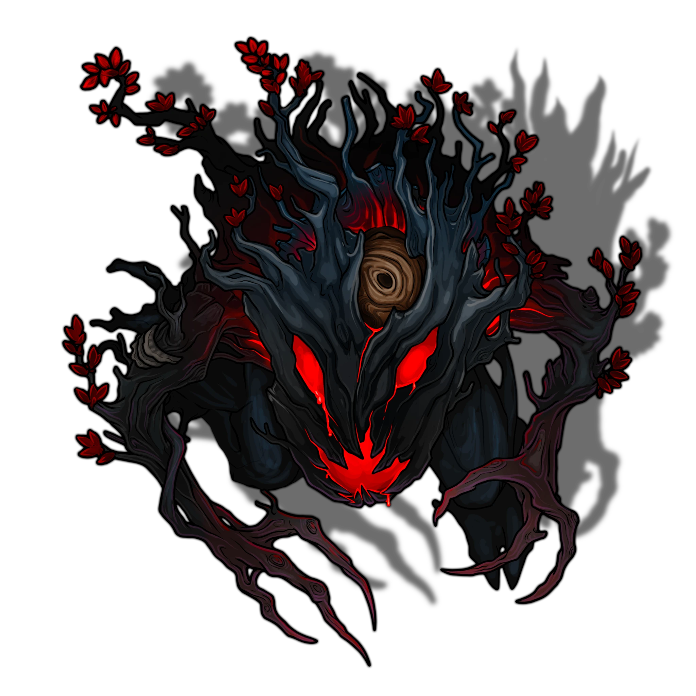
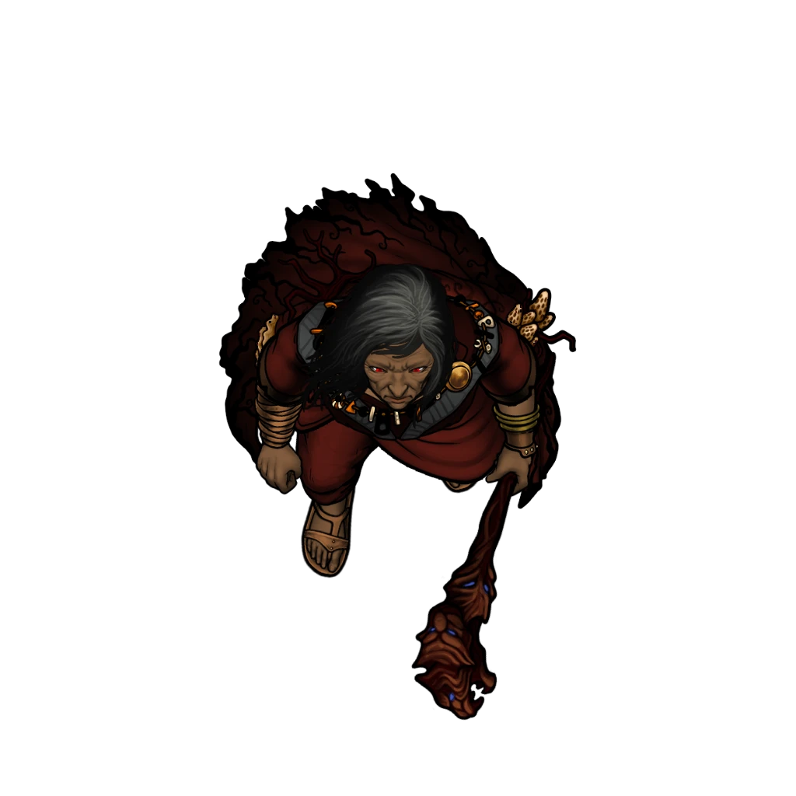
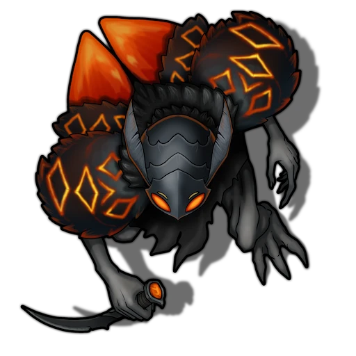

# Atrium Floor

> [!quote] Read Aloud
> The floor of the temple's grand atrium is a sight to behold, and contains an array of uncommon sights … A large tree occupies a small island at the center of the atrium, adorned with strange leaves that appear to seethe with an aura of tenebrous sorcery. This small island is surrounded by a moat of pale amethyst-colored water, and a half-dozen pillars crowned with glowing purple orbs form a concentric circle within this subterranean waterway; motes of energy seem to flow from the orbs toward the large tree. Meanwhile, a scattered array of strange flora populates the area, boasting fronds that simmer with otherworldly colors near the end of the visual spectrum.
>
> The room's occupants stand in stark contrast to its majesty, however, as you take note of a dire host of grim Doomsayers and their cohorts. Kyrban himself stands proudly above a humanoid that kneels in prostration just north of the shaded tree, and a trio of Doomsayers nearby observes with eager anticipation. Kyrban speaks as he turns to the tree, which oozes with lambent magenta sap.
>
> > And now … the time has come for us to welcome a new member to our family. A new grayling must join the Pack.
>
> The mad druid turns back to the prostrated fellow on the ground, and lifts his weary head, revealing the crestfallen face of an Arcturian of the Bloodwoods. Kyrban forces the man's mouth open and pours some of the viscous magenta sap down his throat as he gags and swallows against his will.
>
> In an instant, a horrible and viscous change begins to wrack the Arcturian's weakened body — his skin grows pale and gray, and two moth-like wings erupt from the scapula on his back. Before you can blink, the man is a man no longer … and an obedient fey creature has taken his place.

The large central section of the atrium floor contains an array of six arcane pillars that originally served as a cosmological scrying device for the ancient [[Shent]] who once dwelled here. Now, the esoteric tool has been repurposed by [[Kyrban]] to focus the magical energies of [[Primordis]] so that he might cultivate a dreaded Shadebranch tree — a specimen from the inner reaches of Primordis itself.

The Shadebranch in question lurks at the center of the small island in the middle of the atrium. As the characters arrive, they will interrupt Kyrban's latest ritual — the creation of a new [[Grayling]] from the prisoner named Hodge — and must contend with this diabolical array of Doomsayer adversaries.

> [!warning] Gamemaster
> #### Token Reveal: Shadebranch and Grayling
>
> The [[Shadebranch]] is initially represented as a tree, with its disposition set to **Secret**, meaning the players will not recognize it as an Actor.
>
> Hodge is initially represented as an [[Arcturian]], with his [[Grayling]] transformation token **Hidden** beneath him.
>
> As you narrate the Shadebranch readaloud below, do the following:
>
> 1. Delete Hodge and **Reveal** the Grayling.
> 2. Use the [[Reveal Shadebranch]] Macro to reveal the Shadebranch.

> [!abstract] Shadebranch
> **[[Shadebranch]]**
>
> Level 1 · Unknown Unknown
>
> 

> [!abstract] Kyrban
> **[[Kyrban]]**
>
> Level 1 · Unknown Unknown
>
> 

> [!abstract] Grayling
> **[[Grayling]]**
>
> Level 1 · Unknown Unknown
>
> 

> [!abstract] Doomsayer Acolyte
> **[[Doomsayer Acolyte]]**
>
> Level 1 · Unknown Unknown
>
> 

> [!abstract] Doomsayer Shadewright
> **[[Doomsayer Shadewright]]**
>
> Level 1 · Unknown Unknown
>
> 

> [!tip] Exploration
> #### Surveying the Arcane Pillars
>
> Any character with a `[[/skill investigation 15 passive format=long]]` or who makes a successful **Awareness (DC 13)** check can readily deduce that the six orb-crowned pillars located in the mote can be activated to focus the magical energies of Kadra Zann upon the Shadebranch itself. See "Interactable Objects: Arcane Pillars" below for a full description of how the pillars and Shadebranch's associated [[Pillar Blast]] feature works.
>
> - **Knowledge: Artifacts**: The character automatically succeeds on this check.
> - **Knowledge: Rituals**: The character gains **+2 Boons** on this check.
> - **Knowledge: Shent**: The character gains **+2 Boons** on this check.

> [!warning] Gamemaster
> #### Interactable Objects: Arcane Pillars
>
> Each arcane pillar is an Interactable Object that will change color and automatically trigger the Shadebranch's [[Pillar Blast]] feature when activated.
>
> Any character adjacent to an arcane pillar who takes a Magic action and makes a successful **`[[/skill Arcana 15]]`** check is able to interrupt the flow of [[Primordis]] energy that feeds the [[Shadebranch]]. On a success, the Shadebranch activates its Pillar Blast feature: it loses 14 Hit Points and must succeed on a `[[/save Constitution 18]]` save or become &reference[stunned] until the end of its next turn. Each of the six pillars can only be activated once.

> [!danger] Hazard
> #### Kyrban's Tactics
>
> If the party’s cover is blown before they reach the Atrium Floor, [[Kyrban]] will be ready and waiting for them, with all of his allies and faculties arranged for effective defensive strategies.
>
> At the start of combat, Kyrban will reposition himself nearby using [[Greater Shadowstep]] and lay down an obstacle of magical [[Darkness]] wherever he finds it to be most advantageous.
>
> Over the course of combat, Kyrban will prioritize the following actions and abilities:
>
> - Kyrban will always oppose enemy spellcasters first, targeting them (or their Spells) with [[Dispel Magic]] or [[Spike Growth]] Spells.
> - If Kyrban finds himself surrounded or outnumbered, he'll cast the [[Haste]] Spell on himself to gain a tactical advantage.
> - Kyrban will target the most formidable character with [[Polymorph]], turning them into a frog.
> - Kyrban will target the second-most formidable character with the [[Phantasmal Killer]] at a convenient time, encouraging his allies to concentrate fire on the same enemy.
> - If one of the characters is dealing a significant amount of one particular damage type, Kyrban will utilize the [[Resistance]] Spell as necessary.
> - Throughout the battle, Kyrban will not hesitate to issue commands to his allies and servants, with special consideration for Hodge the Grayling and the Shadebranch tree.
>
> Driven to madness by the absolutism of his cause, Kyrban will fight to the death, no matter the cost. Should the party prove themselves to be arrogant about his defeat, he will respond in kind with petty acts of cruelty during his final moments.
>
> #### Shadebranch Tactics
>
> At the start of combat, the [[Shadebranch]] will lurch to life and target an enemy spellcaster (or otherwise formidable enemy) with [[Cloud of Insects]] and [[Sap Blast]].
>
> Over the course of combat, the Shadebranch will prioritize the following actions and abilities:
>
> - If an enemy is foolish enough to rush into melee combat, the Shadebranch will use [[Constrict]] as often as possible.
> - If the Shadebranch is surrounded by more than one enemy, it will release its [[Primordial Spores]] in an attempt to drive them back.
> - If the Shadebranch fails to drive back or hold off enemy attackers, it will utilize [[Multiattack]] and [[Clawed Branch]] with deadly precision against single targets.
> - If the Shadebranch can maintain a safe distance, it will aggressively utilize [[Multiattack]] and [[Sap Blast]] against enemies with ranged attacks.
>
> The Shadebranch will fight to the death, entirely driven by Kyrban's commands.
>
> #### Grayling Tactics
>
> At the start of combat, the [[Grayling]] will take flight and target a nearby enemy with the [[Phantasmal Force]] spell.
>
> Over the course of combat, the Grayling will prioritize the following actions and abilities:
>
> - Per Kyrban's directives, the Grayling will first attack any druids, warlocks, or **Path: Cindaric Initiate** characters among the party. Barring this, it will attack the most vulnerable of the characters.
> - If the Grayling can identify a proper target for its chicanery, it will cast the [[Seeming]] Spell to sew confusion amongst the characters.
> - Although the Grayling won't hesitate to use its [[Amber Dart]] attack from afar, it will most often engage opponents in melee to use its [[Amber Dirk]].
> - If cornered by a powerful attack or subjected to an area of effect with a duration, the Grayling will use [[Misty Step]] to escape.
>
> The Grayling will fight to the death, entirely driven by Kyrban's commands.
>
> #### Doomsayer Shadewright Tactics
>
> At the start of combat, the Doomsayer Shadewright will cast [[Barkskin]] on itself as a Bonus Action, then cast [[Haste]] on itself.
>
> Over the course of combat, the Doomsayer Shadewright will prioritize the following actions and abilities:
>
> - In melee and from range, the Doomsayer Shadewright will use its [[Multiattack]], alternating between its [[Quarterstaff]] and its [[Tenebrous Wisp]] as appropriate.
> - When outnumbered, the Doomsayer Shadewright will cast [[Conjure Animals]] between itself and its enemies.
> - When surrounded by enemies, the Doomsayer Shadewright will use its [[Vespine Form]] to transform into an [[Unknown]], relying on the creature's [[Unknown]] feature and Fly speed to reposition itself.
> - If the Doomsayer Shadewright is &reference[Bloodied], it will either cast [[Healing Word]] to restore its Hit Points, or cast [[Darkness]] in an attempt to reposition.
>
> As zealous as their deranged leader, this Doomsayer Shadewright will fight to the death.
>
> #### Doomsayer Acolyte Tactics
>
> At the start of combat, the Doomsayer Acolyte will use its [[Ensnare]] Bonus Action to &reference[Restrained]{Restrain} the character with the highest Strength score.
>
> Over the course of combat, the Doomsayer Acolyte will prioritize the following actions and abilities:
>
> - In melee and from range, the Doomsayer Acolyte will cast [[Sorcerous Burst]].
> - If the characters are reliant on a single damage type, the Doomsayer Acolyte will cast [[Resistance]] to mitigate that damage.
> - If the Doomsayer Acolyte is &reference[Bloodied], it will either cast [[Healing Word]] to restore its Hit Points, or [[Fog Cloud]] to attempt an escape.
> - Optionally, if the combat appears to be too easy for the party, you may have the Doomsayer Acolyte flee into the Amerasp Caves and manually trigger [[Amerasp Swarm]] gall traps.
>
> Unlike their allies, these Acolytes will not fight to the death if Kyrban has been slain, but will lay down their arms and surrender to the party. Aside from a death sentence, whatever punishment the characters decide to mete out will be met with complimentary gratitude.

> [!tip] Exploration
> #### Exploring the Atrium
>
> Once the smoke of battle has cleared, the most valuable loot in the area will be the spoils gathered from Kyrban and his Doomsayer allies, with particular interest afforded to the [[Amber Staff]] and [[Vespine Domino]].

### After Kyrban's Defeat

Once the [[Where Shadows Lie]] Event has been completed, the nefarious influence of Kyrban and the Doomsayers no longer stains the magic of Kadra Zann.

> [!tip] Exploration
> #### Interacting with the Atrium
>
> After Kyrban and the Shadebranch have been slain, the amethyst water in the moat here is restored to its full divine potential. During the nest 24 hours, each character can draw enough water from the moat to count as `[[/roll 1d3+1]]` doses of [[Holy Water]]. Each character can only draw holy water this way once, but the water is otherwise potable and supernaturally refreshing.
>
> Additionally, the Arcane Pillars here can be simultaneously activated once per week to cast the [[Enhance Ability]] Spell on a single target with a duration of `[[/roll 2d4]]` hours.
