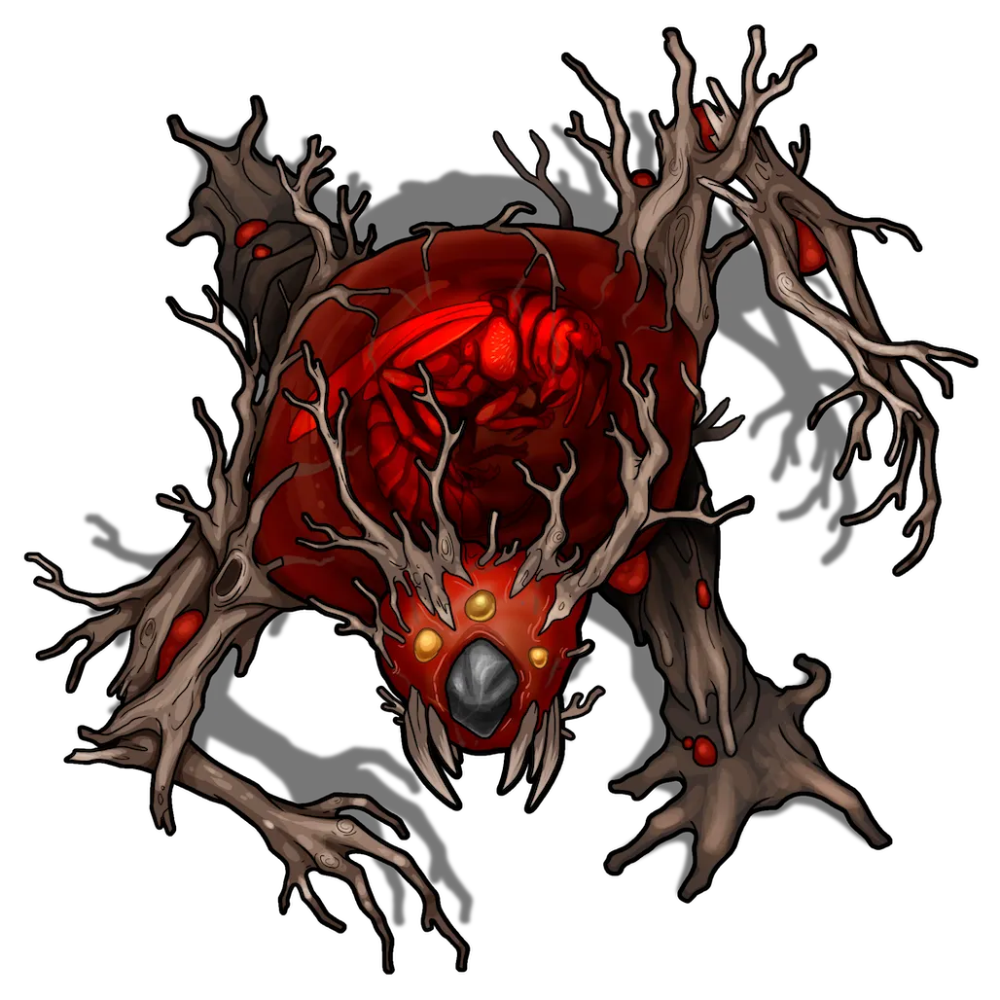

# Vespinoth Pens

> [!quote] Read Aloud
> The sickly sweet smell of rotting fruit assails your senses as you appraise this chamber, which is bifurcated by a ceiling-high manmade wall. Several huge wooden holding pens occupy the room on each side, and you can't help but notice the hulking crimson form of some large creatures in the western- and easternmost enclosure.

Outfitted with two makeshift holding pens that are large enough to contain Huge-sized creatures, this room has been converted into a dwelling for the brutish [[Vespinoth]] that Kyrban and the Doomsayers have introduced to Ember's ecosystem. Two of these horrible fey creatures currently lurk here in the westernmost pen, resting for its inevitable service or confrontation.

> [!abstract] Vespinoth
> **[[Vespinoth]]**
>
> Level 1 · Unknown Unknown
>
> 

> [!danger] Hazard
> #### Vespinoth Tactics
>
> At the start of combat, the Vespinoths will target the closest enemy character with their [[Amber Sputum]] and [[Primordial Buzzing]] as they reposition themselves between this chamber and the Atrium Floor to the north.
>
> Over the course of combat, the Vespinoths will prioritize the following actions and abilities:
>
> - The Vespinoths will "fight loudly" in an attempt to alert the Doomsayers and other allies to the party's intrusion.
> - Using their [[Amber Sputum]], the Vespinoths will continue to target the closest character (or the character with the least amount of cover) as they guard the northern exit.
> - If the party engages the Vespinoths in melee combat, they will switch to a [[Gnarled Claw]] attack each round against the most vulnerable adjacent enemy.
> - As soon as [[Primordial Buzzing]] is recharged, the Vespinoths will target a new enemy, preferring to target those characters who might do the most damage to allies via their arcane confusion.
>
> Vespinoths are innately and biologically programmed to protect the Doomsayers from harm. These Vespinoths will fight to the death in its attempt to keep the party from intruding upon the ritual taking place in the [[Atrium Floor]] area nearby. Chaotic by nature, the Vespinoths will never willingly reason with the characters or serve their opposing cause.

> [!tip] Exploration
> #### Exploring the Vespinoth Pens
>
> Any character with a `[[/skill perception 15 passive format=long]]` or who makes a successful **Awareness (DC 13)** check while searching the room is able to spot the dried husk of a dead spider amongst the overgrowth in the northwest corner of the room. `[[/roll 1d2+1]]` units of [[Spider-cap Mushroom]] can be found growing from this unidentified arachnid's desiccated carcass.
