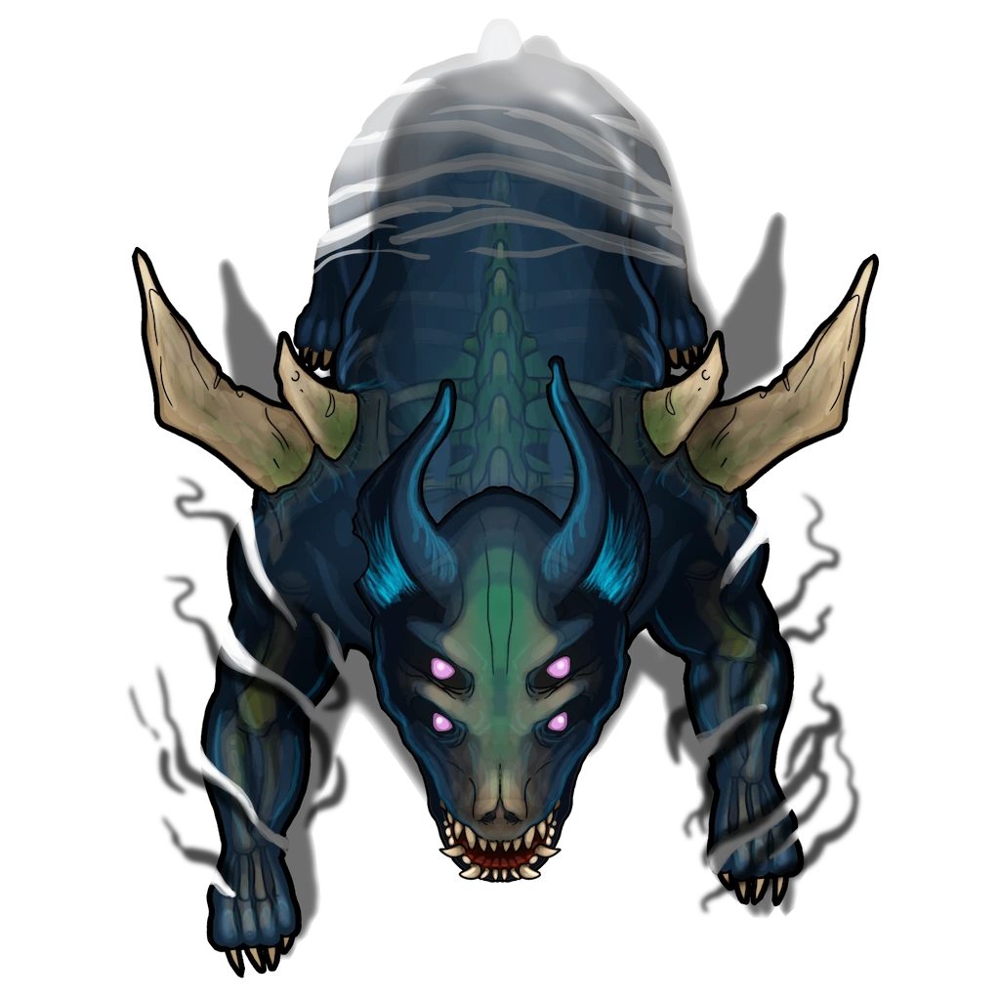

# Central Rotunda

> [!quote] Read Aloud
> This massive space is round, and broken into two levels, with oversized stairs bridging them. Along the curve of the upper level are numerous glowing gems in bronze cages, suspended over the floor by unseen magic, but anchored in place with heavy bronze chains.
>
> The central space of this area is spattered with blood and the shredded remains of multiple humanoids. Each body is rent into pieces, limbs detached from torsos, and heads from necks, yet horribly, these corpses still squirm and move as though not quite dead.
>
> At the center of this space is a large winged being with luminous dust falling from its wings. Its eyes burn with anger, and that ire is directed at you.

## Meeting The Guardian

This guardian is a Vanexis, as depicted in the carved reliefs of the [[Hall of Sages]].

> [!abstract] Mythspire Guardian
> **[[Mythspire Guardian]]**
>
> Level 8 (Elite) · Vanexis Primordial Guardian
>
> 
>
> This luminescent creature moves with predatory grace, each step leaving a faint radiant trail. Its large, glowing eyes seem to peer into the very essence of what it observes. Streaks of radiant color pulse rhythmically through its partially feathered fur, and up its two sets of wings.
>
> The first pair extends from its forelegs, connecting to its sides, while the second, larger set fans out from its back. Both sets of wings are intricately patterned with luminous feathers that ripple like living stardust with the slightest motion.
>
> This is a creature also appears to have been wounded, with raw burns cast across its face, neck and shoulders. The wounds are covered in swollen pustules and the fur and feature has been burned way to show raw, bubbled flesh.

> [!quote] Read Aloud
> The being speaks, its pained voice betraying the agony its wounds inflict.
>
> > You corpses should know better than to rise again. How many times must I put you down?
>
> It winces in pain, and shakes its head. For a moment it seems confused, but composes itself, finding its anger anew.
>
> > You come bearing false pretense, lying about your motives, I smell the lies, the falsehoods. You are not Shent, or Anachraenum, you are interlopers, enemies! You walk hallowed ground without leave! The passage shall remain closed, and your bodies shall join those of your allies at my feet!
>
> The being crouches down, preparing its assault, but is overtaken by a fit of hacking coughs and shudders of pain no doubt caused by the wounds it bears.

The Mythspire Guardian is clearly unwell. The burns and scars on its face and neck are covered in weeping boils. It seems disoriented, confused, or easily agitated. Parties interacting with it should take care.

> [!warning] Gamemaster
> #### Secret History
>
> The guardian's grievous wounds were inflicted by the [[Mutagists]] and their leader [[Serethus]] who infiltrated Mythspire Observatory under the guise of Anachraenum explorers.
>
> The guardian is afflicted by a virulent poison which is causing its body to waste away. In its current deranged state, the guardian is mistrustful and volatile, readily finding enemies where there may not be any, but it is not beyond reason.
>
> #### The Path of Diplomacy
>
> A diplomatic party can manage to delay or avoid combat by placating the guardian, after which point it can calm enough to perceive that the party is not a threat and not aligned with the Mutagist aggressors. This social challenge is described in [[Mythspire Observatory]].
>
> #### The Path of Combat
>
> The party may have no option but to battle the creature, as described in section [[Mythspire Observatory]].
>
> #### The Fate Of The Guardian
>
> If the party doesn't kill the Guardian, it will rest somewhat peacefully and then eventually die after `[[/gmroll 3d12]]` hours. When this occurs, the creature's form crumbles into swirls of light and energy in brilliant reds, pinks, purples, and blues. These ribbons of light fade away to nothing, with only [[Luminous Feather]] remaining.
>
> If the party leaves before this occurs, they will return to an empty Mythspire Observatory, discovering these three feathers where they last saw the guardian.

## Placating the Guardian

The party may attempt to engage the guardian in conversation rather than attacking it outright, doing so is initially simple, but grows harder over time. Placating the guardian may allow them to befriend the creature, but any slip up could prove fatal.

> [!info] Social
> #### A Dangerous Conversation
>
> It is possible to placate the creature, though it is not easy. To fully placate the guardian the party must succeed on five social checks before they fail three times.
>
> This is a social challenge consisting of multiple rounds. Each round is a **Group Skill Challenge** using each character's choice of **Diplomacy (DC 13, Group)** or **Deception (DC 13, Group)**. The party must work together to soothe, trick, or convince the guardian that they are not hostile.
>
> - **Critical Success**: With a critical success, the attempt counts as two successes towards placating the creature.
> - **Critical Failure**: With a critical failure, the attempt counts as two failures towards provoking the creature.
> - **Intimidation:** Any attempt at intimidation will not work, immediately provoking the guardian to violence.
>
> After each success, the party has a momentary window to [[Mythspire Observatory]] and ask a single question or attempt a single check to [[Mythspire Observatory]].
>
> - If the party achieves **five** cumulative successes, the guardian is fully mollified and now views the party as allies.
> - If the party achieves **three** cumulative failures, the guardian is provoked and now views the party as enemies.
>
> #### Escalating Difficulty
>
> Each new attempt to placate the guardian suffers a cumulative +1 DC increase regardless of whether the prior attempts succeeded or failed. This escalation also shifts the thresholds which determine critical success or critical failure for each round of the challenge.

## Examining the Guardian

A brief examination of the guardian's condition is possible after succeeding on one social check in [[Mythspire Observatory]]. A thorough examination is possible if the guardian has become fully placated.

> [!tip] Exploration
> #### The Ancient Guardian
>
> A successful **Awareness (DC 13)** check reveals that the guardian is deeply unwell, easily agitated, and seems unable to tell friend from foe. It likely views all visitors as possible enemies, perhaps the same as those that attacked it.
>
> Examining the guardian with a successful **Medicine (DC 13)** check reveals wounds suffered from some alchemical affliction, likely a poison or toxin. However, given the creature is not a terrestrial beast, it is impossible to render comprehensive medical aid.
>
> - **Knowledge: Forensics**: The character gains **+2 Boons** on this check.
> - **Critical Success**: The character concludes that the guardian is actively dying from whatever toxin it is exposed to, and it is unlikely to survive much longer.
>
> Through examination of the guardian the party can learn:
>
> - **Vital Sense** reveals the presence of a powerful lethal toxin in the creature, and suggests its progression has advanced beyond the point where intervention will be successful.
> - Curatives like [[Antitoxin]] or magical healing like **Vital Influence** are incapable of curing the toxin, but they can reduce its potency for long enough that the guardian temporarily recovers some of its senses. This grants **+2 Boons** on the next attempt to placate the guardian.

## Fighting the Guardian

The guardian is a formidable adversary able to employ a wide range of tactics against interlopers.

> [!danger] Hazard
> #### Guardian Tactics
>
> If the Mythspire Guardian enters combat with the party it immediately casts **Protective Mirage** to improve its defense.
>
> The guardian utilizes speed and flight to actively reposition itself, using **Ferocious Leap**, **Swooping Strike**, or **Pouncing Strike** to attack while moving.
>
> The guardian prefers to **Strike** in melee, but at a distance can use its [[Luminous Sting]] if necessary.
>
> The Mythspire Guardian augments its physical attacks with an arsenal of spellcraft, including:
>
> - **Aspect of Illumination** to empower its own attacks to deal additional radiant damage.
> - **Illusory Ray** to torment multiple enemies with psychological hallucinations dealing damage to **Morale**.
> - **Kinetic Influence** to punish an enemy in melee with the physical damage type they are least resistant to.
>
> If facing enemy spellcasters, the guardian may use **Counterspell** to attempt negating a hostile weaving of spellcraft.
>
> #### Cosmic Gems
>
> The area features seven cosmic gems that represent important bodies in the cosmos of Ember: Lantyr, Akon, Orbis, Ragen, Mayis, Cora, and Aura. The Vanexis can use its **Charge Gem** to activate one of these gemstones, infusing it with light.
>
> Once a gem is charged, its specific Action will activate at the end of the round. When a gem's effect activates, its charge is consumed.
>
> It is possible for the characters to disable a charged gem before its effect is activated by interacting with the gemstone and discharging its energy before it fully activates. This requires expending **1 Focus** while in touching distance of the gem.
>
> #### Inescapable Fate
>
> The Vanexis has been fatally **Poisoned** and suffers damage every round at the start of its turn from [[Wasting Poison]]. This effect will eventually kill it if the fight lasts long enough.

## Speaking with the Guardian

It is possible for the party to ask questions to the guardian after each successful social check in [[Mythspire Observatory]]. An open-ended conversation is possible if the guardian has been fully placated.

> [!question] Q&A
> **Q:** Who are you?
>
> **A:**
>
> > Primordial Giants built this place when they emerged from the pathways so long ago. They built this place to study the skies which they had never seen before. I was sent here to serve as their guide, to teach them many things about magic and the cosmos, and welcome them to the surface.

> [!question] Q&A
> **Q:** Your wounds?
>
> **A:**
>
> > A toxin most foul, a strange work of alchemy or twisted spellcraft. It is as if my flesh eats away at itself. I am holding on but the river flows so fast now.

> [!question] Q&A
> **Q:** Why are you still here?
>
> **A:**
>
> > The Casia of Primordis put me here, to protect the knowledge of this place, to preserve the memory of its builders and to keep this observatory safe. However, it seems the Casia have forgotten about me. All who had connection to this place passed into history and I alone watched over this crumbling chamber. One day it will turn to dust, and there will be nothing to protect, and I will return home.

> [!question] Q&A
> **Q:** Dead adventurers?
>
> **A:**
>
> > The corpses scattered at my feet were interlopers attempting to open the sacred passage to the Pathways. Only visitors seeking to know the history of the Giants and their path are allowed. Liars, invaders, and killers are not!
> >
> > They said they were of the "Anachraenum" but they were unlike others of that order I have met. They threatened to use acids and tools to carve open the way below if I would not give them access. When I acted to remove them, they turned those implements on me.

> [!question] Q&A
> **Q:** Necromantic reanimation?
>
> **A:**
>
> > Bidden to wake again and again by the Sleeper, I put them down countless times. Eventually their remains were savaged so thoroughly that they could not rise again… but you can see their rotting forms still writhe and wriggle, trying.

> [!question] Q&A
> **Q:** The "Sleeper"?
>
> **A:**
>
> > The sleeper wakes. It slumbers in Ember now, but not for much longer. Its voice has been growing louder and louder in my ears. It promises me life after my death, but it does not know that I am beyond its reach. Still… the light of this place has grown more dim.

> [!question] Q&A
> **Q:** The ancient giants?
>
> **A:**
>
> > I watched the ancients grow. Although, they didn't really grow, better to say that they changed, became different as they reached the surface. I watched this place turn from observatory to a place of reverence and history. Then the Shent came to connect with their cultural heritage. I witnessed them come here in dark times, when the Abyss was destroying them, to gaze at the old mosaics and try to find purpose or solace. I remember when I last saw the Shent, and they told me they would soon be no more. I miss them.

> [!question] Q&A
> **Q:** The Pathways?
>
> **A:**
>
> > The passage is a great lift that descends to the base of this great tower. The passage has been opened only a few times by visitors. It leads down into the ancient pathways beneath the surface. You would find the world below to be strange and alluring, almost as the shaded boughs of Primordis.

> [!question] Q&A
> **Q:** Opening the passage?
>
> **A:**
>
> > The reliefs on the walls here hold the secrets you need. You must find order in the cosmos and perform their ancient ritual. Your answer is not their answer, for your dawn is not theirs. So much time has passed, and yet they foresaw. Prove you share their knowledge.

## Examining the Undead

The party may want to examine the remains of the adventuring party. While they are in a horrible state, a little bit can still be gleaned from them.

> [!quote] Read Aloud
> The scattered remnants of the dead here depict a gruesome scene. Limbs have been carved from rotting torsos, and heads split open and scattered on stone. Still there is an unseemly life in them as digits twitch and arms curl, grasping feebly towards anything nearby.

> [!tip] Exploration
> #### Undead Remnants
>
> Examining the remains with a successful **Awareness (DC 13)** check notices that these bodies have seemingly legitimate Anachraenum badges, pins, or crests, making them recognized members of the guild. This is almost certainly the group that Liestra helped in Skybrush.
>
> - **Knowledge: Alchemy**: The character gains **+2 Boons** on this check.
> - **Critical Success**: The character notices the fragments of several shattered canisters in the possessions of the deceased. These canisters seem to have housed some sort of alchemical compound, although it's impossible to identify from the remaining residue alone.
>
> A successful **Medicine (DC 12)** check while examining the bodies identifies that the bodies are still relatively fresh, perhaps two or three weeks at most. They must have been preserved by the cold and dry air of this place. There is a discolored cast to the skin and muscle, as though something more is tainting it.
>
> - **Knowledge: Forensics**: The character gains **+2 Boons** on this check.
> - **Critical Success**: The character notices that several of the dead have old wounds akin to burns, and by the look of them you would guess from contact with corrosive chemicals. While none of them were fatal, all of them seem to have regularly handled dangerous alchemical substances while they lived.
>
> A character with **Knowledge: Undeath** or who succeeds on a **Arcana (DC 12)** check understands that undeath is extremely uncommon, outside of specific regions of the world like the [[Lumek]] Firelands where its influence is keenly felt.
>
> - **Knowledge: Souls**: The character gains **+2 Boons** on this check.
> - **Critical Success**: The character understands that there would ordinarily have to be some identifiable source of magic causing these bodies to reanimate. The absence of a noticeable source raises concern about how powerful or distant the cause of this necromancy must be.
