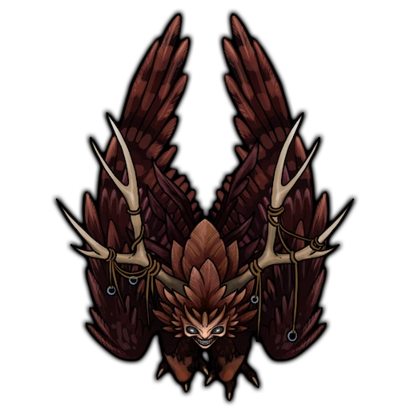

# Collapsed Archives

> [!quote] Read Aloud
> The air in this gloom-shrouded chamber is heavy with the scent of stony dust and rotten parchment. Piles of rubble and ruined masonry fill the place, crowding most of the floor, with only a few narrow paths running through the ruin.
>
>  Along the battered walls you can see the shattered remnants of massive shelves, their stone broken and buried beneath the debris of a collapsed ceiling. Amidst the rubble, you spot the destroyed remains of several scrolls and stone tablets, all of them pulverized long ago.

 > [!tip] Exploration
> #### Remaining Undetected
>
>  A party moving quietly can slip into the chamber unnoticed with a successful **Stealth (DC 13, Group)** group check, where at least half the party succeeds, leaving the V'mar undisturbed in their roosts. The party remains hidden only as long as they are silent during their exploration.

 ## Roosting V'mar

 Three [[V'mar Ravager]] roost in this chamber, perched atop the massive bookshelves and tucked into the broken crags of the tower's rocky walls. They emerge to attack as soon as they notice the party.

 > [!quote] Read Aloud
> A rasping shriek splits the stale air. From the tops of the towering shelves and the dark crags in the walls above, three winged shapes unfurl and drop toward you, talons outstretched, scattering dust and fragments of parchment in their wake.

 > [!abstract] V'mar Ravager
> **[[V'mar Ravager]]**
>
> Level 4 · V'mar Harrier
>
> 
>
> A tangled mass of matted black and red feathers, long, birdlike legs, and tense muscles moves toward you. Its face resembles a pale, bone-like mask crowned by cord-bound antlers, with deep, pitch-black eyes, and as its jaw unhinges, rows of needle-thin teeth glisten beneath a frantic, blood-frenzied grin.

 > [!danger] Hazard
> #### V'mar Tactics
>
>  The V'mar open by diving from their roosts with **Swooping Strike**, each targeting a different character, then tear at their prey with **Rake** or stagger it with **Gore**. Between dives, [[Elusive Flight]] carries them back to the tops of the shelves without provoking, and they dive again at whoever is isolated or already **Bleeding**. Critical hits fuel [[Blood Frenzy]], granting them extra actions, and they fight to the death, even if **Broken**.

 Once the V'mar are slain, the characters can take a closer look at the strange creatures.

 > [!tip] Exploration
> #### Examining the Creatures
>
>  A character who makes a successful **Arcana (DC 14)** check recognizes the creatures as V'mar, savage predators that roost on remote heights and can smell blood from miles away. The ruined tower makes a natural roost, but their presence suggests that fresh blood or carrion lies somewhere nearby.
>
>  - **Knowledge: Monsters**: The character gains **+2 Boons** on this check.
>
>  Anyone inspecting the bodies notices that the V'mar's antlers are unnaturally hard and resist even a blade's edge. They could be harvested, and such a material might be valued for alchemy or enchanting. Each V'mar yields a pair of [[V'mar Antlers]].

 Beneath the rubble, a few of the archive's records have survived the collapse.

 > [!tip] Exploration
> #### Records of the Past
>
>  The first character to make a successful **Awareness (DC 14, Passive)** check while searching the rubble here can locate a single undamaged scroll. Covered in glittering diagrams of constellations and written in **Language: Pathward**, this scroll appears to be an ancient celestial map that tracks the ancient movements of the shattered moon [[Akon]].
>
>  A character who makes a successful **Science (DC 14, Passive)** check recognizes from these charts that the Shent were very fixated on understanding the sequence and timing of the moons and their orbits.
>
>  - **Knowledge: Cosmology**: The character gains **+2 Boons** on this check.
> - **Critical Success**: The character concludes that such charts would have allowed the Shent to predict with extreme precision, even into the very distant future, when certain celestial events would transpire.
>
>  Any character who makes a successful **Arcana (DC 14)** check can recognize the hallmarks of protective Abjuration runes on the scroll, which have done a fine job of magically preserving the document throughout the ages.
>
>  - **Knowledge: Artifacts**: The character automatically succeeds on this check.
> - **Knowledge: Rituals**: The character gains **+2 Boons** on this check.
