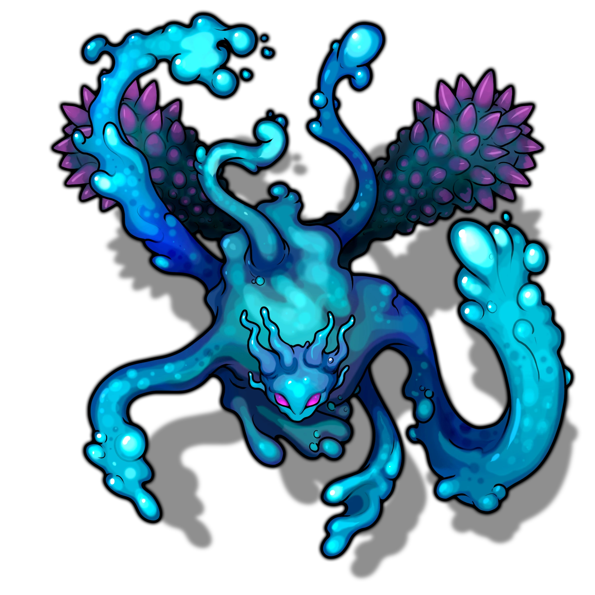
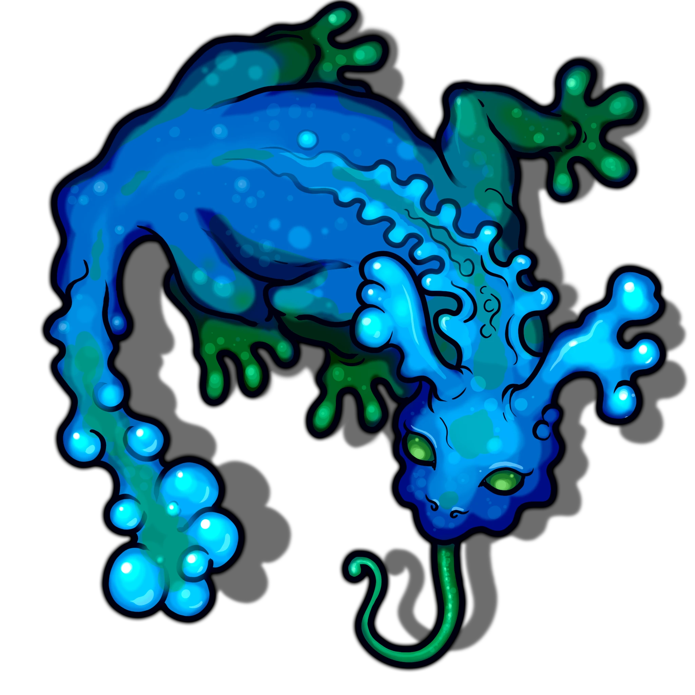
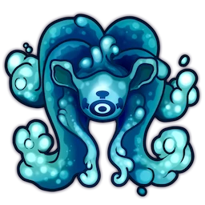

# Chasm

> [!quote] Read Aloud
> A broken stone bridge leans out over a broad chasm before ending abruptly in a jagged edge. Forty feet below, shattered masonry lies scattered across the lakebed, half-buried in silt. Across the gap stands the drowned temple, its entrance framed by ancient Sedyri stonework.

> [!tip] Exploration
> #### Exploring the Chasm
>
> A simple search of the area reveals the following:
>
> - A stone bridge once spanned the chasm, but its sudden submergence caused it to snap across the middle. Broken sections lie scattered across the chasm floor roughly 40 feet below.
> - Several broken Cinderspar statues lie among the bridge rubble, partially buried in the lakebed.
>
> #### Slumbering Elementals
>
> Elemental guardians slumber at the bottom of the chasm. Characters with a `[[/skill perception 18 passive format=long]]` or who make a successful **Awareness (DC 16)** check when entering the chasm can detect their camouflaged forms.
>
> A character who approaches the lakebed [[Chasm]], causing them to attack. If the creatures were still hidden, the characters are &Reference[Surprise]{Surprised}.

### Awakening the Elementals

Water elementals slumber at the bottom of the chasm, camouflaged by the silt and dark waters of the lakebed.

> [!warning] Gamemaster
> #### Token Reveal: Elementals
>
> The [[Benthweaver]], [[Riptongue]], and 2 [[Tidegazer]] begin the encounter **Hidden** in the Scene. To better see these Hidden tokens, hold down the Left Alt Key with Token Controls active. When you are ready for combat to begin, **Reveal** the **Hidden** Elementals to represent them awakening.

> [!abstract] Benthweaver
> **[[Benthweaver]]**
>
> Level 1 · Unknown Unknown
>
> 

> [!abstract] Riptongue
> **[[Riptongue]]**
>
> Level 1 · Unknown Unknown
>
> 

> [!abstract] Tidegazer
> **[[Tidegazer]]**
>
> Level 1 · Unknown Unknown
>
> 

> [!danger] Hazard
> #### Surprise
>
> Characters with a `[[/skill perception 18 passive format=long]]` or who make a successful **Awareness (DC 16)** check when entering the chasm can detect the elementals' camouflaged forms. Otherwise, the characters are &reference[surprise]{Surprised} when combat begins.
>
> #### Benthweaver Tactics
>
> At the start of combat, the [[Benthweaver]] will use its [[Icy Whorl]] action on as many enemies as possible.
>
> Over the course of combat, the Benthweaver will prioritize the following actions and abilities:
>
> - In melee and from range, the Benthweaver will use its [[Multiattack]] action.
> - The Benthweaver can use its [[Waterstep]] Bonus Action defensively to move away from enemies, or offensively to &reference[blinded]{Blind} and &reference[suffocating]{Suffocate} enemies in conjunction with its [[Water Form]] feature.
> - The Benthweaver will use its [[Icy Whorl]] Action whenever it is available.
>
> The Benthweaver fights until destroyed.
>
> #### Riptongue Tactics
>
> At the start of combat, the [[Riptongue]] will attempt to Grapple a creature using its [[Tongue Lash]] Action, prioritizing Medium creatures if able.
>
> Over the course of combat, the Riptongue will prioritize the following Actions and abilities:
>
> - In melee and from range, the Riptongue will use its [[Multiattack]] Action.
> - The Riptongue will attempt to reel in Medium or smaller enemies using its [[Tongue Lash]] Action in order to &reference[blinded]{Blind} and &reference[suffocating]{Suffocate} them in conjunction with its [[Water Form]] feature.
>
> The Riptongue fights until destroyed.
>
> #### Tidegazer Tactics
>
> At the start of combat, the [[Tidegazer]] will use its [[Captivating Gaze]] Action to &reference[Charmed]{Charm} a creature, prioritizing Small creatures if able.
>
> Over the course of combat, the Tidegazer will prioritize the following Actions and abilities:
>
> - From range, the Tidegazer will use its [[Water Blast]] Action.
> - When threatened, the Tidegazer can use its [[Aqueous Transmission]] Bonus Action to reposition itself.
> - The Tidegazer will attempt to lure in Small or smaller enemies using its [[Captivating Gaze]] Action in order to &reference[blinded]{Blind} and &reference[suffocating]{Suffocate} them in conjunction with its [[Water Form]] feature.
>
> The Tidegazer fights until destroyed.

### Cinderspar Statues

Characters who swim down to the lakebed to inspect the Cinderspar statues discover that the statues depict robed Ashka figures carrying ceremonial bowls and tablets.

> [!tip] Exploration
> #### Investigating the Cinderspar Statues
>
> A successful **Arcana (DC 14)** or **Society (DC 14)** check reveals signs of purposeful alterations predating the temple's submergence: the fire motifs were completely removed and replaced with additional water motifs.
>
> - **Knowledge: Ancients**: The character gains **+2 Boons** on this check.
> - **Critical Success**: The fire imagery was not simply covered over, but deliberately defaced before being recarved. The character can reasonably conclude that, at some point in the temple's history, fire came to be regarded as something opposed to water, rather than its counterpart.
>
> There are 3 silver runed bowls of varying condition worth  **4d8** each amongst the statues, but they have fused with the Cinderspar: each bowl requires a successful **`[[/skill sleightofhand 14]]`** or **`[[/skill Strength 14]]`** check using a suitable tool to remove without damaging them. On a failure, the bowl is removed, but its value is reduced by half.
>
> - **Knowledge: Arts**: The character gains **+2 Boons** on this check.
> - **Knowledge: Crafts**: The character gains **+2 Boons** on this check.
