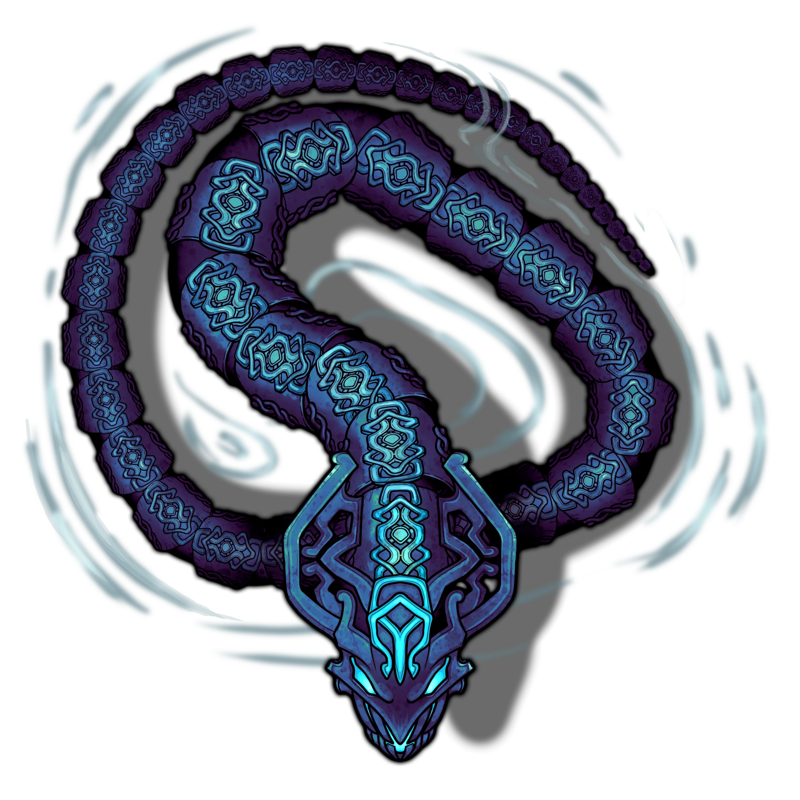

# Sedyri Tribune

> [!quote] Read Aloud
> The concourse steps down into a recessed court, its floor laid with intricate mosaics partly buried beneath silt and aquatic plant life. Stylized Ashka heads loom from the surrounding walls, watching over the open space from above — something black glints within the eye sockets of the largest statue.

> [!tip] Exploration
> #### Exploring the Tribune
>
> A simple search of the area reveals the following:
>
> - The central mosaic has been altered since its original construction.
> - Weathered Sedyri statues stand along the outer ledges. Several have been damaged or altered, but none appear recently disturbed.
> - Yellow plants have erupted through seams in the masonry: their thick, translucent stems contain pockets of trapped air, allowing them to survive long periods underwater. A creature can break one open to draw a single breath before the pockets collapse.
>
> #### Investigating the Mosaic
>
> A successful **Awareness (DC 14)** or **Society (DC 14)** check reveals traces of orange stone beneath several of the tiles, suggesting an older design incorporating both fire and water motifs was later covered over.
>
> - **Knowledge: Ancients**: The character gains **+2 Boons** on this check.
> - **Critical Success**: The alterations were made well after the original floor was laid. Combined with the older fire and water design beneath, the character can reasonably conclude that the temple was originally built according to traditional Sedyri Unifier beliefs, then later rededicated solely to water.
>
> If the characters fail to glean information here, they can examine a similar mosaic in the [[Narthex]] area.
>
> #### Examining the Statue Heads
>
> If the characters examine the smaller statue heads, refer to the [[Concourse]] page.
>
> Characters who examine the largest snake-head statue up close notice something black glinting in its eye sockets (see below).
>
> #### Retrieving the Gemstones
>
> The largest snake-head statue has a pair of smooth black gemstones worth  **2d10** each set deep within its eye sockets. A character can remove one with a successful **`[[/skill sleightofhand 14]]`** or **`[[/skill strength 14]]`** check using a suitable tool. On a failure, the gemstone is removed, but its value is reduced by half.
>
> - **Knowledge: Arts**: The character gains **+2 Boons** on this check.
> - **Knowledge: Crafts**: The character gains **+2 Boons** on this check.
>
> The first time a character removes one of the gemstones, the surrounding Cinderspar shudders, and a [[Sedyri Tribune]] from the mouth of the snake-head statue.

### The Hydrotherm Emerges

This [[Hydrotherm]] is hostile to other elemental creatures within the temple and the party unless one of the characters is wearing the [[Ring of the Unifier]].

Read or paraphrase the following:

> [!quote] Read Aloud
> The gemstone comes loose with a sharp crack. Suddenly, the carved snake-heads around the court tremble, and a burst of pressure pours from their mouths. A serpentine figure unfurls from the mouth of the largest statue, its shell locking into place around its body as it coils across the flooded floor.

> [!warning] Gamemaster
> #### Token Reveal: Hydrotherm
>
> The [[Hydrotherm]] begins **Hidden** in the Scene. To better see this Hidden token, hold down the Left Alt Key with Token Controls active. When you are ready for it to appear, **Reveal** the **Hidden** Hydrotherm to represent it materializing.

> [!abstract] Hydrotherm
> **[[Hydrotherm]]**
>
> Level 1 · Unknown Unknown
>
> 

> [!danger] Hazard
> #### Hydrotherm Tactics
>
> The [[Hydrotherm]] begins in its [[Superheated Form]].
>
> If a character freezes the water surrounding the Hydrotherm via cold magic while it is in its Superheated Form, it will transition to its Frozen Form; if a character heats the water surrounding the Hydrotherm via fire magic while it is in its Frozen Form, it will transition to its Superheated Form. Use the Effects tab on the Actor's sheet to toggle its forms off and on as needed.
>
> Over the course of combat, the Hydrotherms will prioritize the following actions and abilities:
>
> - The Hydrotherms will use their [[Multiattack]] to make two [[Scalding Slam]] or [[Pressurized Jet]] attacks, depending on their current form.
> - A Hydrotherm reduced to 0 Hit Points becomes &reference[Incapacitated] until revived by its [[Elemental Reconstitution]] feature.
> - A Hydrotherm can quickly reposition to a different part of the Scene using its [[Snake Passage]] Bonus Action.
>
> The Hydrotherm fights until &reference[Incapacitated].
