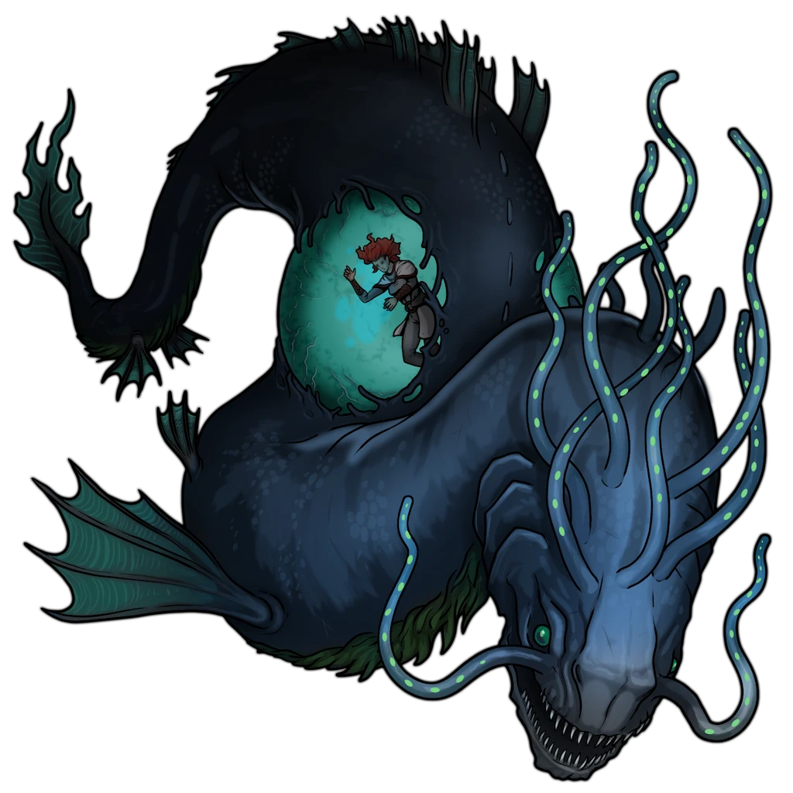

# Undercroft

> [!quote] Read Aloud
> This dark, enclosed undercroft is submerged in warm water; heavy metal grates cover glowing fissures on the floor, orange embers flickering up through the bars. Stylized Ashka statues loom from the surrounding walls, their faces turned inward toward the center of the heated chamber.

> [!danger] Hazard
> #### The Spawn Appears
>
> Shortly after the characters enter the chamber, the [[Spawn of Bwagaw]] surges in from its [[Den]]. As you position its token, read or paraphrase the following:

> [!quote] Read Aloud
> A vast, dark shape glides into view from the southeast, and the water seems to move with it, dragged into a slow, heavy surge by its sheer bulk. Long tendrils stream from its head and face, each shivering with a cold light that moves liquidly beneath its skin. Its body is pale and translucent in places; its stomach is a glowing sac where Fesira hangs suspended, dimly visible inside. As the creature turns to face you, its mouth parts to reveal crowded rows of long, razor-sharp teeth.

> [!abstract] Spawn of Bwagaw
> **[[Spawn of Bwagaw]]**
>
> Level 1 · Unknown Unknown
>
> 

> [!danger] Hazard
> #### Spawn of Bwagaw Tactics
>
> At the beginning of combat, the [[Spawn of Bwagaw]] will use its [[Pressure Jet]] Action to &reference[Stunned]{Stun} as many enemies as possible and create areas of &reference[heavily obscured] terrain through its [[Scalding Fissures]] feature (if able).
>
> Over the course of combat, the Spawn of Bwagaw will prioritize the following Actions and abilities:
>
> - In melee, the Spawn of Bwagaw will use its [[Multiattack]] Action, prioritizing its [[Constrict]] Action if it currently has no creature &reference[Grappled].
> - The Spawn of Bwagaw will use its [[Crushing Slipstream]] Bonus Action on each of its turns, affecting as many enemies as possible and colliding with a chamber wall in order to trigger its [[Rock Fall]] feature, if able.
> - The Spawn of Bwagaw causes damage to [[Fesira Inari]] at the beginning of each of its turn through its [[Swallow]] feature.
> - The Spawn of Bwagaw will use its [[Pressure Jet]] whenever able to &reference[Stunned]{Stun} enemies and create areas of &reference[heavily obscured] terrain through its [[Scalding Fissures]] feature.
> - [[Scalding Fissures]] may revive an &reference[incapacitated] Hydrotherm through its [[Elemental Reconstitution]] feature or cause it to change forms through its [[Elemental Polarity]] feature.
>
> The Spawn of Bwagaw fights until destroyed.
>
> #### Saving Fesira Inari
>
> Fesira Inari is represented in the Scene as a **Hidden** Actor. Use this Actor to track her Hit Points; using the average damage per round of the Spawn of Bwagaw's [[Swallow]] feature, Fesira Inari will survive for exactly 10 rounds.
>
> If the players are struggling with the encounter, you may choose to adjudicate that the players can target Fesira with healing spells directly, even though the [[Swallow]] feature provides her &Reference[Total Cover].
>
> #### Escaping with Fesira Inari
>
> Once the Spawn of Bwagaw is slain, the characters must retrieve Fesira from its body: **Reveal** her **Hidden** token. Once Fesira is freed, a character can shake her awake.
>
> - As an [[Ashka]], Fesira Inari can hold her breath for **20 minutes** before beginning to &reference[Suffocating]{Suffocate} and has a Swim Speed of 30 feet; she is more than capable of escaping the temple without aid.
>
> If the characters successfully exit the temple with Fesira alive, award them the Attunement point below, then continue with the [[Tidebound Temple]] section of the [[Tidebound Temple]] Event.
>
> #### If Fesira Inari Dies
>
> Just before Fesira Inari dies, she wakes momentarily (if still inside the Spawn of Bwagaw), long enough to transmit one final telepathic message to the party. Refer to [[Undercroft]].

#### Fesira Inari Saved

Each character who participated in saving Fesira Inari advances their **Attunement: Mayis (+1)**.

> [!info] Social
> #### Fesira's Last Words
>
> If Fesira would be killed, the grievous injury knocks her from her meditation. In her final moments, she conveys telepathically to the party:
>
> > Please … tell Sorak … he was right … the Ripple was only a dream … without the Spark …

> [!warning] Gamemaster
> #### Alternate Breadcrumb
>
> If the party fails to save Fesira, they may feel discouraged from following up with Sorak at Mount Sitara; however, this would prevent them from progressing this Quest by triggering [[Dousing the Flame]].
>
> Use Fesira's last words to encourage players to go to Sorak and deliver her message — at which point, they learn he has no option but to let the players into the citadel anyway.
