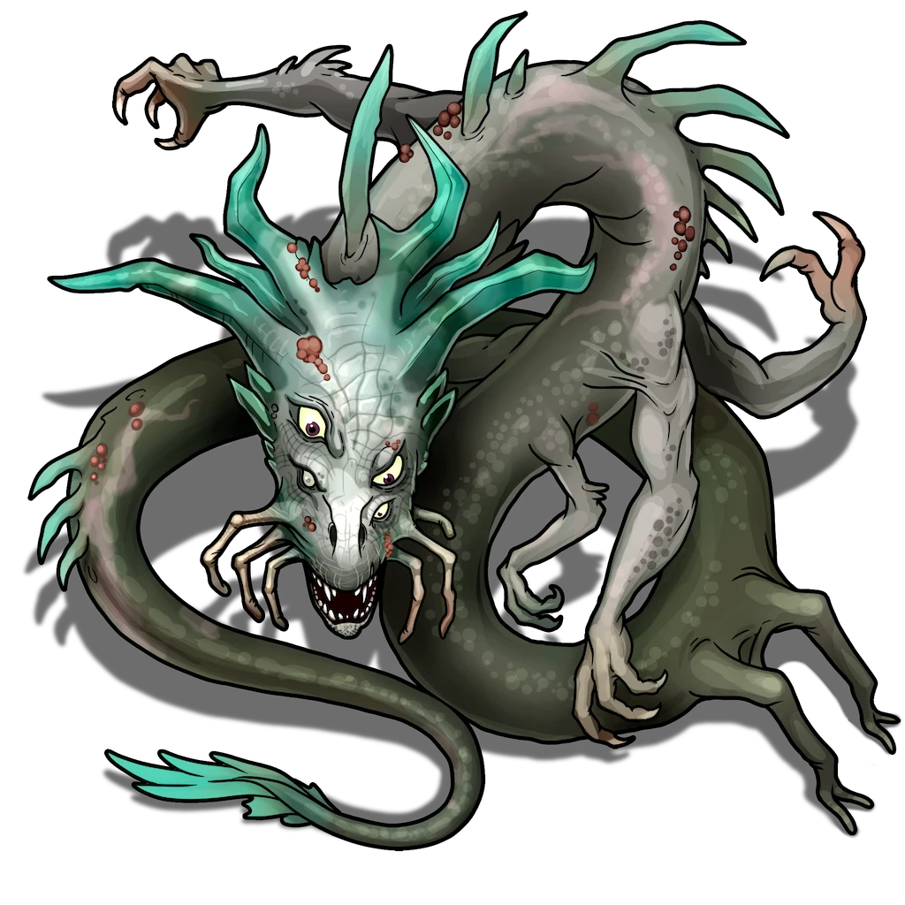

# Flooded Pit

> [!quote] Read Aloud
> The flooded pit marks the quarry's deepest point, a vast expanse now claimed by dark, swift-moving water. The reflective surface shimmers continuously under the erratic light, creating an illusion of boundless depth beneath. The sound of the cascading waterfall above reverberates through this space, adding to the sense of both confinement and expanse.

> [!danger] Hazard
> #### Drake Attack
>
> The massive drake here prefers to remain out of sight for as long as it can, waiting to attack prey when they are unwary. Its token begins hidden or with the Invisible status to represent it being submerged.
>
> Characters moving through this area must succeed on a **Awareness (DC 18)** check to notice the presence of a massive, mutated drake lurking in the water of the flooded pit. Characters that fail are subject to **Unaware** when the creature explodes from the water and attacks.

> [!abstract] Mutated Ultra Drake
> **[[Mutated Ultra Drake]]**
>
> Level 6 (Boss) · Afflicted Pallid Drake Ultra Drake
>
> 
>
> Warped and misshapen, this monster is covered in thick scales, and scuttles forward on half a dozen limbs protruding haphazardly from its grotesque form. Its head is crowned with a flaring array of teal horns which extend into long, uneven spikes that run halfway down its spine. The creature's elongated mouth is framed by six finger-like appendages ready to guide pray into its jagged teeth. Scabbed over brown pustules blemish its body, hinting at an illness in remission.

> [!danger] Hazard
> #### Drake Tactics
>
> The Mutated Ultra Drake is the most dangerous creature in the quarry, and its stat block has more moving parts than most the party has faced. It hunts from the water, punishes groups and wounded prey, and never gives up the fight.
>
> **Ambush.** The drake begins submerged and hidden, and its [[Extended Breath]] lets it stay under for 15 minutes. [[Thermal Vision]] lets it track warm bodies through the dark water from 60 feet away, so it waits until the party has spread out along the water's edge before it bursts out and strikes the nearest character. [[Preternatural Instinct]] gives it +2 Boons on Initiative, so it is likely to act before most of the party.
>
> On its turn, the drake will:
>
> - Strike with its [[Talons]] and [[Bite]], favoring wounded characters, which its [[Blood Sense]] pinpoints within 20 feet.
> - Press any advantage. A Critical Hit triggers [[Bloodletter]], leaving the target **Bleeding** for 3 Rounds, and [[Blood Frenzy]], granting +1 Action once per Round. After defeating a character, it uses **Ruthless Momentum** to move and strike the next.
> - Use **Noxious Spray** when two or more characters line up within its 30-foot ray, or **Noxious Spit** on a single character within 20 feet who stays out of reach.
> - Use **Tail Sweep** when three or more characters surround it; on a Critical Hit, they become **Staggered**.
> - Climb the quarry walls and structures when a character shelters out of reach. If it finds itself above its prey, it can leap down on them with **Swooping Strike**, gaining a Boon for every 10 feet it descends. This is an opportunity, not its main avenue of attack.
>
> When it dodges a melee attack, it spends Focus on **Counter Evade** to strike back. Its [[Electricity Absorption]] heals it from lightning that its resistance more than absorbs, so electrical attacks are a poor choice against it.
>
> Breaking its morale only provokes it further. If it becomes **Broken**, it does not flee, but becomes **Enraged** and fights to the death.

> [!tip] Exploration
> #### Explore
>
> Examining the dead drake, you find a [[Control Collar]]. A successful **Arcana (DC 14)** check reveals that the inscriptions and runes would have worked in concert with runes carved into the quarry walls to keep the drake in the lowest level. The runes would have leveled a shockingly powerful and likely painful psychic shock when triggered. However, they are largely burned out, and likely haven't functioned for quite a while.
>
> - **Critical Success**: The amount of magical artifice needed to make something like this is considerable, and likely required it to be custom made. Characters with **Knowledge: Crafts** note that while there's no clear maker's mark, the list of people who could create something of this sort is probably fairly short.
>
> - A further **Wilderness (DC 14)** check regarding this would lead you to believe that the creature was eventually conditioned to remain in the quarry, even without a working collar. Likely, it was smart enough to know what would happen if it tried to breach containment, and unwilling to risk it.
