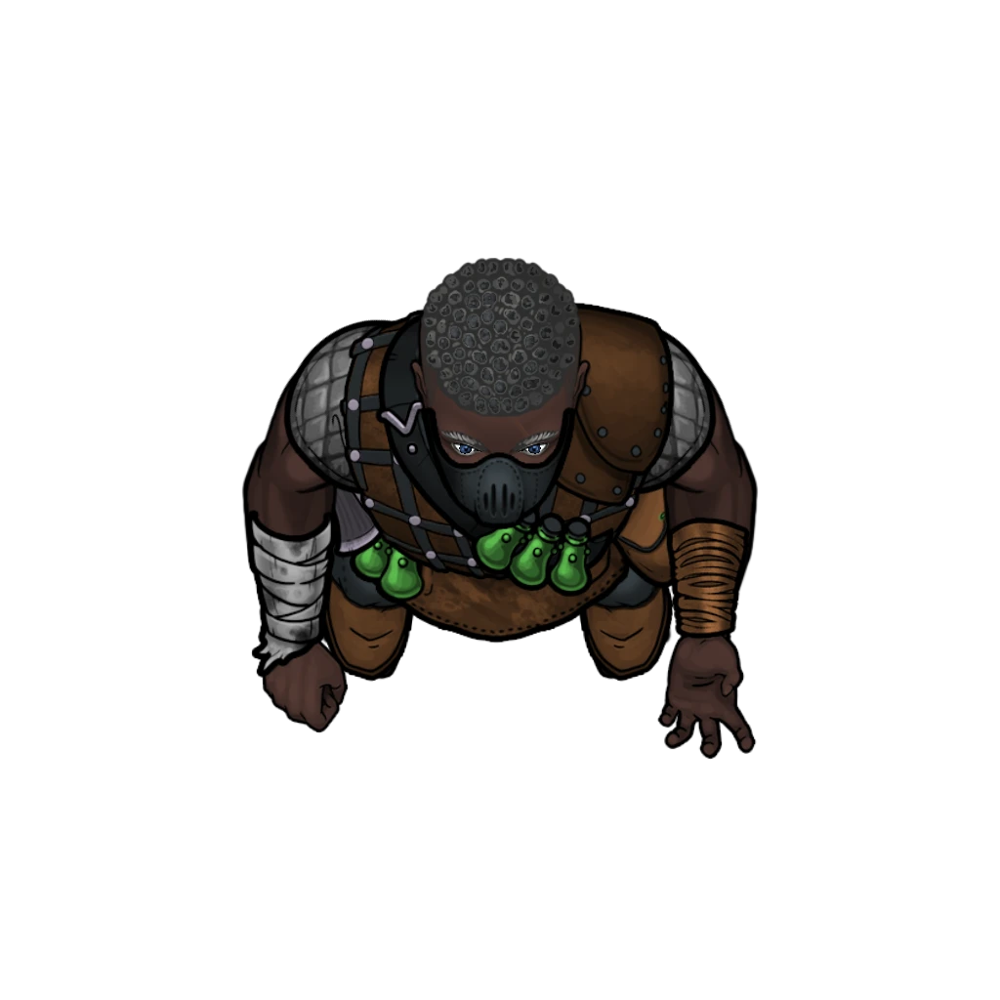

# Quarry Ledge

> [!quote] Read Aloud
> Emerging from the tunnel, the space opens up quickly to reveal a cavernous quarry with structures and catwalks running between them, all suspended over a pit flooded by running water. The cliff-side path continues on north, and the entrance to a wooden structure sits nearby to the east.
>
> The gaps of the quarry are spanned by suspended catwalks made of rusting metal, the mechanisms to move them obscured by the darkness above. From here you see no obvious controls, but there must be a way to move them.

If the lab has been forewarned by returning Scouts, the following section does not occur, as the [[Chemical Storage]] area is already destroyed. Before the party arrives, set off both the Chemical Storage and the [[Destroyed Lab]] as described on those pages, so that both are already burning.

### Lab Explosion

Give the players a moment to survey the landscape, but before they have the opportunity to explore further, an explosion injects immediacy into proceedings.

> [!warning] Gamemaster
> #### Setting Off the Explosion
>
> As you read the following aloud, look at the [[Destroyed Lab]] on the northeast side of the quarry and trigger its explosion using the  Interact With Objects mode in the Tokens layer of Scene Controls, which will cause it to burst into flame.

> [!quote] Read Aloud
> As you take in the quarry lab you spot movement on the other end of the quarry. A figure stands before the entrance to a building, reaches into a pouch on their belt, and throws the object into the structure. A moment later there is a sudden flash of light and a resounding boom which rattles the entire cavern.
>
> Flames and smoke begin erupting out of the windows, while a stream of some bright green fluid spills down through the floor of the suspended structure, bubbling and smoking on the stone a level below.
>
> Now outlined by the blazing fire issuing from the destroyed lab, the figure turns and begins running across a catwalk, heading your way. As they go, you see them pull another vial off their bandolier and shake it, causing it to glow violently in their hands.

The figure is a [[Mutagist Bombardier]] and they appear in front of the [[Destroyed Lab]] after having just destroyed it.

> [!abstract] Mutagist Bombardier
> **[[Mutagist Bombardier]]**
>
> Level 3 (Minion) · Human Bombardier
>
> 
>
> This wiry figure is clad in a studded leather vest caked with old stains, worn over a grimy apron looped around their waist. A bandolier loaded with glass vials and chemical canisters hangs across their chest. Their face is hidden behind a bulky, round-eyed gas mask, its filter puffing quietly with each breath. Chemical stained and burned fingers twitch restlessly at their sides, hovering near their arsenal and always ready to snatch up a bomb.

The Bombardier begins moving for the [[Chemical Storage]] room to blow it up next. The party can attempt to intercept them, potentially saving the room.

> [!danger] Hazard
> #### A Deadly Race
>
> If the party declares their intention to stop the Bombardier, begin a tracked combat encounter with the party and the Bombardier. On their turn, the Bombardier will move towards [[Chemical Storage]] and — once they arrive in that room — begin staging an explosion by sabotaging the alchemical equipment within.
>
> Staging the explosion requires spending fifteen **Action**, spread out over multiple Rounds. Refer to the [[Chemical Storage]] page for consequences should the Bombardier manage to finish their work without being stopped.
