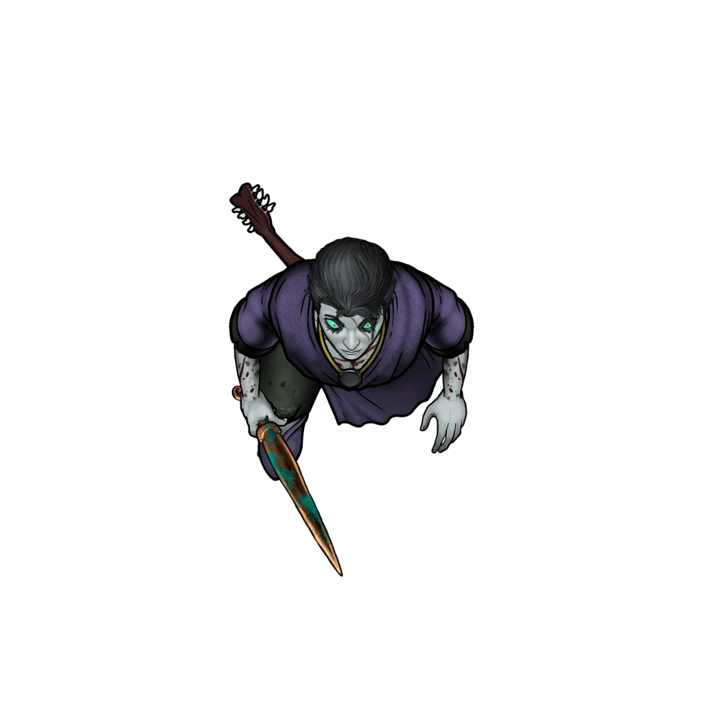

# Grim Findings

> [!warning] Gamemaster
> #### Gamemaster's Summary
>
> This social event occurs on a Vista scene depicting the Veiled Chain's headquarters in the Hallows area of Ordain. The characters reconnect with the [[Veiled Chain]] at [[The Hallows]], where they'll reveal what they've learned while traveling with [[Ankarist]]. In this event, the party can:
>
> - Meet important figures from the Veiled Chain, including [[Desham "Shaar" Phos]], the leader of the Veiled Chain, and [[Serethus]], a highly skilled mage, scholar, and ally of the Veiled Chain.
> - Lay out the evidence they've gathered, gain insights from other NPCs, and establish important social connections in Ordain.
> - Receive a reward for their efforts.
>
> #### Delivering Prisoners
>
> If the party completed the [[Empty Laboratory]] outcome, Ankarist hands [[Kalasak the Cutter]] over to Veiled Chain custody as soon as they arrive at the Hallows, which is part of why the party's wait runs long. If the party instead took a [[Mutagist Vivisector]] alive, Ankarist hands them over the same way. When the debrief begins, Shaar tells the party:
>
> > Your prisoner is in our custody. He has said very little so far, but our people will keep at him.

### Formal Introductions

> [!quote] Read Aloud
> After an indeterminate stretch of time Ankarist finally reappears, his features apologetic as soon as he makes eye contact with you. Saying nothing, he leads in a pair whose presence feels painfully official.
>
> In the group, a gray-skinned Fej with veins of blue embers simmering under their skin, and eyes to match. Behind them, a majestic Cor'ak whose purple horns sweep round his head, and wearing robes decorated with jewels and bronze fabric.
>
> They all immediately settle into seats, and Ankarist facilitates introductions. He indicates the Fej first.
>
> > This is Shaar, head of the Veiled Chain.
>
> Shaar offers a silent nod in recognition, but says nothing. Ankarist then gestures to the Cor'ak.
>
> > This is Serethus, fellow investigator and resident expert in mystical matters. Probably no better spellcaster in the city.
>
> Serethus offers a wide, toothy smile and scoffs.
>
> > Certainly there are better, I am only remarkable because my skills and knowledge are accessible.
>
> Shaar then breaks their silence.
>
> > So, let's speak about what you found in the pathways... we're going to go over our findings based on the evidence you recovered, and make sure this aligns with what you saw and observed. If you have anything to add, please don't hesitate to do so.

> [!abstract] Desham "Shaar" Phos
> **[[Desham "Shaar" Phos]]**
>
> Level 1 · Unknown Unknown
>
> 

> [!abstract] Serethus
> **[[Serethus]]**
>
> Level 12 (Boss) · Cor'ak Sorcerer
>
> 
>
> Tall and imposing, with a strong, bulky frame typical of the Cor'ak, this man's brown and tan are accented by splashes of vibrant purple. Long, purple horns that frame his head in a regal yet intimidating manner. His teal eyes are striking and seem to pierce through those he engages with. His robes are bright and vibrant, in Ordani fashion, and draped with glittering gems of all shapes and sizes.

### Discussing the Evidence

Shaar drives the debrief, putting each of the following questions to the party in turn. Give the players a chance to share what they know or suspect, then read the reactions of Shaar, Ankarist, and Serethus. What the investigators can add depends on how much evidence the party recovered, so the questions are repeated in each of the three sections below, with reactions to match. Ankarist can build on the party's answers or correct anything they get wrong.

> [!warning] Gamemaster
> #### Grading the Evidence
>
> There are three grades the party's evidence collection can have: poor, good, and excellent, based on how much information they collected. The more evidence they have, the better a picture of events the Veiled Chain will have. The party needs 8 points of evidence to achieve "good" status, and 14 points of evidence to reach "excellent."
>
> The [[Evidence]] page of the Repurposed Quarry lists where each laboratory item can be found. The following things contribute to their evidence score:
>
> - Gain +1 Evidence for each of the following items claimed from the Pathways scouts: [[Muddy Logbook]], [[Scout Journal]], [[Alchemical Grenade]], [[Pathways Scout Map]]
> - Gain +1 Evidence if the party collected a unit of [[Molted Dragon Skin]] from [[Impossible Skin]].
> - Gain +1 Evidence for each of the following items taken from the laboratory: [[Mutagenic Formulae]], [[Examination Notes]], [[Kalasak's Observations]], [[Manual of Drake Anatomy]], [[Testing Schedule]], [[Experiment Reports]], [[Vial of Mutagenic Medium]], [[List of Chemicals]], [[Rare Chemicals]].
> - Gain +3 Evidence if they captured [[Kalasak the Cutter]] alive, or +1 Evidence if instead they captured at least one [[Mutagist Vivisector]] alive. These do not stack: a captured Vivisector adds nothing once Kalasak is captured.
> - Gain +1 Evidence if they [[Emergence]] where they emerged from the pathways.

Tally the party's evidence score, then open the matching section below. Each section holds the outcome to mark, the attunement it grants, the investigators' reactions to Shaar's questions, and the party's reward.

### Poor Evidence

If the party's total evidence score is **less than 8**, record that they collected poor evidence and work through the following debrief.

`[[/outcome poor]]`

#### Aura Attunement: Poor Evidence

If the party manages to collect very little useful evidence, each character advances their **Attunement: Aura (+1)** at the conclusion of the event.

Poor Evidence Debrief> [!question] Q&A
> **Q:** What was the lab producing?
>
> **A:**
>
> Ankarist glances at his notes and then says:
>
> > Far as we can determine, they were producing large amounts of alchemical compounds and shipping them to locations unknown. It's clear they are part of a larger operation, but to what extent we're not clear.

> [!question] Q&A
> **Q:** Who was supplying the lab?
>
> **A:**
>
> Ankarist shakes his head.
>
> > We don't know, yet. We're assuming that the chemicals were coming out of Ordain, so we're going to start looking at smuggling and black market channels and see what shakes out.

> [!question] Q&A
> **Q:** Why were they shutting the lab down?
>
> **A:**
>
> Shaar says:
>
> > They were either tipped off that someone was coming, or they completed their work.
>
> Ankarist nods.
>
> > I think the timing was coincidental, but we're not sure about why the lab was being scuttled.

> [!question] Q&A
> **Q:** Who are the Mutagists?
>
> **A:**
>
> Ankarist lets out an exasperated sigh, his frustration clear.
>
> > The short answer is: a threat. They appear to be a collection of absolutely amoral healers and alchemists that have dedicated themselves to a line of unethical pursuits to achieve well… we're not sure. The scale and complexity of the operation in the lab we found hints they are very well funded. Sadly we just don't know anything else right now.

> [!question] Q&A
> **Q:** Who do the Mutagists work for?
>
> **A:**
>
> Serethus offers a shrug and an unhelpful statement of:
>
> > Who's to say? Perhaps nobody. They seem to be a bunch of crackpots working in a pit.
>
> Ankarist interjects, countering with:
>
> > Given the scale of support they had with incoming supplies? Doesn't seem small.
>
> Serethus smiles, the expression somewhat patronizing.
>
> > As an alchemist I can tell you that bulk chemicals are cheap, and you can always pay someone to leave a wagon somewhere if you pay them well enough. We simply lack any evidence that this is bigger than the lab you found.
>
> Shaar cuts in:
>
> > I believe Serethus is right, to an extent, they clearly have allies, but until we have evidence of that, we can't say to what extent. Not yet, at least.

> [!question] Q&A
> **Q:** What are these drakes that attacked Helkas?
>
> **A:**
>
> Ankarist answers that:
>
> > As far as we can tell they are offshoots of vile dragons, we have no idea if they are naturally occurring or not.

> [!question] Q&A
> **Q:** Where did the drakes come from?
>
> **A:**
>
> Ankarist speaks up first:
>
> > The short answer is: the lab in the quarry. It's unclear if they were being trapped in the pathways, or grown, but they were certainly being contained and experimented on there, and likely escaped. However, there's no record of these drakes in the region up to this point, so they may have been introduced from elsewhere, or might be newly spawned.

> [!question] Q&A
> **Q:** Why are the drakes ill?
>
> **A:**
>
> Serethus clears his throat and says:
>
> > Well, that's quite simple actually! They were being injected with alchemical solutions of varying designs and compositions for some unspecified reason. This was causing them to go blind, develop wounds and pustules and so forth.

> [!question] Q&A
> **Q:** Why did the drakes attack Helkas?
>
> **A:**
>
> Ankarist shrugs slightly.
>
> > Their presence alongside the raiders seems like nothing more than good timing. We're not sure why, beyond possibly just being an animal attack.

When the meeting concludes, the party receives a  **10**.

### Good Evidence

If the party's total evidence score is **8 to 13**, record that they collected good evidence and work through the following debrief.

`[[/outcome good]]`

#### Mayis Attunement: Good Evidence

If the party manages to collect a moderate amount of useful evidence, each character advances their **Attunement: Mayis (+1)** at the conclusion of the event.

Good Evidence Debrief> [!question] Q&A
> **Q:** What was the lab producing?
>
> **A:**
>
> Ankarist glances at his notes and then says:
>
> > Far as we can determine, they were developing mutagenic compounds and testing them on Drakes then shipping the tested compounds to locations unknown. It's clear they are part of a larger operation, receiving regular shipments of base chemicals from somewhere, likely Ordain itself, along with Drakes to be experimented on.
>
> Serethus nods, adding:
>
> > The volume of compound they were moving into that location is impressive, and doing so without anyone noticing is doubly impressive… the dire implications notwithstanding, of course. Operating a lab of that size would not be inexpensive.

> [!question] Q&A
> **Q:** Who was supplying the lab?
>
> **A:**
>
> Ankarist nods at you.
>
> > That's the key question. They clearly had someone funding their operation, and providing them materials. We have some chemicals and materials we can investigate for leads, but a lot of this is going to end up being us shaking down local smugglers and black market operators to see what falls out.

> [!question] Q&A
> **Q:** Why were they shutting the lab down?
>
> **A:**
>
> Shaar says:
>
> > It seems as though they completed their work, and the timing with your arrival was purely coincidental.
>
> Ankarist nods.
>
> > I think that's correct, and documents recovered indicate they were shipping large volumes of materials out of the lab just prior to scrapping everything.

> [!question] Q&A
> **Q:** Who are the Mutagists?
>
> **A:**
>
> Ankarist casts a grim glance down at his notes, then looks back at you.
>
> > The short answer? A threat. They are a well connected, well funded, and worryingly clandestine network of amoral scholars and alchemists that have dedicated themselves to a line of unethical pursuits to create a new breed of drakes for some unclear reason.
> >
> > This was only one part of a much larger operation, and one that seemingly established under our noses without anyone being the wiser.

> [!question] Q&A
> **Q:** Who do the Mutagists work for?
>
> **A:**
>
> Serethus offers a contemplative hum at the question, then says:
>
> > They may not work for anyone, but there are certainly no shortages of bodies to join their cause. I know far too many frustrated academics, and frustratingly amoral alchemists than I like to admit, and someone offering them a chance to work unbidden would be quite tempting.
>
> Ankarist adds:
>
> > Given the level of supply in that lab, it's safe to assume they have no shortage of allies in the area, likely in Ordain itself. We have some files and evidence that can hopefully help us track down names, and hopefully find a source of their funding.

> [!question] Q&A
> **Q:** What are these drakes that attacked Helkas?
>
> **A:**
>
> Ankarist answers that:
>
> > As far as we can tell they are offshoots of vile dragons. It's unclear if they are migrating into the region from elsewhere, or were always present and are just now emerging, or how many there are.

> [!question] Q&A
> **Q:** Where did the drakes come from?
>
> **A:**
>
> Ankarist says:
>
> > Initially it seemed like they were being trapped in the Pathways, but evidence suggests they were being brought in from some external location to be experimented on. The precise location is unknown, but it's clear they aren't naturally occurring in the pathways.

> [!question] Q&A
> **Q:** What did you make of the molted skin?[[Impossible Skin]]
>
> **A:**
>
> Ankarist answers:
>
> > If the drakes are offshoots of vile dragons, they probably came from the one that shed that skin. I'd hate to meet the creature itself.

> [!question] Q&A
> **Q:** Why are the drakes ill?
>
> **A:**
>
> Serethus speaks up, saying:
>
> > Rather straightforward answer, that: The drakes were undergoing extensive mutagenic treatment, seemingly to correct some inborn issue with them, or to enhance them. This was causing them to go blind, develop wounds and pustules and so forth, since the mutagenic compounds were all experimental and highly toxic. However, it does seem they achieved success eventually.

> [!question] Q&A
> **Q:** Why did the drakes attack Helkas?
>
> **A:**
>
> Shaar speculates:
>
> > Given the lab was releasing drakes into the wild, it seems plausible to me that Helkas was attacked simply because the Dusktide Festival drew their attention. They don't seem to be connected to the raiders at all.

When the meeting concludes, the party receives a  **25**.

### Excellent Evidence

If the party's total evidence score is **14 or higher**, record that they collected excellent evidence and work through the following debrief.

`[[/outcome excellent]]`

#### Akon Attunement: Excellent Evidence

If the party manages to collect extensive useful evidence, each character advances their **Attunement: Akon (+2)** at the conclusion of the event.

Excellent Evidence Debrief> [!question] Q&A
> **Q:** What was the lab producing?
>
> **A:**
>
> Ankarist glances at his notes and then says:
>
> > Looking at the recovered records, the lab was established so that Kalasak could conduct experiments on drakes being shipped in from elsewhere, with the intention being to create a mutagen that made the drakes stronger and more resilient. They had some level of success, because they shipped finished mutagenic compounds and mediums right before we arrived.
>
> Serethus nods, adding:
>
> > I should like to note that they are clearly part of a larger operation, as running such a large lab would come with considerable expenses. Zealots aside, they were receiving regular shipments of base chemicals from somewhere, likely Ordain itself, along with Drakes to be experimented on. The volume of compound they were moving into that location is impressive, and doing so without anyone noticing is doubly impressive… the dire implications notwithstanding, of course.

> [!question] Q&A
> **Q:** Who was supplying the lab?
>
> **A:**
>
> Ankarist taps a folder.
>
> > The answer to that is in the evidence we recovered. We have lists of names, chemical shipments, and contacts that are related to supplying the lab. With that information in-hand we can start following specific leads and seeing what connections exist. Without that evidence we would have been stuck shaking down local smuggling rings, which rarely goes well.
> >
> > One name we have which stands out is a figure known as "Professor Bleak" who seems to be in charge of operations on a grander level. If we can figure out who they are, we can unravel everything else.

> [!question] Q&A
> **Q:** Why were they shutting the lab down?
>
> **A:**
>
> Shaar says:
>
> > They completed their work, and were destroying the evidence. It's possible they knew you were coming, but more likely the timing was purely coincidental.
>
> Ankarist nods.
>
> > Correct, as far as I can tell. They were shipping large volumes of materials out of the lab just prior to scrapping everything. Kalasak was ordered to scrap the lab and destroy anything that wasn't being shipped out by his superior, someone named "Professor Bleak" whom we're looking into.
> >
> > Sadly we don't know who or where they are, or where everything was sent, but we are looking into it.

> [!question] Q&A
> **Q:** Who are the Mutagists?
>
> **A:**
>
> Ankarist casts a glance at his papers then fixes his eyes on you.
>
> > Given all the documents you and I recovered, we know they are a well connected, well funded, clandestine network of scholars and alchemists that have dedicated themselves to the breeding and enhancement of a new line of drakes, possibly as weapons, or as part of some larger scheme.
> >
> > We know they are headed by a figure known as "Professor Bleak" though this is an assumed name. The lab we found was only a small part of a much larger operation, and we have strong suspicions there's another lab in Ordain itself, but don't know where… yet.

> [!question] Q&A
> **Q:** Who do the Mutagists work for?
>
> **A:**
>
> Serethus offers a contemplative hum at the question, then says:
>
> > Well, there is this "Professor Bleak" figure, whom Kalasak answered to. Seems that they are the one calling the shots and deciding what gets done. However, I don't know anyone by that name in any of my circles.
>
> Ankarist adds:
>
> > That's my thinking, yes, we need to find this Professor Bleak figure, they are almost certainly head of this organization. Also, given what we found in that lab, they clearly have a sizable operation under their control. We need to find threads to pull, and see if we can unravel the tapestry. Luckily, we have files with names and suppliers which hopefully help us track down names, and hopefully find a source of their funding.
>
> Serethus nods at that, stroking his jaw.
>
> > That is most fortunate, and I have to admit I'm morbidly curious about who you turn up in your investigation. I know a great many frustrated academics, and frustratingly amoral alchemists.
> >
> > Someone offering them a chance to work unbidden would be quite tempting, especially since many of them end up ostracized from more mainstream scholarly organizations, or chafing badly by the confines they are forced to work within.

> [!question] Q&A
> **Q:** What are these drakes that attacked Helkas?
>
> **A:**
>
> Ankarist answers that:
>
> > As far as we can tell they are offshoots of vile dragons. Documents from the labs indicate they were being bred for the lab's use. So they aren't natural to this region, but if they are present now we can expect them to crop up more. We're planning to send out warnings to locals.
>
> Serethus adds:
>
> > Rather fascinating, isn't it? The creation of an entirely new species of creature based on another. I believe only Ember itself has done such a thing before.
>
> Ankarist frowns at that.
>
> > I'd find it more interesting if they weren't attacking settlements.
>
> Serethus clears his throat.
>
> > Well yes of course, goes without saying.

> [!question] Q&A
> **Q:** Where did the drakes come from?
>
> **A:**
>
> Ankarist says:
>
> > Evidence points to the Drakes being a bred or engineered sub-type of vile dragons. They were being shipped in from elsewhere, extensively studied and tested by the personnel in the quarry lab, then released into the wild.

> [!question] Q&A
> **Q:** What did you make of the molted skin?[[Impossible Skin]]
>
> **A:**
>
> Ankarist answers:
>
> > According to the lab's records, the drakes were likely spawned from material taken from a vile dragon's molt, like the one we found in the Pathways. Those cuts in the skin make sense now. Someone was harvesting it.

> [!question] Q&A
> **Q:** Why are the drakes ill?
>
> **A:**
>
> Serethus speaks up:
>
> > Rather fascinating answer for that, actually! It seems that the Drakes have inborn maladies and weaknesses that leave them physically weaker and malformed, possibly related to the process by which they are spawned.
> >
> > Given findings in the laboratory, it seems that the rather extensive testing being done there was aimed at enhancing their physical prowess and resilience.
> >
> > This had been going on for months, and early versions of the mutagen were causing outright death in the earlier subjects, and they only recently stabilized the formula before you arrived.

> [!question] Q&A
> **Q:** Why did the drakes attack Helkas?
>
> **A:**
>
> Shaar breaks their silence:
>
> > To see how the creatures perform, nothing more, nothing less. There might have been other ulterior motives, or other agendas with the Otherhood raiders, but for this lab's part, it was just to see how effective they were. It's possible these are intended to be weapons in the long term for their own operations, or to be given out to allies, such as the raiders.

When the meeting concludes, the party receives a  **50**.

### Concluding the Meeting

> [!quote] Read Aloud
> Shaar looks to Ankarist and says:
>
> > I think we can conclude this debriefing, Ankarist. See to it that rewards are handed out for the assistance, and then follow up on the leads we discussed previously.
>
> Ankarist nods at Shaar.
>
> > Absolutely will do, Shaar.
>
> Shaar offers a faint smile to Ankarist, which is then directed to you.
>
> > Thank you for your assistance in this. If the Chain has further need of you, we will be in contact. Be well.
>
> With that, Shaar lingers only long enough to collect goodbyes from you and Serethus, and then leaves. A moment later Serethus speaks up, saying:
>
> > I should take my leave as well, cunning and wisdom guide you, friends.
>
> In short order you are left with Ankarist, who says:
>
> > Like Shaar said: thank you for the help. I don't know that I could have done it without your assistance. As for reward, I'm going to have someone pay you some gold on your way out. It might not be much, but I'd rather you not leave entirely empty handed.

> [!question] Q&A
> **Q:** Will you need more help?
>
> **A:**
>
> Ankarist lets out a small laugh.
>
> > Probably, yeah. I don't need your help right this moment, so you should go spend your reward money, see Ordain, relax a bit. If something comes up, and I expect it will, I'll reach out and we'll get back into the field.

### Concluding the Event

After the party has left the Veiled Chain offices they are once more free to pursue whatever interests they have.

> [!warning] Gamemaster
> #### Milestone Progression
>
> Completing this event awards a [[Milestone Progression]] point, potentially enabling the party to advance in level.
>
> #### Subsequent Quests
>
> This event concludes the "Ancient Paths" quest, but Ankarist and the Mutagists will return during Chapter 3 with the [[Spreading Sickness]] quest, which will begin with [[An Unexpected Requisition]] after some time passes.
