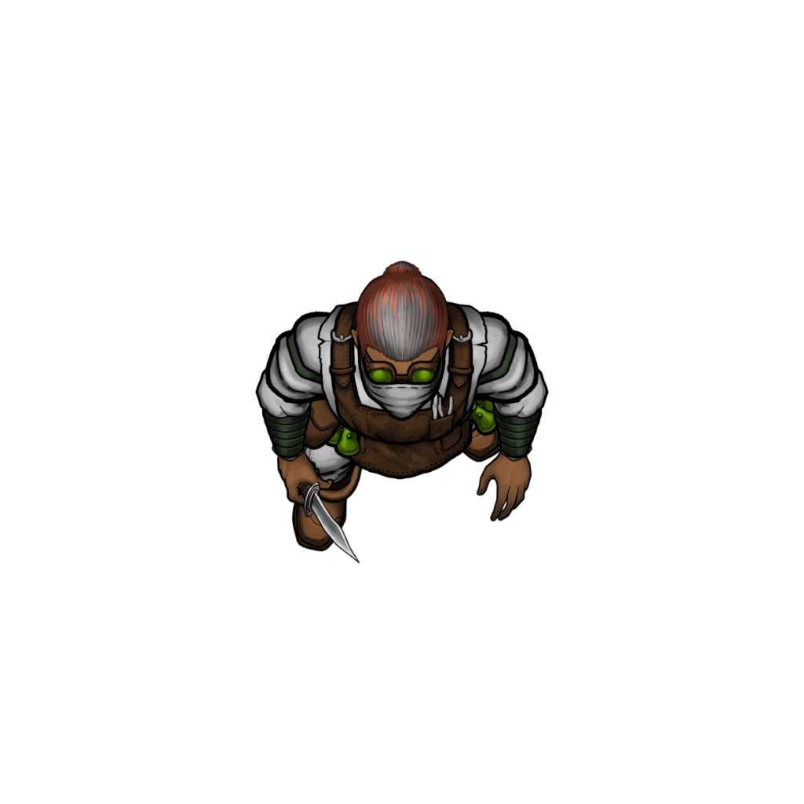

# Missing Scouts

> [!warning] Gamemaster
> #### Gamemaster's Summary
>
> This exploration and social event invites the characters to explore the [[Mycelian Expanse]], where they'll discover a makeshift camp used by a group of [[Mutagist Scout]]. Although unoccupied, this camp shows signs of recent use. In this event, the party can:
>
> - Investigate the [[Mutagists]] camp for details about the scouts that occupy it.
> - Find a map detailing other key events they could encounter in this area.
> - Encounter a group of Mutagist Scouts posing as members of the [[Anachraenum]].
> - Inadvertently alert the Mutagists to their investigation.
>
> This event begins on the [[Scout Camp]] Level of the [[Vista: Mycelian Expanse]] Vista. Depending on the party's actions, it may lead to a follow-up combat encounter using the [[Mycelian Expanse]] area map.

### Investigating the Camp

> [!tip] Exploration
> #### Cold Camp
>
> A successful **Stealth (DC 14)** check leads you to believe that this camp was very specifically laid out to be hard to spot while traveling nearby trails. You're not even sure you could spot it from above unless you knew what you were looking for.
>
> A successful use of the **Wilderness (DC 13)** skill notes the firepit still holds a few smoldering coals buried under the ash and burned fuel. While it's impossible to tell precisely how long ago the fire was used, it wasn't more than a day or two if the pit is still warm.
>
> Examining the camp area with a successful **Wilderness (DC 13)** check finds numerous footprints belonging to a group that recently left.
>
> - **Critical Success**: The character detects that there were 5-6 people in this camp, given the distinct gaits, boot shapes, and impressions they made.
>
> A successful **Awareness (DC 13)** check notes that the camp has collections of fungal wood, plant fronds, bags of mushrooms and other edibles on offer.
>
> - **Critical Success**: The character notices that there are far more useful supplies and edible provisions here than the number of camp occupants would require. They are likely collecting resources for some reason.
>
> #### Unattended Bags
>
> The following items can be found in the camp:
>
> - [[Rations]]
> - [[Cook's Toolkit]]
> - [[Expanded Toolbelt]]
> - [[Fletcher's Toolkit]]
> - [[Travel Jug]]
> - [[Rope]]
> - Two backpacks.
>
> #### A Useful Map
>
> Attached to one of the backpacks, sealed up in a protective case is a fairly detailed [[Pathways Scout Map]] of the immediate area. Along with the camp itself, this map details numerous locations in the area, and paths to or from them.
>
> The scout map item description contains a number of locations that can be explored if the party choose to use it as a reference point.

If the party obtains the scout map, mark the following outcome as complete:

`[[/outcome map]]`

Once the party has finished exploring the camp, or once some time has passed, continue to Returning Scouts below.

### Returning Scouts

> [!quote] Read Aloud
> Laughter and voices cut through the air, followed by the sound of approaching footsteps. A quick glance in the direction of the noise reveals movement and several figures coming toward the camp.
>
> Ankarist dives behind cover and looks towards you, silently gesturing for you to indicate what the next move is.

> [!abstract] Mutagist Scout
> **[[Mutagist Scout]]**
>
> Level 3 (Minion) · Human Scout
>
> 
>
> A rugged, sly-looking individual, clad in a patchwork cloak of leather and fabric, their attire a mismatched collection of adventure-worn gear. They have the bearing of a well traveled and road worn adventurer or mercenary. It is concerning how utterly nondescript they actually are.

> [!danger] Hazard
> #### Hiding from the Scouts
>
> If the party wishes to remain undetected by the returning scouts, they must attempt a **Stealth (DC 14, Group)** check.
>
> - If successful, the returning scouts are **Unaware** of the party's presence. The characters can choose whether to [[Ancient Paths]], [[Ancient Paths]], or [[Ancient Paths]] the scouts.
> - If the party was detected, the scouts will [[Ancient Paths]] them with suspicion.

> [!warning] Gamemaster
> #### Who Are These People?
>
> In truth, the scouts are wicked and clandestine [[Mutagists]] agents who were dispatched to the pathways by their leader [[Kalasak the Cutter]] from the [[Repurposed Quarry]] which houses a secret Mutagist lab.
>
> They are wary of strangers in the area, and will be careful not to reveal their nature or their mission. They will pretend to be adventurers, commissioned by the Anachraenum to extract resources from the Pathways.

Avoiding the ScoutsIf the party remained undetected, they may decide to surveil the scouts movements to try and identify what they are doing. Read the following aloud:

> [!quote] Read Aloud
> A group of adventurers walk into the camp carrying bundles of fungus lashed together with rope and a few carcasses of strange animals plucked from the wilds. With a hint of frustration one of them speaks:
>
> > Well that was a bust, we'll rest here for a bit, then go check the other areas.
>
> Another adventurer speaks up, glancing back at their comrade:
>
> > I'm telling you, the Jurtak probably got them. They've been really active around here lately, and I think the last couple teams managed to completely piss them off by poaching their hunting grounds. We'll be lucky if we find any trace of them. We should just load up and head back to the lab.
>
> Though none of the others say it, there's a ripple of grudging agreement that moves through the rest of the adventurers.

Since the party has remained unnoticed, it is possible for them to wait and observe long enough to [[Missing Scouts]] when they depart their camp after resting for 10 hours.

Addressing the ScoutsIf the party decides against hiding and instead chooses to greet the scouts directly, or if they are discovered by the scouts when they search the camp, use this description:

> [!quote] Read Aloud
> One of the adventurers goes into full alert, and calls out:
>
> > We've got company!
>
> Hands go to weapons, and the adventurers turn to face you, taking defensive stances. However, they don't immediately enter combat, instead choosing to parley.
>
> > Mind explaining why you're skulking around our camp? We're not expecting visitors, and not keen on raiders. So talk or walk, strangers.

The scouts are not immediately hostile, but are very suspicious at the beginning of this exchange. They won't immediately resort to violence without a reason, giving the party a chance to talk their way out of the situation, but combat remains a real possibility depending on party actions.

> [!danger] Hazard
> #### Scout Wariness
>
> As they interact with a party their wariness will increase. Failing a skill check to persuade, deceive, or intimidate the scouts increases wariness by 1. If they become too wary of the party, they will attack or flee to warn their base of operations. The scouts' wariness and bearing to the party is rated as follows:
>
> - **0-1 Wariness**: The party is viewed as weird but harmless. The scouts do their best to send them on their way as quickly as possible.
> - **2-3 Wariness**: The party is viewed as suspicious, but doesn't warrant direct action unless they refuse to leave. The scouts will plan to report them once done with their work here.
> - **4-5 Wariness**: The party is now highly suspect, and the Scouts will begin scrutinizing anything they say, and pick at any holes in their story so far. They will leave as soon as the party departs and return to the [[Repurposed Quarry]] to report the encounter.
> - **6+ Wariness**: The party is clearly a threat to the Mutagist operation and must die. Four of the scouts attack immediately while two others break off to report the intrusion to [[Kalasak the Cutter]] at the [[Repurposed Quarry]].

The scouts are willing to answer questions, but only if the party answers their questions as well.

> [!info] Social
> #### Trading Information
>
> This encounter is played as a social challenge wherein the groups take turns asking questions to the other. The scouts go first and ask the party one of the following questions, or another question of the Gamemaster's choosing:
>
> 1. Who are you?
> 2. What are you doing in the Pathways?
> 3. How'd you get down here?
> 4. Did you run into an adventuring team around Skybrush?
> 5. Is the way up open now?
> 6. Have you seen any other travelers down here?
>
> #### Convincing Required
>
> Each question requires the party to respond in-character and to make one of the following group checks depending on how they responded:
>
> - A **Diplomacy (DC 12, Group)** check if their answer was truthful and inoffensive.
> - A **Deception (DC 14, Group)** check if their answer was untruthful or misleading.
> - An **Intimidation (DC 16, Group)** check if their answer was hostile or coercive.
>
> Depending on the group's collective success or failure, the scouts' wariness changes:
>
> - **Critical Failure**: Wariness increases by 2.
> - **Failure**: Wariness increases by 1.
> - **Success**: No change in wariness.
> - **Critical Success:** Wariness decreases by 1.
>
> Each time the party answers one of the scouts' questions, they may ask one in return. Suggested responses to likely questions are provided below.
>
> #### Sensitive Matters
>
> If the party speaks or asks about any of the following, the scouts will immediately raise their wariness by 1.
>
> - The presence of Drakes in the upper region.
> - The attack on Helkas.
> - People utilizing poison or alchemical weapons, such as those in the Mythspire ruins.
> - Ankarist's role as a Veiled Chain investigator.
>
> Players with **Awareness (DC 13, Passive)** recognize that the scouts reacted negatively to the topic and that continuing to speak on it will increase their wariness rapidly, leading to escalating tension.

> [!question] Q&A
> **Q:** What are you doing down here?
>
> **A:**
>
> > We are down here collecting rare reagents, plants, animals, artifacts and the like for contacts in Ordain. It's not really a formal expedition so much as a bunch of Anachraenum just trying to make some coin and build reputations.

> [!question] Q&A
> **Q:** Are you with the Anachraenum?
>
> **A:**
>
> > We sure are, actually.
>
> The scouts present their personal Anachraenum badges and insignia, allowing you a moment to look at them up close.

> [!tip] Exploration
> #### Genuine Badges
>
> A successful **Society (DC 12)** check confirms that these appear to be authentic Anachraenum seals, badges, and insignia proving they are members in good standing.

> [!question] Q&A
> **Q:** What's this camp for?
>
> **A:**
>
> > There's several teams. We all mostly work together and share knowledge. That's what this camp is for. We stockpile things, talk about finds, so forth. Sure, we might make less than if we hoarded our finds, but, this way involves way less squabbling over rights to territory and finds.

> [!question] Q&A
> **Q:** Why are there multiple Anachraenum teams in the area?
>
> **A:**
>
> > We're all working for the same patron on the same scouting job.

> [!info] Social
> A successful **Society (DC 12)** may lead one to wonder why there are multiple teams of adventurers down here. Characters with the **Culture: Ordani** know that usually Anachraenum only work in teams of 3-5 people unless it's an official/sponsored expedition.

> [!question] Q&A
> **Q:** Have you seen anyone out of place or suspicious down here?
>
> **A:**
>
> > Aside from you? Hard to say.
> >
> > There's all sorts of weird things down here, and weird people coming through the Pathways. We're not aware of anyone particularly, but it's a big space. You might try heading down south into the fog-shrouded areas of the Pathways, there's plenty of ways topside there, and places to hide out.

If the party manages to part ways with the Mutagist Scouts without the encounter turning to violence, award the following attunement progression:

#### Akon Attunement: Cautious Conversation

If the party concludes conversation with the Mutagist Scouts without raising their suspicion beyond 3 wariness, every character in the party advances their **Attunement: Akon (+1)** at the conclusion of the Event.

Fighting the ScoutsIf the party manages to provoke the scouts during a social confrontation, ambushes them, or is caught looting their camp, a fight will break out. There are six scouts in total, however some of their number may have broken off to report back, depending on the party's actions.

> [!warning] Gamemaster
> #### Entering Combat
>
> To begin a combat encounter with the Mutagist Scouts, mark the following outcome as having occurred, which will automatically trigger a transition to the [[Mycelian Expanse]] area map where the encounter takes place. The encounter spawns with 6 scouts present, so you should remove any who have fled before the fight.

`[[/outcome attacked]]`

> [!abstract] Mutagist Scout
> **[[Mutagist Scout]]**
>
> Level 3 (Minion) · Human Scout
>
> 
>
> A rugged, sly-looking individual, clad in a patchwork cloak of leather and fabric, their attire a mismatched collection of adventure-worn gear. They have the bearing of a well traveled and road worn adventurer or mercenary. It is concerning how utterly nondescript they actually are.

> [!danger] Hazard
> #### Scout Tactics
>
> The Mutagist scouts are coordinated skirmishers used to working together to take down larger prey. They rely heavily on ranged combat, using:
>
> - **Precision Shot** to take down difficult targets.
> - **Pinning Shot** to prevent enemies from fleeing or closing distance.
> - **Quick Draw** to fire shots under pressure.
>
> If they are able to gain a tactical advantage by doing so, the scouts will not hesitate to **Sneak** or **Hide** to elude detection. When they have a moment to do so, they will @Action[Actor.dDzLM6gOY0EKzF1F paralyticApply] to their weapons, allowing them to apply a disabling effect.
>
> The Mutagists are cunning, and not willing to throw their lives away. If they are **Broken** they will not hesitate to flee.
>
> Any scouts who flee the battle will return to the [[Repurposed Quarry]] with haste and will inform [[Kalasak the Cutter]] of the party's intrusion.

If the party initiated the combat themselves, rather than waiting for the scouts to become suspicious on their own accord, award the following attunement progression:

#### Ragen Attunement: Mutagist Scouts Attacked

If the party chose to attack the Mutagist scouting party, each character advances their **Attunement: Ragen (+1)** at the conclusion of the event.

Following the ScoutsIt is possible for the party to trail the team from their camp if they want.

- If the team was made to feel especially wary and suspicious they instead will begin heading for the [[Empty Laboratory]] to report back to [[Kalasak the Cutter]].
- Otherwise, they will first travel to the location of [[Cruel Traps]], then eventually head towards [[Mythspire Overlook]].

In either case, when the party follows the scouts, mark this event complete, and then guide the party token toward the next relevant location.

> [!danger] Hazard
> #### Staying Hidden
>
> The party must succeed on a **Stealth (DC 14, Group)** check with at least half the party succeeding to avoid being spotted as they travel. If successful, the team remains unaware of the party. They only need to make this check once per day.
>
> #### Being Detected
>
> If the party fails to remain hidden, the scout team becomes aware they are being followed. The scouts realize they are being followed and immediately attack as described in [[Missing Scouts]].

If the party successfully follows the Mutagist scouting party, mark the following outcome as complete and award attunement described below:

`[[/outcome followed]]`

#### Primordis Attunement: Mutagist Scouts Tailed

If the party remains hidden from the Mutagist scouting party and successfully follows them all the way to either the Repurposed Quarry or to the Mythspire Overlook, each character advances their **Attunement: Primordis (+1)** at the conclusion of the event.

### Concluding the Event

Once the party has finished dealing with the scouts — whether it be through diplomacy, stealth, or violence — they can continue exploring.

> [!warning] Gamemaster
> #### Next Steps
>
> Whether by confronting or by following the scouts, the party may have learned some clues as to the location of the [[Repurposed Quarry]], or the [[Dragon Skin]] which provides a notable landmark on the path towards it. This path will lead the party towards the [[Impossible Skin]] event.
>
> While exploring the pathways in search of further clues, the party will also encounter [[Crackpot in the Caves]] which provides alternative clues as to the Mutagists' location.
