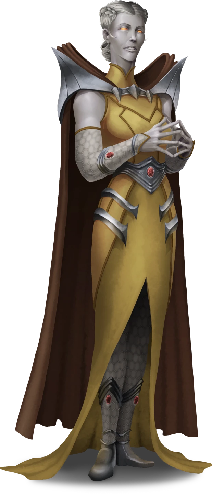
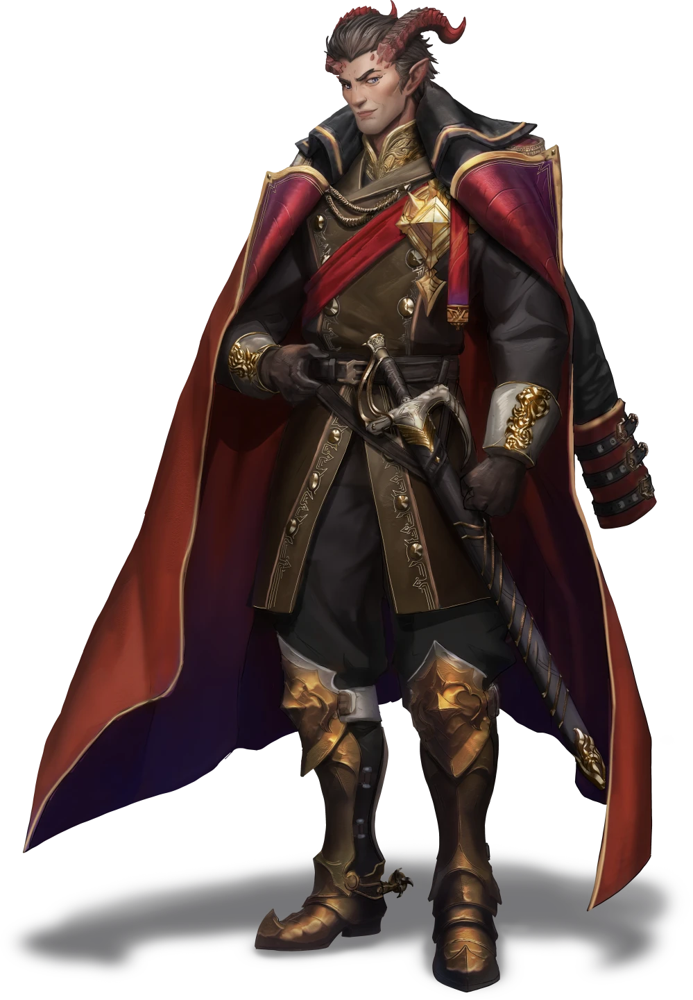

# Reuniting with Ankarist

> [!warning] Gamemaster
> #### Gamemaster's Summary
>
>  This Social Event occurs when the party arrives in the remote town of [[Skybrush]] on the heels of [[Ankarist]], who can only be found via his local contact — the pawn broker [[Liestra Grann]]. In this Event, the characters can:
>
>  - Encounter a local named **Mattock**, who can point the party towards Liestra Grann's shop, The Long Haul.
> - Meet Liestra and learn about her storied history with Ankarist.
> - Reconnect with Ankarist and learn about his discovery and exploration of [[Mythspire Observatory]].
> - Learn about local troubles in Skybrush which Ankarist suggests helping to resolve.
>
>  This Event occurs only if the party is not already traveling with Ankarist and later events in the quest have not already transpired. This Event is depicted using the [[Gloom]] Level of the [[Vista: Skybrush]] Vista.

 ### Local Rumors

 The party will need to find Liestra Grann if they hope to reconnect with Ankarist. Fortunately, the characters can seek help from warrior-turned-miner Mattock, even if no other townspeople are initially willing to help them.

 > [!info] Social
> #### Conversation with Mattock
>
>  Mattock can help point the party in the right direction, as well as provide them with a few basic rumors about Skybrush and other topics of interest.
>
>  **Mattock (Neutral Good, Lumek Fej, he/him)**
>
> This grizzled, scar-covered mine worker has seen more action than most of Skybrush. A retired warrior who decided to settle down in a foreign land, the stout-hearted Mattock is rather protective of this treetop hamlet he calls home.
>
>  Mattock is gracious with basic information, and is willing to discuss the following topics of conversation with the party:
>
>  - Liestra Grann and directions to her pawn shop, The Long Haul.
> - Ankarist passed through Skybrush several days ago, but Mattock hasn't seen him since.
> - A few basic details about Skybrush, including the name of his favorite watering hole, The Roost — where he's actually headed right now.
>
>  Any character who makes a successful **Deception (DC 13, Passive)** check is able to readily trust the veracity of Mattock's claims, and recognizes him as something of a local influencer in various regards.

 > [!question] Q&A
> **Q:** Liestra Grann?
>
> **A:**
>
> > Liestra, eh? Yeah, I know her … she runs the Long Haul over on the east side of town.
>
>  He turns and points.
>
>  > Head just up that way about a quarter of a mile. You can't miss the sign, unless you're blind. Now that I've done my good deed for the day, I'm gonna reward myself with a tasty beverage at the Roost. Best watering hole in town.
> >
> >  These days, it's the only watering hole in town.

 > [!question] Q&A
> **Q:** Ankarist?
>
> **A:**
>
> > The Drakon investigator? He arrived in town several days back, but I haven't seen hide nor horn of him since then. I thought he was here to help us with our local troubles, but I suppose he must have other business afoot.

 > [!question] Q&A
> **Q:** Local Troubles?
>
> **A:**
>
> > Murder. Messy at that. Kin turned on each other over dinner and the whole town is on edge. I'll not spread gossip on it, if you want more details you'll have to ask the constable, Mica.

 Any conversation with Mattock is likely to be brief, as he is intent to head onwards towards The Roost for refreshment.

 ### The Long Haul

 If the party follows Mattock's simple directions, they'll find their way soon enough to the front door of The Long Haul, a cluttered pawn shop that serves as Liestra Grann's place of business.

 > [!quote] Read Aloud
> You approach a round, two-story building bearing a finely painted sign that reads: "The Long Haul." Just through the doors you see rows of racks, floor to ceiling shelves, and display cases in between, all packed with items old and obscure. From art, to old tools, clothing, and odd pieces of decorated stone, the shelves hold something for everyone.
>
>  However, you aren't given much time to browse before you hear a voice call out:
>
>  > Welcome to The Long Haul. You buying or selling today?

 > [!abstract] Liestra Grann
> **[[Liestra Grann]]**
>
> Level 4 · Kivahr Thief
>
> 
>
> A muscular Kivahr femme clad in in loose layers of cloth and leather leans upon the wall with casual composure. A side-parted bob of tawny hair hangs just below her chin as she scrutinizes some curious trinket using a small eyepiece. A wry, expressive grin rises to meet you moments before she sizes you up with amber-colored eyes, and you can't help but spot a stony ersatz mace strapped to her side. It's quite evident she means business.

 Liestra is first and foremost a businesswoman, and an experienced one at that. The Long Haul caters to the locals of Skybrush with a variety of goods that have been accumulated over the years, and attracts outsiders from far afield in search of the rare [[Shent]] and [[Varún]] antiques that occasionally come through the area. The party may wish to survey the contents of Liestra's shop.

 > [!tip] Exploration
> #### Scanning the Long Haul
>
>  A successful **Awareness (DC 14)** check or having the **Knowledge: Artifacts** knowledge reveals that most of the free-standing items around the Long Haul are unremarkable, but practical, wares. A mix of salvaged and some newer-looking items. You do spot several intriguing artifacts around the store, most of which are secured behind a locked display case.
>
>  - A further **Society (DC 15)** check confirms that these items are of Shent origin, and their people populated this region in ancient times. Magically and technologically sophisticated, their relics and artifacts could certainly be valuable to collectors or researchers.

 When the party initially enters her shop, Liestra will steer conversation towards familiar topics like whether the party is in search of any wares, if they would like to trade, or the exchange of general rumors about Skybrush. At some point, however, the topic of Ankarist is likely to come up.

 > [!info] Social
> #### In Search of Ankarist
>
>  Liestra will demand they explain their relationship to the mysterious Drakon investigator. In truth, Liestra already knows of the party and was anticipating their arrival — she poses this challenge as a test to see how they react. Liestra initially feigns ignorance of Ankarist's identity or location.
>
>  Any character who makes a successful **Awareness (DC 15)** check suspects that Liestra has something to hide, and that her imposing physical frame does a fine job of masking her innate proclivity for subterfuge.
>
>  - **Knowledge: Intrigue**: The character gains **+2 Boons** on this check.
> - **Critical Success**: The character notices that Liestra tends to look towards her back room each time Ankarist's name is mentioned.

 After feigning ignorance of Ankarist at first, Liestra becomes satisfied by the party's explanations and will quickly step into the back room to fetch Ankarist himself.

 > [!quote] Read Aloud
> Without a word, the pawn broker steps into the back room for a split second before emerging with a familiar face in tow … none other than Ankarist himself, who seems to have been monitoring your exchange with Liestra from a position of secrecy. Liestra addresses you with an element of confession in her voice.
>
>  > It seems we have a friend in common …

 If the party is interested in learning more about how Ankarist and Liestra know each other, the pawnbroker has a story to tell.

  Liestra's Story If the party asks Liestra or Ankarist how they know each other, the Kivahr pawnbroker is happy to recount the tale of their meeting.

 > [!quote] Read Aloud
> > I met the good inspector in Ordain, got into a bit of trouble and needed a hand. Believe it or not, there was a time I was a somewhat accomplished burglar, despite this dainty frame of mine. But I also had a habit of working with some real scoundrels from time to time.
> >
> >  Thanks to Ankarist, I didn't have to serve a sentence meant for someone else.
>
>  Ankarist interrupts to clarify.
>
>  > You were still caught, weren't you? Word to the wise: don't steal something from the Lorando Collection without express permission. And don't get suckered by a syndicate of Rhivan thieves … you'll always get left behind.
> >
> >  I wouldn't call it the most auspicious beginning for a friendship, but I was glad to make sure you got a fair hearing.
>
>  Liestra grins, taking the story further:
>
>  > A lot more to it than that, Ankarist, and you know it. If you weren't a good man, you'd have taken that upstart merchant-lord's offer to look the other way while he killed me for breaking into his manor. I'm actually glad you caught me and took me to the Hallows. I wouldn't bet on most in the Chain being so upright as you.
>
>  Ankarist offers a faint, dissenting grumble but says nothing as Liestra wraps up:
>
>  > Anyway, after that I got out of Ordain, and ended up here in Skybrush. Been running this pawnshop for years now, and mostly deal in local artifacts found by Anachraenum passing through. Specialty is Shent artifacts, which I ship off to a couple collectors in the region. Those are my real money source these days, everything else is small time.
> >
> >  I've come a long way since my rough-and-tumble days in the streets of Ordain, that's for sure. But enough about me …

  Once the party has exchanged introductions, Liestra offers to withdraw and give them a chance to speak with Ankarist in private, if they prefer discretion.

 ### Ankarist's Updates

 > [!warning] Gamemaster
> #### Music: Ankarist's Theme
>
>  While Ankarist updates the party, play  **Music: Ankarist Theme**.

 > [!abstract] Ankarist
> **[[Ankarist]]**
>
> Level 2 · Drakon Veiled Chain Investigator
>
> 
>
> You observe a stern Drakon warrior with a determined expression and piercing golden eyes. Clad in leather armor reinforced with steel, his martial prowess is immediately apparent in the way he handles the hefty greatsword at his side — a hulking blade with a wide, flared tip. This two-handed brand is obviously venerated by the Drakon, who regards the blade with marked discipline. A cloak pin on his breast bears the symbol of the Veiled Chain, the city of Ordain's noble protectorate.

 > [!info] Social
> #### Catching Up with Ankarist
>
>  Not much has changed about Ankarist's stoic demeanor since last the characters saw him, but he is eager to share news of his activity since they parted ways:
>
>  - Ankarist traveled to Skybrush and obtained directions for how to find Mythspire Observatory from his friend Liestra Grann.
> - Ankarist searched out the location of Mythspire Observatory and investigated the ancient ruin, finding evidence that another group of adventurers had explored it recently, meeting with a gruesome fate.
> - Ankarist encountered a powerful and ancient guardian, seemingly mad and lashing out violently, which forced the investigator to withdraw.
> - Ankarist returned to Skybrush in search of backup, hoping to recruit Liestra or some other locals to help him. Unfortunately there are troubles in town that have the hamlet on edge.

 > [!question] Q&A
> **Q:** Did you find the Pathways?
>
> **A:**
>
> Ankarist grunts in frustration.
>
>  > No. Although I think I'm close. I got the information I needed from Liestra — there's rumor of an ancient path downwards through a ruin called Mythspire Observatory. I've already scouted it out, but I ran into some trouble there and had to come back to town.

 > [!question] Q&A
> **Q:** Mythspire Observatory?
>
> **A:**
>
> > An impressive structure, thousands of years old and still standing strong. It used to hold extensive machinery, I think it was perhaps a sort of orrery from which the ancient Shent studied the heavens.
> >
> >  There was trouble there, though. I discovered a band of adventurers who met a grisly end beneath the claws of a guardian who prowls the ruin. The creature seemed overtaken by some madness.
> >
> >  I need help to defeat or elude it so that I can explore the ruins in detail to find the means to descend into the Pathways, if such a route exists.

 > [!question] Q&A
> **Q:** Dead Adventurers?
>
> **A:**
>
> > Liestra mentioned that she helped outfit and direct a party of adventurers working on behalf of the Anachraenum. Regrettably, I found what remained of them — dismembered throughout the bottom-most level of Mythspire Observatory.
> >
> >  Most concerning of all, some of the bodies showed signs of unnatural reanimation. It appears that the guardian kept killing them until they had been sufficiently destroyed and couldn't rise any longer.

 > [!question] Q&A
> **Q:** Returning to Mythspire?
>
> **A:**
>
> > Yes, I need your help and would be grateful to receive it. Before we go, there are some recent troubles here in town to resolve. As you no doubt noticed, the locals are rather on edge. I've told Liestra I'm willing to help. She'll explain.
> >
> >  I am eager to return to Mythspire, but I wouldn't feel good about leaving Skybrush in its current state of unrest. Would you join me as I look into this concern in town? My plan was to begin investigation over at The Roost, a tavern and social hub. I expect the locals there will be willing to talk.

 > [!warning] Gamemaster
> #### Music: Default
>
>  Once the party has finished conversing with Ankarist, return to the default music:  **Music: Reset**

 ### Trouble in Skybrush

 Once the party is done conversing with Ankarist, Liestra rejoins the conversation and makes an appeal to the assembled group.

 > [!quote] Read Aloud
> > Ankarist, I know you've got business at Mythspire and you intend to return there, but I had hoped you might help our hamlet resolve its current troubles before leaving. I just don't like how messy things have gotten in town. The current chaos is bad for business and I don't like seeing the locals turning on each other. They're good people up here, and they might end up doing things they regret. I want things to go back to normal.
>
>  Ankarist lifts his hands in an acknowledging gesture. His expression conveys genuine care for a friend.
>
>  > I understand. You don't need to convince me, Liestra. Besides, on the way in I noticed things felt off. What can you tell us about the situation?
>
>  Liestra's shoulders relax, her relief palpable.
>
>  > Well, the short and long of it is that there's been some murders in the town. Nasty ones too. One of the victims was pregnant, which is just… awful. So, naturally everybody's up in arms and wanting justice.
> >
> >  You know, Ankarist, I'd wager that Constable Valaston could use the help of an actual Veiled Chain investigator. Poor bastard's barely holding things together right now.

 > [!info] Social
> #### Local Law
>
>  Characters with **Knowledge: Politics** suspect that the constable in a frontier town like this is capable of enforcing local law and dispensing justice, but perhaps out of their depth when it comes to a complex murder investigation.

 > [!question] Q&A
> **Q:** Where should we start looking?
>
> **A:**
>
> > I recommend talking to some of the other locals who probably know the latest news. I've been keeping busy here lately, so I don't know everything going on. You should swing by The Roost and talk to the regulars there, guaranteed well of gossip those bunch.
> >
> >  In fact, if you're sticking around, why don't we all head over to The Roost together? We can throw a few back and you can "interrogate" the locals!

 > [!warning] Gamemaster
> #### Changing Quests
>
>  After the party has met with Ankarist, they may choose to investigate the events of [[A Brush With Death]] at Liestra's request. This is a side quest set primarily within Skybrush which would begin with [[The Situation in Skybrush]], an event that will occur automatically if the party spends at least 1 hour in town.
>
>  #### Ankarist's Interest
>
>  Ankarist favors investigating local trouble first, as he does not like the idea of leaving a murder unsolved, especially if the locals need help which he can offer. Once the party has completed [[Delivered from Evil]], Ankarist would insist on delaying no further and recommends that the party proceed to Mythspire directly.

 ### Concluding the Event

 Once the party has concluded their discussion with Ankarist and Liestra, they may depart the Long Haul, either to investigate local troubles in Skybrush or to depart for Mythspire Observatory.

 > [!warning] Gamemaster
> #### Related Quests
>
>  Review the [[Changing Quests]] information presented previously for information about the recommended side-quest investigation that occurs in Skybrush.
>
>  If the party is not yet at least level 3, you may wish to strongly suggest the party investigate the [[A Brush With Death]] side quest so they are better prepared for the trials that await them.
>
>  #### Next Steps
>
>  Now that the party has reunited with Ankarist, the next step of this quest [[Guardian of Myth]] becomes accessible and the party may journey towards [[Area Overview]], located 6 miles northeast of Skybrush in ⬢ s.3195.2889.
