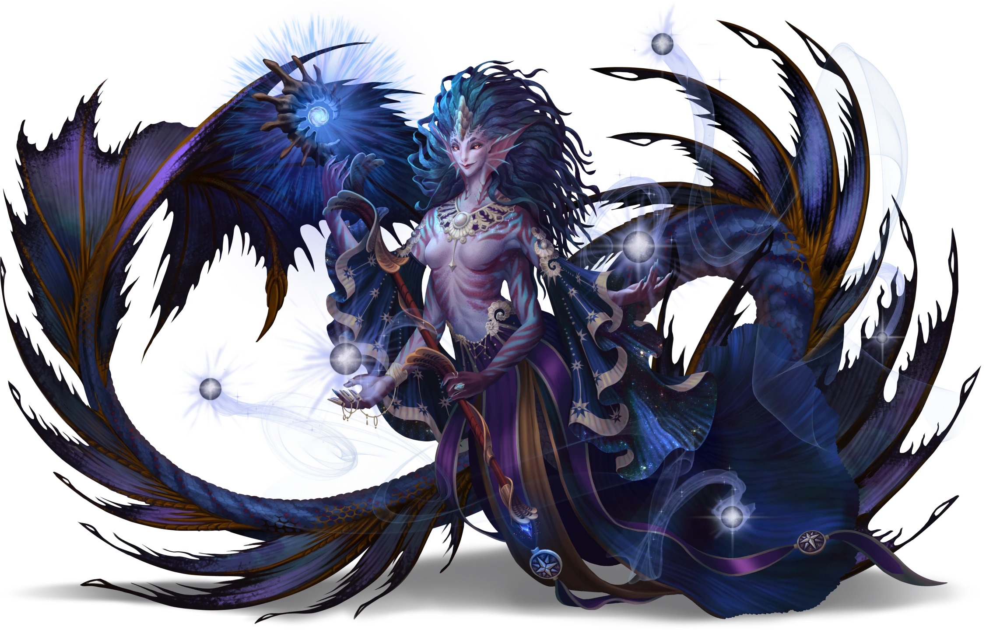
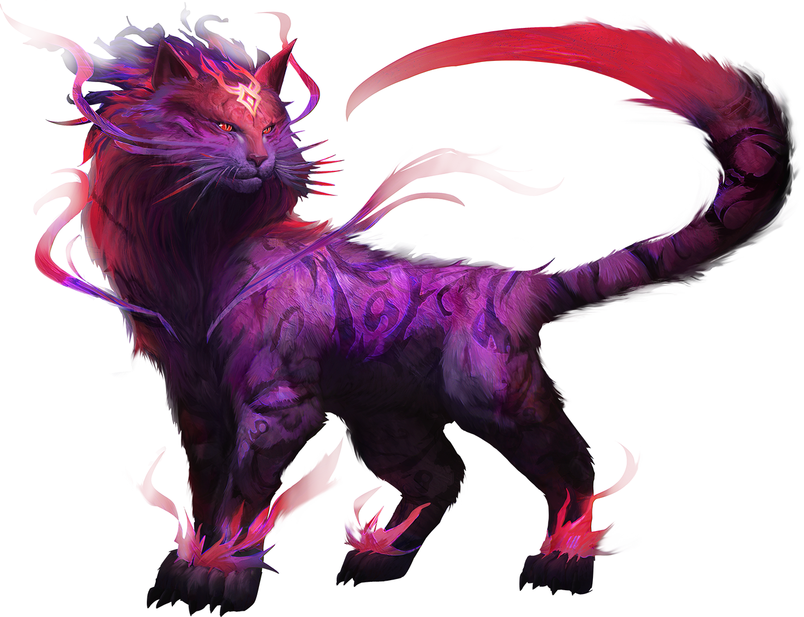

# Local Experts

> [!warning] Gamemaster
> #### Gamemaster's Summary
>
> This Exploration and Social Event occurs when the party arrives at the [[Arbore Sanctorus]] near the northern edge of the [[Bloodwoods]]. In this Event, the characters can:
>
> - Interact with [[Sanguinary Warden]] outside the Arbore Sanctorus, who are disguised as ordinary cats.
> - Speak with [[Nimaelle]], the [[Casia]] of [[Primordis]] who created the Bloodwoods.
> - Speak with [[Avwynn Taol]], the head of the Sanguinaries, and learn about her missing protege and the trouble brewing in the Bloodwoods.
> - Explore the sitting room of the Arbore Sanctorus.
>
> This Event is depicted using the [[Vista: Arbore Sanctorus]] Vista.

> [!tip] Exploration
> #### Examining the Arbore Sanctorus (Exterior)
>
> The bark footpath that spirals around the Arbore Sanctorus feels sturdy underfoot. Orbs of soft, magical blue light are positioned at regular intervals along the path to guide visitors' steps at night.
>
> It takes approximately 20 minutes to ascend or descend the Arbore Sanctorus via the footpath.
>
> Any character who makes a successful **`[[/skillCheck socety 15]]`** check recognizes the great tree as the Arbore Sanctorus, home of the Sanguinaries.
>
> - **Path: Cindaric Initiate**: The character gains **+2 Boons** on this check.
> - **Critical Success**: The character also recalls that the Arbore Sanctorus is not of Ember, but of [[Primordis]], planted in the aftermath of the [[Abyssal Shear]] to regrow and revitalize the area after it was devastated by Abyssal corruption.
>
> #### Interacting with the Cats
>
> The three cats at the base of the Arbore Sanctorus are actually [[Sanguinary Warden]] in disguise. The Wardens keep their distance, positioning themselves where they can see the footpath; they follow the characters from a respectable distance.
>
> A character who makes a successful **Deception (DC 15)** or **Awareness (DC 15)** check while observing the cats notices that they are watching them with more than simple animal curiosity. However, as is typical with shape-shifting, there is no way to discern the creatures' true identities. The Wardens do not reveal themselves under any circumstances unless the characters threaten to harm the Arbore Sanctorus.

Once the characters reach the top of Arbore Sanctorus, read or paraphrase the following:

> [!quote] Read Aloud
> The footpath ends at a broad landing carved into the pale trunk. The red canopy shifts overhead, close enough now to hear the creaking of upper branches.
>
> Before you stands a pair of tall doors grown shut inside an arch of gnarled bark. Upon your arrival, the grain of the wood begins to move. Knots in the wood form eyes, a split in the bark curls into a mouth — the doors morph into the shape of a face, old and severe. Moss has grown in the creases. The knot-eyes study you for a moment. Its mouth creaks open. The voice is low and ponderous. It releases a heavy sound like a sigh.
>
> > Visitors. Uninvited visitors.

> [!info] Social
> #### The Door to Arbore Sanctorus
>
> The face in the door does not open for the characters immediately. It watches them for a long moment, its knot-eyes shifting from face to face. When it speaks, its mouth opens with the slow creak of bending wood.
>
> > I am born from harm, but I am not the harm. I close what was rent apart, but I cannot make it whole. I mark what survives, and yet I may vanish. What am I?
>
> - The answer to the door's riddle is "**scar**," though the door accepts similar answers (such as "**scab**").
>
> If the characters answer correctly, the door returns to its dormant state, then peels apart, revealing the way inside.
>
> If the characters are unable to answer the riddle, a character can still convince the door to open by making a successful **Diplomacy (DC 20)** or **Society (DC 20)** check.
>
> - **Recognized the Arbore Sanctorus:** The character gains **+2 Boons** on this check if they succeeded on the check to examine the Arbore Sanctorus exterior, or already knew of its purpose.
> - **Disguised:** The character gains **+2 Boons** on this check if they are disguised as a Sanguinary.
> - **Name Drop:** The character gains **+2 Boons** on this check if they invoke Avwynn Taol's name.
>
> On a success, the door opens as described above. On a failure, the door remains shut. However, if the characters did not threaten or harm the cats outside, read or paraphrase the following:

> [!quote] Read Aloud
> One of the cats pads up the footpath and sits before the door, flicking its tail. It watches you for a moment, then rises onto its hind legs; in the space of a breath, its body lengthens to the height of a person, and its fur draws inward to reveal a Sanguinary acolyte, dressed in plain traveling clothes.
>
> The Sanguinary speaks a single word in Druidic. The old face in the tree recedes into the bark, its features vanishing back into the grain, and the doors begin to pull apart with a dry creak.
>
> The Sanguinary turns back to you and bows fractionally.
>
> > No one gets it on the first try. So long as you remain peaceful, you are welcome here.

> [!warning] Gamemaster
> #### Scene Transition
>
> Once the characters gain access to the Arbore Sanctorus, mark the Outcome below as complete; this will automatically transition the Scene to the [[Vista: Arbore Sanctorus]] Vista.

`[[/outcome entered]]`

## Entering the Sanctum

> [!quote] Read Aloud
> The doors open into a wide chamber carved from the interior of the great tree. A series of tall arched windows have been carved out of the outer wall, each one trellised by pale wood; beyond them, the canopy of the Bloodwoods hangs close enough to scrape the glass. Along the inner wall, bookshelves vanish into the dark bark, packed tight with scroll cases. The room smells of incense and candlewax.
>
> A woman in a white cloak stands to greet you, flanked by an enormous feline. It is the cat who speaks first.
>
> > Please, sit. You have come a long way.

> [!abstract] Avwynn Taol
> **[[Avwynn Taol]]**
>
> Level 12 (Boss) · Human Mystic
>
> 
>
> Tall, regal, and confident, this human woman carries herself with certainty and exudes a powerful confidence back with a steely, unwavering calm. Her icy blue eyes glimmer sharply against black sclera, betraying some hint of non-human ancestry, or perhaps magical twisting in her blood.

> [!abstract] Nimaelle
> **[[Nimaelle]]**
>
> Level 1 · Unknown Unknown
>
> 

> [!info] Social
> #### Conversation with the Sanguinaries
>
> [[Avwynn Taol]] and [[Nimaelle]] receive the characters politely, but do not treat them as trusted allies at first. Everyone in the Arbore Sanctorus is alert. Cats watch the party from shelves and window ledges.
>
> - If the characters **already** **met Avwynn** during the [[Corpin Arrival]] Event, she is warmer, but still guarded.
> - If [[Maevren]] is **accompanying the party**, she whispers a warning to one of the characters along the lines of, "Do not trust these sorcerers."
>
> Avwynn begins by asking what brought the characters to the Arbore Sanctorus. She is especially interested in the following topics:
>
> - What happened in Talei during the [[Ill Met in Talei]] Event.
> - Whether the characters examined the vendor or their magic.
> - What the characters believe is wrong with the ruby.
>
> Once the characters have explained themselves, Avwynn and Nimaelle can provide the following information:
>
> - **The Vendor's Magic:** The vendor's magic stems from Primordis, but it differs from the practices of the Sanguinaries. Nimaelle can identify a more specific source: a coalition of Casia known on Primordis as [[The Silent Pack]].
> - **Kyrban's Heresy:** Avwynn believes a former Sanguinary protege named [[Kyrban]] may be responsible for what has been happening. He recently claimed to have a divine vision about a stronger and more dangerous form of ruby, something that could "rescue the soul" from the dying [[Heart of Ember]]. Kyrban broke from the Sanguinaries and formed a rival sect in the Bloodwoods; Avwynn Taol refers to these followers as Doomsayers.
> - **Kyrban's Stronghold:** Avwynn believes Kyrban has hidden his stronghold somewhere in the Bloodwoods, but powerful magic obscures its location. The characters will have to seek it out on their own.
> - **The Unmarked Vespiary:** Sanguinary scouts have reported an unmarked vespiary to the southwest, a few miles from [[Lake Yrthain]]. The vespiary is of recent construction, and the amerasps have been unusually aggressive. Avwynn can provide the approximate location of this vespiary, which may contain evidence of how Kyrban is altering the ruby cycle.
> - **The Missing Sanguinary:** One of Avwynn's Sanguinaries — Cael, a [[Sanguinary Warden]] — has gone missing after returning to the unmarked vespiary; she is concerned that the missing Sanguinary may have been captured after getting too close to Kyrban's operation.
>
> Specific answers to likely questions are enumerated below this Social Block.
>
> #### Requesting Additional Aid
>
> Avwynn provides directions to the diseased hive freely. However, the Sanguinaries are not eager to arm strangers or send another of their order into danger.
>
> A character can convince Avwynn to provide additional aid by making a successful **Diplomacy (DC 18)** check. A character who lies convincingly can attempt a **Deception (DC 21)** check instead.
>
> - **Path: Cindaric Initiate**: The character gains **+2 Boons** on this check.
> - [[Corpin Arrival]]: The character gains **+2 Boons** on this check if they already met Avwynn Taol during the [[Corpin Arrival]] Main Quest.
>
> On a success, Avwynn provides the following aid:
>
> - One dose of [[Ruby]] for each character.
> - A [[Sanguinary Warden]] guide, who can lead the characters as far as the outer edge of the unmarked vespiary but will not enter it. This guide counts as a survival guide for the purposes of the [[Traversing the Bloodwoods]] Standalone Event.

> [!question] Q&A
> **Q:** Who is Kyrban?
>
> **A:**
>
> Avwynn's eyes turn toward the arched windows.
>
> > Kyrban was one of mine. A brilliant student, but possessed by a fierce … impatience. None of my answers were ever satisfactory for him. I suppose that is why he went looking for his own. He claimed Primordis had shown him a stronger form of ruby, something that would not merely protect us from the Bloodwoods, but rescue our very souls from being consumed by the Heart of Ember. A transformation into fey.
>
> Avwynn turns back toward you.
>
> > I banished Kyrban from the Arbore Sanctorus. In doing so, I fear I drove him into the arms of darker forces.

> [!question] Q&A
> **Q:** What is the Silent Pack?
>
> **A:**
>
> Nimaelle's words are punctuated with an occasional growl.
>
> > The Silent Pack are both one and many. They stalk the very heart of Primordis, and has done so since the dawn of creation. Hungering for mortal souls, their consciousness reaches ever outward, searching for prey … weak minds, like Kyrban's. It is imperative that their servants are destroyed wherever they are found. They will promise anything in exchange for a foothold on this world. Would you listen to their offer?

> [!question] Q&A
> **Q:** A missing Sanguinary?
>
> **A:**
>
> Avwynn speaks.
>
> > Though we leave the ruby cycle in the capable hands of Talei, we do occasionally patrol the vespiaries to ensure the absence of predators. During a patrol at the western edge of the forest, one of our Wardens, Cael, discovered a vespiary of new construction — one that Talei does not claim. The amerasps there were agitated and territorial, as if they had recently migrated. I commanded Cael to return to the remote grove and investigate further. They have not reported back.

> [!question] Q&A
> **Q:** Where did the Arbore Sanctorus come from?
>
> **A:**
>
> Nimaelle looks up into the pale branches above you, toward something in the sky that only she can see.
>
> > From Primordis. I stole away a seed from the First Forest and planted it here, within the scar rent by a terrible battle. I meant for the Arbore Sanctorus to close the wound. What do you think of my little forest?
>
> A nearly imperceptible purr stirs in Nimaelle's chest.

> [!tip] Exploration
> #### Surveying the Sanctuary
>
> The characters are not permitted to freely explore the Arbore Sanctorus during this Event. Avwynn is willing to receive them as guests, but not yet as allies with full access to the sanctuary. Before concluding the Event, the characters are permitted to take a &reference[Short Rest].
>
> Any character who studies the sitting room and makes a successful **Awareness (DC 15)** check can discern the following details:
>
> - Several cats linger throughout the chamber and along the branches outside — [[Sanguinary Warden]] in disguise.
> - The scroll cases along the bookshelves are marked with a subtle shorthand: some are maps of the Arctus Plateau, others are firsthand accounts of Sanguinary investigations. Avwynn does not permit the characters to touch the scroll cases, and the Sanguinary Wardens are prepared to detain anyone who would attempt to steal their hard-won knowledge.
>
> If the characters ask to explore the Arbore Sanctorus more fully, Avwynn politely refuses; she explains that the sanctuary is not closed to them forever, but with the threat of the Silent Pack lurking in the shadows, she would rather not expose the sanctuary to strangers.

### Maevren's Remarks

If the party has established a rapport with their guide [[Maevren]], she may have some valuable remarks to offer during a conversation about the encounter here.

> [!info] Social
> #### Conversation with Maevren
>
> This is Maevren's first visit to Arbore Sanctorus, a wondrous and mysterious place nearly mythical in status to the people of [[Talei]]. She is amazed by the artifice on display here, and finds both solace and camaraderie in the company of other strong women like Avwynn Taol — although she remains careful in the presence of new allies, and withholds her trust until it is earned. If the characters attempt to share a word with her about their visit here, Maevren is keen to oblige them.
>
> Topics that Maevren is willing to discuss at the moment include (but are not limited to) the following:
>
> - The nature of the Arbore Sanctorus and the Sanguinaries who live here.
> - [[Nimaelle]] and Avwynn's leadership.
> - The relationship between the [[Sanguinaries]] and the [[Cindaric Sages]].
> - The party's next steps.
>
> Questions Maevren might have for the characters themselves include:
>
> > I bear only casual suspicion about these Sanguinaries, but they seem to know what they're talking about. What do **you** think of this Avwynn and her casia patron?
>
> > Do you think this "Cael" fellow is still alive?
>
> > Shall we head west?
>
> Maevren has no reason to mislead or withhold information from the characters unless they've been duplicitous or antagonistic to her in the past. Any character with a `[[/skill insight 13 passive format=long]]` or who makes a successful **Deception (DC 11)** check can readily tell that the guide is being honest and forthcoming in her analysis of the encounter.

> [!question] Q&A
> **Q:** Arbore Sanctorus and the Sanguinaries?
>
> **A:**
>
> Maevren gazes upon the masterful craftsmanship on display here with an unmistakable look of wonder on her face.
>
> > In all my days, I've never seen something so … magnificent. No wonder the Sanguinaries never leave this place. It's incredible.
>
> An errant Sanguinary walks by, and Maevren regains her composure.
>
> > They've been a welcoming group, these Sanguinaries. And they seem to be straightforward enough. It's just … the people ofTalei didn't make it this long by being too gullible. I just want to make sure these new friends of ours are as honest as they seem.

> [!question] Q&A
> **Q:** Nimaelle and Avwynn's leadership?
>
> **A:**
>
> An expression of admiration crosses Maevren's face as she considers the Sanguinary leaders and their rather esoteric nature.
>
> > This Nimaelle character is a force to be reckoned with. I've never met a casia before. And Avwynn seems quite the capable leader for the other magic users here.
>
> She leans in to whisper under her breath.
>
> > I'd like to learn more about what goes on here when nobody's looking. But one thing's for sure: the Sanguinaries hate the Doomsayers as much — if not more — than we do. This might turn out to be a fruitful alliance for us all.

> [!question] Q&A
> **Q:** What about the Cindaric Sages?
>
> **A:**
>
> > Based on what I've seen, I'm not really sure why the Cindarics would take umbrage with the Sanguinaries to begin with. Their goals seem aligned to me. But religion is a strange and unpredictable creature, is it not?

If the party hasn't already stumbled upon the [[The Primordial Grove]] Event:

> [!question] Q&A
> **Q:** Next steps?
>
> **A:**
>
> > I think we should heed Avwynn's advice and seek out this grove to the west. Perhaps there we'll find the missing Sanguinary, and the answers we seek.

### Concluding the Event

> [!warning] Gamemaster
> #### Next Steps
>
> Once the party is ready to continue, they can seek out the unmarked vespiary, triggering the [[The Primordial Grove]] Event.
