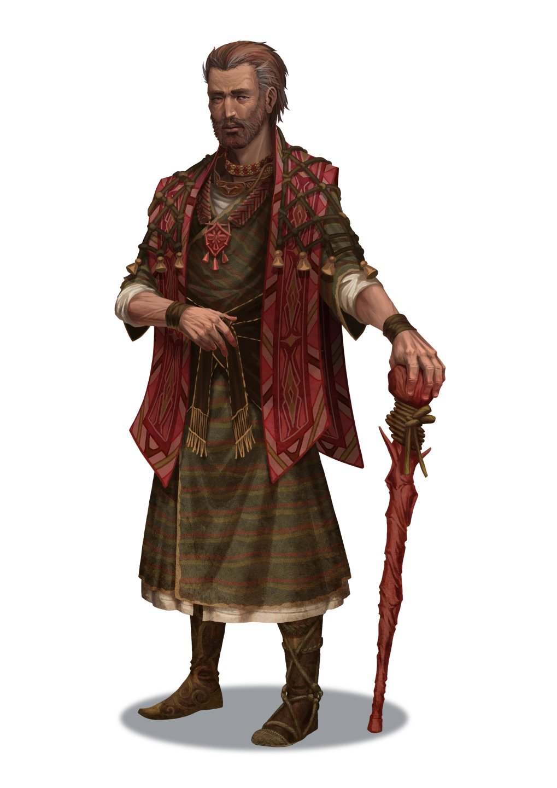
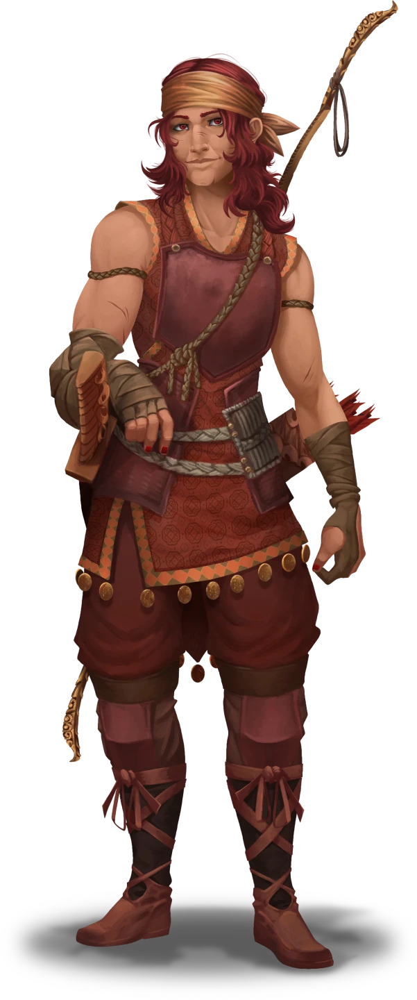

# Return to Talei

> [!warning] Gamemaster
> #### Gamemaster's Summary
>
> This Social Event occurs when the party journeys to [[Talei]] for the first time during Chapter 4. In this Event, the characters can:
>
> - Meet once more with [[Proctus Caylas]] to inform him about what transpired during their encounter with [[Kyrban]] and the [[Doomsayer Shadewright]] at [[Kadra Zann]].
> - Decide whether or not to return [[Hodge's Heirloom]] and potentially claim a reward for the effort.
> - Enjoy their time in Talei as saviors of the town's [[Ruby]] industry.
>
> This Event uses the [[Vista: Talei]] Vista.

### News for Proctus

Proctus is eager to hear about the party's exploits, and hopes for good news about their journey through the Bloodwoods (even though he most often expects it to be bad). He'll ask the characters about what happened, who and/or what was the cause, and what reports (if any) they have of the missing trapper named Hodge. With the proper answers at the ready, the characters can accept their just rewards from the Reeve and take their places as veritable heroes of Talei.

> [!abstract] Proctus Caylas
> **[[Proctus Caylas]]**
>
> Level 1 · Unknown Unknown
>
> 

> [!info] Social
> #### Reunited with Proctus
>
> Proctus is eager to discuss the following topics with the characters:
>
> - What happened to the party since their last visit to Talei.
> - Whether or not they have news of the origin of [[Queen's Ruby]].
> - What they've learned about the missing trapper named Hodge, whose disappearance has been a lingering concern for the Reeve and the local guild of trackers at [[Talei]].
>
> A successful **Deception (DC 16)** check is required to deceive Proctus about what happened at Kadra Zann, should the characters wish to lie to him for one reason or another.
>
> Once the party has recounted their tale of "what happened" at Kadra Zann and how it will impact Talei's ruby trade, Proctus presents them with a heavy leather pouch containing a  **500** and says the following:
>
> > It will take some time for us to recover from the scourge the so-called queen's ruby made by Kyrban and his Doomsayers. But the local coffers still have a bit of life in them yet. Please, take this as a token of our gratitude. And know that you are always welcome in Talei.
>
> The first character to make a successful **Diplomacy (DC 15)** check is able to convince Proctus to sweeten the deal by offering an additional  **100** and `[[/roll 2d3]]` doses of [[Ruby]] to the party for their achievements.
>
> #### The Trapper's Heirloom
>
> The party can return [[Hodge's Heirloom]] to Proctus for an additional reward: a [[Moon Ring]] that was intended to be a family gift for Hodge.
>
> For a full description of this interaction, consult the readalouds below.

If the characters present [[Hodge's Heirloom]] to Proctus with an explanation of what happened to Hodge at Kadra Zann, the Reeve accepts the heirloom with a mix of relief and resignation on his face. Check the appropriate outcome and read the following:

> [!quote] Read Aloud
> Proctus takes the heirloom and studies it with a brief look of sorrow on his face.
>
> > I had hoped young Hodge wasn't caught up in all of this. But trappers aren't expressly known for staying out of trouble.
>
> The Reeve reaches into the deep folds of his pockets and produces a silver ring set with a nacreous gemstone.
>
> > Hodge's family left this trinket in my stead, should someone deliver timely news of his fate. Given your relative experience with otherworldly places of the cosmos, it's only fitting that you should have it.

`[[/outcome returned]]`

#### Akon Attunement: Heirloom Returned

If the party returns Hodge's Heirloom to Proctus, each character advances their **Attunement: Akon (+1)** at the conclusion of the Event.

If the characters withhold the heirloom from Proctus (whether or not they tell the truth about what happened), check the appropriate outcome and read the following:

> [!quote] Read Aloud
> Proctus regards you with a look of resignation and lets out a heavy sigh.
>
> > Well … as they say, hope springs eternal. Perhaps Hodge's family can hold onto theirs for a bit longer.
>
> The Reeve absentmindedly raps his fingertips upon the knobbed handle of his cane, briefly swept away by the contemplation of this unfinished business.

`[[/outcome withheld]]`

#### Aura Attunement: Heirloom Withheld

If the party deliberately keeps Hodge's Heirloom in their possession, each character advances their **Attunement: Aura (+1)** at the conclusion of the Event.

### A Goodbye from Maevren

With the business of Talei's liberation from Kyrban and the Doomsayers settled, there's nothing left but one last goodbye with the party's newfound ally Maevren.

> [!abstract] Maevren
> **[[Maevren]]**
>
> Level 1 · Unknown Unknown
>
> 

> [!info] Social
> #### Conversation with Maevren
>
> Depending on how their journey through the Bloodwoods went, the party's interactions with Maevren could result in any number of different types of relationships. If Maevren and the characters separate on good terms, she is eager to mention the following as the party is saying their proverbial goodbyes:
>
> - Maevren's need to get back to her duties as a tracker with Talei's local guild.
> - Remarks of support if the party returned Hodge's Heirloom to Proctus, and casual remarks of disappointment or condemnation if they kept it.
> - The party's next steps for adventure in the Arctus Plateau.
> - The benefits of ridding The Bloodwoods of Kyrban and the Doomsayer scourge.
> - The lingering threat of [[The Silent Pack]] (if she became aware of their otherworldly influence during the quest).
> - An open invitation to return to Talei for a visit, and perhaps join the ranks of the hunters and trackers of [[Talei]].

### Concluding the Event

> [!warning] Gamemaster
> #### Next Steps
>
> If they have yet to do so, the party can take another trip to the [[Arbore Sanctorus]] to share tale of their exploits with [[Nimaelle]] and [[Avwynn Taol]], who may present the characters with a reward for their efforts.
