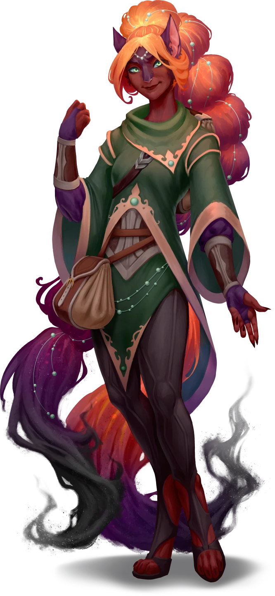

# Blasted Books

> [!warning] Gamemaster
> #### Gamemaster's Summary
>
> This Social Event takes place on the Region Map, and can occur in any Location with a notable library, or places populated and developed enough to reasonably contain a library. By helping douse the flames on [[Kess the Firemage]] then speaking with her, the characters can:
>
> - Rescue Kess's research, and acquire a portion of it for themselves in the future.
> - Learn about the [[Caryx Savanna]] Biome, and its strangely unstable seasons.
> - Take on a job to explore the [[Tomb of the Unifiers]] and retrieve an ancient [[Sedyri]] artifact for Kess the Firemage.

### Dousing the Fire

The flaming woman, Kess the Firemage, is urgently concerned … more for her books than her own safety! Read or paraphrase the following:

> [!quote] Read Aloud
> The burning Kiska shouts to you:
>
> > Please! My research! The books! They're irreplaceable! Please, save the books!
>
> The fire, meanwhile, continues to crawl up the woman's body … though strangely, anywhere she fixes her gaze, her auburn fur refuses to burn. Still — as if her focus cannot keep up with the flame — the rest of her fur sizzles, its ends turning first bright orange, then black.

> [!abstract] Kess the Firemage
> **[[Kess the Firemage]]**
>
> Level 1 · Unknown Unknown
>
> 

> [!tip] Exploration
> #### A Burning Need
>
> The party may attempt to save Kess and/or her books from the flames:
>
> - If no party members attempt (and succeed) on a strategy to save the books, they burn up. At least one party member must succeed on their *first* attempt — otherwise, the books have already burned away.
> - If no party members succeed in dousing the flames on Kess, the Kiska takes damage, but eventually employs her mastery of fire magic to squelch the flames on herself.
>
> Each party member who makes either a successful **Athletics (DC 16)** check or [/skillCheck wilderness 14]] check can leverage either their manual dexterity or mastery of the elements (respectively) to douse the flames on their choice of *either* Kess's books or the fire that climbs Kess herself.
>
> Alternatively, party members may attempt to douse the flames by magical means. Spellcasters who know [[Unknown]]] and who make a successful **Arcana (DC 16)** check can squelch the flames on either the books or Kess.
>
> Attempts to douse the flames with water (via magic or otherwise) can put out the flames on both without a check, but the water ruins the books in the process.

If the party saved Kess's books, mark the following Event Outcome — they will be rewarded for having done so during [[Summoning the Spark]].

`[[/outcome saved]]`

### A Quest for Kess

> [!warning] Gamemaster
> #### A Fiery Spirit
>
> As the party speaks to Kess, players may wish to urge Kess caution, or introduce doubt as to whether she is knows what she is doing in exploring ancient Sedyri magic. They would be correct to do so — the ritual Kess intends to use has a water-based counterpart known as the "Ripple of the Rivers" that is necessary for it to function properly, as will be later revealed in [[Flash of Insight]].
>
> However, for the purposes of the Quest, Kess can neither be deterred nor convinced to slow down and investigate what she may be missing. If necessary to explain her refusal, take advantage of Kess's strong-willed (and incautious) personality. She truly believes this needs to happen for the safety of the Savanna, and that she is capable of handling it.

Party Saved Kess's booksIf the players successfully saved the books, read or paraphrase the following. Optionally, you may modify the narration to reflect any damage done to Kess.

> [!quote] Read Aloud
> The singed Kiska seems surprisingly bright, despite the flames that wreathed her only moments ago — as if she were used to such mishaps. She opens one of the books and displays it with infectious excitement.
>
> > Thank you **so** much, you have no idea how important what you just did was. Look!
>
> The page she shows you is curled and blackened … except for a single point in the middle of what looks like it was once a map.
>
> > It's an ancient Sedyri technique for hiding information. Burn the page, and only the important bit remains! This artifact had … a bit more arcane energy stored in it than I expected, hence the … accidental fireball, whoops. But … it **worked!** The location of the Tomb of the Unifiers! Finally! Now if only I can find some adventurers to delve into it …

Party Failed to Save Kess's BooksIf the players did not save the books, read or paraphrase the following. Optionally, you may modify the narration to reflect any damage done to Kess.

> [!quote] Read Aloud
> The singed Kiska looks on at the wreckage of her books with despair, before her eyes widen with excitement as she notices a single, pale beige circle among the pulp and ashes. She reaches a hand into the pile and retrieves tiny intact slip.
>
> > It **worked!** All my research and translation books are gone, but even still … it **worked!**
>
> She holds out the slip of paper towards you. Best you can tell, it shows a single point on what was once a larger map.
>
> > It's an ancient Sedyri technique for hiding information. Burn the page, and only the important bit remains! This artifact had … a bit more arcane energy stored in it than I expected, hence the … accidental fireball, whoops. But … it **worked!** The location of the Tomb of the Unifiers! Finally! Now if only I can find some adventurers to delve into it …

> [!tip] Exploration
> #### Background Research
>
> Any character who makes a successful **`[[/skillCheck crucible 14]]`** check is familiar with the [[Sedyri]] — an ancient culture of [[Ashka]] known for there superb craftsmanship and powerful magic, and for idolizing contradiction and contrasts. After the Shattering, they were decimated, and spread into a diaspora before being subsumed completely into other cultures — their secrets and techniques lost to time.
>
> - **Knowledge: Ancients**: The character gains **+2 Boons** on this check.
> - **Knowledge: Legends**: The character gains **+2 Boons** on this check.
> - **Critical Success**: The character has also heard of the Unifiers: a group of diasporic Sedyri mage-priests who resided in the Caryx Savanna on the Arctus Plateau, and are said to have unified and tamed the Savanna's dangerous and unstable seasons of fire and flood.

> [!info] Social
> #### Seasons' Greetings
>
> Kess the Firemage wishes the party to meet her at the [[Tomb of the Unifiers]] in the north of the Caryx Savanna, and help her delve into the dangerous ruins of the Tomb of the Unifiers and retrieve the [[Vessel of the Spark]], an ancient Sedyri artifact that she believes will help her control the Savanna's dangerous fire season. After asking the party for help, she will eagerly discuss the following topics:
>
> - Kess has a natural affinity for fire magic, and wants to use it to protect her home of Tajar from the Caryx Savanna's dangerous fire season.
> - The Caryx Savanna is heavily affected by the moons of [[Ragen]] and [[Mayis]], causing seasons of incredibly destructive fire and flood as each moon reaches its zenith.
> - Kess believes lost Sedyri magic will let her protect her home from the fires:
>   - Thousands of years ago, the Savanna was inhabited by the remnants of the Sedyri, an ancient culture of master craftspeople and practitioners of lost magic.
>   - Kess believes that by using an ancient Sedyri ritual to summon the Spark of the Savanna, she can control the dangerous fire-weather of the Caryx Savanna.
>   - Kess's research indicates the Tomb of the Unifiers should have the artifact she needs, but it is too dangerous to delve into on her own.
>
> Specific dialogue for Kess on the above topics can be found immediately below this block.
>
> Any character who makes a successful **Diplomacy (DC 12)** check determines Kess is being entirely open and honest — though seems to get carried away in her own excitement.
>
> #### Token Payment
>
> Given this is a project the young mage has undertaken entirely on her own, she has little to offer in exchange for completing the task — only a simple  **5** payment. However, in addition, she notes that the Tomb of the Unifiers might contain powerful Sedyri artifacts, and the party is welcome to keep anything they find other than the Vessel of the Spark.

> [!question] Q&A
> **Q:** About Kess?
>
> **A:**
>
> > I'm a firemage — always have been. Even as a kid, it came totally natural to me. My moms said they caught me making sparks with my fingers at just five years old!
>
> She snaps, and a flame sparks to life demonstratively.
>
> > It's a dangerous power to have in the Caryx Savanna, which is basically a giant tinderbox during the fire season. But I've always wanted to use it for good! A decade ago, half my home city of Tajar was wiped out in a wildfire known as the Great Burning. My moms and I lost our home. Ever since then, I've been trying to figure out how to use fire magic to **protect** the Savanna. And with the Vessel of the Spark … I think I'll finally be able to!

> [!question] Q&A
> **Q:** About the Caryx Savanna?
>
> **A:**
>
> > My home. Beautiful grasslands from horizon-to-horizon, full of beasts wonderful and terrifying. But also … a hard to place to live. As the moon of Ragen waxes and wanes, unstoppable firestorms and wildfires tear across the plains. Then, when Mayis lifts overhead, the rivers and seas rise to swallow us, while the rains drown us from above.
> >
> > The Flamewardens do their best to protect us from the fires, and some people — like the acolytes of the storm god Katu — even worship the chaos, but …
> >
> > … half my home city of Tajar went up in the Great Burning, then flooded once we gave up on holding back the water there. I can't do anything about the tides, but with the help of an ancient Sedyri ritual, I think I can use my magic to hold back the fires!

> [!question] Q&A
> **Q:** About the Vessel of the Spark / Tomb of the Unifiers?
>
> **A:**
>
> > The Tomb of the Unifiers is said to contain an ancient Sedyri artifact known as the Vessel of the Spark — a magical Cinderspar bowl that I think inspired the candle bowls some Tajarins keep in their houses today! Wait, wait— I'm getting ahead of myself!
> >
> > Many thousands of years ago, long before the Shattering, the Savanna was inhabited by a culture known as the Sedyri — master craftspeople and practitioners of lost magic. It was said that a few survivors returned after the events of the Shattering, clinging to lost traditions, and that their mage-priests, known as "Unifiers," both created and controlled the flames and floods of the Savanna's seasons!
> >
> > I believe the Vessel is part of the summoning ritual for what I've … maybe somewhat poetically translated to Coin as the "Spark of the Savanna." The Sedyri books I've dug up say that whoever holds the Spark can control the fire season like the Unifiers once did.
> >
> > The Tomb is said to be dangerous and trapped and all that stuff, so I'm a bit worried I won't make it through without some seasoned adventurers. But if the Vessel will really let me protect my home from the fires that once burned half of it down … don't I have to try?!

If the party agrees to meet Kess at the Tomb of the Unifiers and help her retrieve the Vessel of the Spark, read of paraphrase the following:

> [!quote] Read Aloud
> Not only do the Kiska's eyes alight with excitement, but a literal shower of sparks fizz off of her hands as she waves them animatedly and bounces on her toes.
>
> > **Amazing!** Thank you **so** much, I promise you, it's going to make **such** a big difference for the people of Tajar, and for the whole Caryx Savanna. I'm gonna go straight to the Tomb and make camp, but I still have a bunch of preparation to do for the summoning ritual, so take your time, and I'll be there when you're ready. Really, I can't thank you enough for this!!

### Concluding the Event

> [!warning] Gamemaster
> #### Next Steps
>
> Once the party has finished speaking with Kess, they can reunite with the firemage at the [[Tomb of the Unifiers]] — located in the [[Caryx Savanna]] — at any time, and undertake [[Summoning the Spark]].
