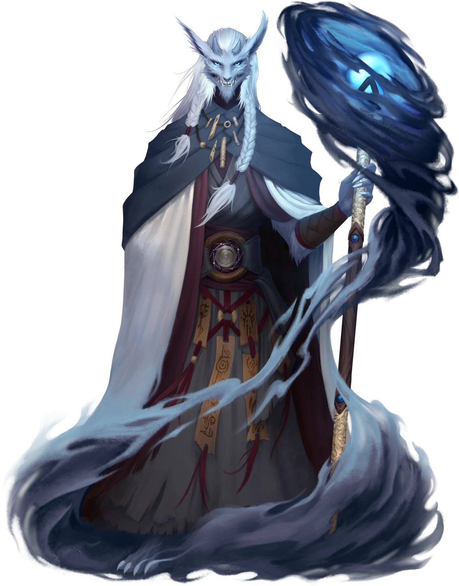

# Eye of the Storm

> [!warning] Gamemaster
> #### Gamemaster's Summary
>
> This Social Event occurs when the party visits the [[Katino Shrine]] after completing [[Flash of Insight]]. By speaking with [[Sorak the Stormheart]], the characters can:
>
> - Learn about [[Katu]], the Acolytes of the Tempest, and the increasing threat posed by the destabilized waters of the Caryx Savanna.
> - Take a job to rescue the trapped acolyte [[Fesira Inari]] to win Sorak's trust and gain his assistance piercing the dome of flame around the [[Citadel of Fire]].
>
> This Event is depicted using the [[Katino Shrine]] Level of the [[Vista: Caryx Savanna]] Vista.

### Meeting Sorak the Stormheart

As the party approaches, Sorak the Stormheart is bellowing to the sky, berating his god Katu and demanding his assistance in protecting the Savanna — he is not happy to be interrupted, though tries to restrain himself. Read or paraphrase the following:

> [!quote] Read Aloud
> As you trudge closer, the shouts resolve into a string of furious, bellowing demands.
>
> > KATU, YOU COWARD! SHOW YOURSELF! ATTEND TO YOUR ACOLYTES! THE GRASSES BURN AND THE LAKES BOIL! IS **THIS** HOW YOU THANK MORTALS FOR THEIR DEVOTION?!
>
> Only then does towering seven-foot Wirrun finally notice you, turning his icy blue stare in your direction, wind and water still whipping around him. For a moment, it seems as if he will tear into you with the same ferocity … but the Stormheart closes his eyes, takes a single, slow breath, then fixes his gaze on you again, the winds stilling with his mood. His tone is low and flat — the product of unbelievable restraint.
>
> > Heed this, strangers: few have stood between myself and my god and survived intact. For **what** reason have you disturbed me?

> [!abstract] Sorak the Stormheart
> **[[Sorak the Stormheart]]**
>
> Level 1 · Unknown Unknown
>
> 

After the party explains their purpose — assuming they convey the request of [[Vekaris Ossa]] to help with accessing the citadel — Katu snaps back dismissively. Read or paraphrase the following, keeping in mind that if the party their involvement with Kess's ritual, Sorak adds an accusation of their culpability in this disaster to his list of reasons for mistrusting the party:

> [!quote] Read Aloud
> The Wirrun snorts, nostrils flaring.
>
> > You make assume much and know little, strangers. Here I stand, pleading Katu's aid in dousing the wildfires that ravage the Savanna … and to **NO AVAIL**, I **must** add!
>
> …he shouts, glancing momentarily to the sky, then back at you.
>
> > And you all dare ask more of me? You, who I do not know? Do not trust? Ha! Even to allow you access to such a site of such great power …
>
> He closes his eyes for a moment, considering.
>
> > Still … it seems probable that confronting what waits within will be necessary to ending this foul fireplague. Here is what I will do:
> >
> > I will go to the citadel. I will call upon Katu — who will **LISTEN,** for once! — and work to bring down this wall of fire. You, meanwhile, will prove your worth. As these fires began to anger the waters, the rivers and lakes rose, trapping an Acolyte initiate in the ruins of an ancient Sedyri temple, sodden with enraged water elementals. Attempt a rescue, and perhaps I will trust you enough to take you with me when I enter the citadel myself. Do you believe yourselves capable of such a task?

> [!info] Social
> #### Against the Tides
>
> Sorak wishes the party to delve into the [[Temple of the Tides]] and rescue [[Fesira Inari]], a young Kiska initiate of the Acolytes of the Tempest, a task for which he offers [[Eye of the Storm]]. To this end, Sorak will impatiently discuss:
>
> - Fesira went to the temple to investigate Sedyri water magic, and upon finding herself trapped and hunted, scryed Sorak … but hasn't been heard from since.
> - The temple was built by the Sedyri to honor the waters, and was originally fully submerged, but the lake receded — until enraged water elementals have lifted its waters.
> - Sorak knows little of the Ripple of the Rivers and cares not for Sedyri magic, but Fesira was obsessed, and was visiting the temple to investigate.
>
> Any character who makes a successful **`[[/skill diplomacy 13]]`** check determines that Sorak is being honest with the party — if anything, he is restraining his even deeper anger and mistrust for the the party's own protection.
>
> #### Payment in Coin and Trinkets
>
> Sorak sees little value in money or magical items — believing, above all else, in the value of a person's inner strength — but as such easily parts with them, and believes (scornfully) adventurers value such trivialities. To this end, he offers  **50** and a [[Talisman of the Storms]] if they rescue Fesira and meet him at the wall of flame that blocks the plateau below the citadel on Mount Sitara.

> [!question] Q&A
> **Q:** About the initiate?
>
> **A:**
>
> > Young, headstrong, and skilled beyond her years — like many of the Acolytes. Fesira's been investigating that decrepit temple for months, convinced she can master ancient Sedyri magic that would allow her to rival even Katu's power over the waters.
> >
> > When these blasted fires upset the Savanna's water spirits, the temple flooded, and she contacted me via scrying, explaining that she was trapped in the temple's bowels and being hunted by a terrible creature of water and scales. I have not heard from her since.
> >
> > While I wish to go to her aid, these fires threaten to the lives of more than just a single initiate; and there is no one else with even the slightest chance of enlisting Katu's aid in beating them back — which he **WILL ATTEND TO!**

> [!question] Q&A
> **Q:** About the Temple of the Tides?
>
> **A:**
>
> > Sedyri nonsense. They say when it was built, it stood dry in the fire season, and fully submerged as Mayis rose overhead. Nowadays, the lake lies lower, but these twice-damned wildfires have enraged the Savanna's dormant water elementals, and the lakes and rivers are rising apace. You'll have to descend into the depths of Lake Pihir — I will grant you Katu's blessing, such that you may breathe its waters like air.

> [!question] Q&A
> **Q:** About the Ripple of the Rivers?
>
> **A:**
>
> > I care not for Sedyri magic — Katu alone demonstrates the power any mortal can attain, and through him, all I care to do is possible. Fesira though, believes otherwise, and to each acolyte their own. She believes the secrets lie in the temple's inscriptions, as well as scraps of her own research that the young Kiska has guarded jealously, as our kind are wont to do. Speak to her of it when you've rescued her — if you prove able, that is.

If the party agrees to his task, before the party leaves, Sorak provides additional aid for their journey into the Temple of the Tides. Read or paraphrase the following:

> [!quote] Read Aloud
> > Now, with the entire temple is now submerged the lake, I imagine the uninitiated such as yourselves will need some additional aid to have a chance of rescuing Fesira.
> >
> > First, I bestow upon you a blessing of Katu.
>
> His hands swirl in circling gestures, and wind whirls around each of you.
>
> > For the next week, you may breathe water as easily as air, swim like a fish, and speak telepathically with each other while submersed in water. If you dally in the task before you, you must meet me at Mount Sitara to renew the blessing. As an Ashka, Fesira may breathe the water herself for a limited time, but I cannot grant this blessing from afar. If her own capacity fails her, she spoke of plant life in the temple that captures oxygen — you will need to make use of that.
> >
> > Finally, a mundane necessity for every Acolyte of the Tempest: waterproof leathers. Enclose your most delicate items in these satchels, lest submersion disintegrate them like ships in a storm.

Drag the following onto party members' Actors:

- The [[Unknown]] onto each party member.
- A [[Waterproof Leather Satchel]] into the inventory of each party member.

If the party arrives to Mount Sitara without having completed [[Tidebound Temple]], while no specific Event will trigger, Sorak waits there, beseeching Katu, and can renew the blessing as needed.

Afterward, Sorak urges them on their way:

> [!quote] Read Aloud
> > Go. **Now.** Save the little one, then meet me on Mount Sitara, southeast of that forsaken citadel. We shall see if you are worthy.

### Concluding the Event

> [!warning] Gamemaster
> #### Next Steps
>
> Once the party has finished speaking with Sorak:
>
> - They must journey onward to the [[Temple of the Tides]] and rescue the initiate [[Fesira Inari]] during [[Tidebound Temple]] .
> - They may be ambushed by enraged water elementals during [[Rising Tides]].
