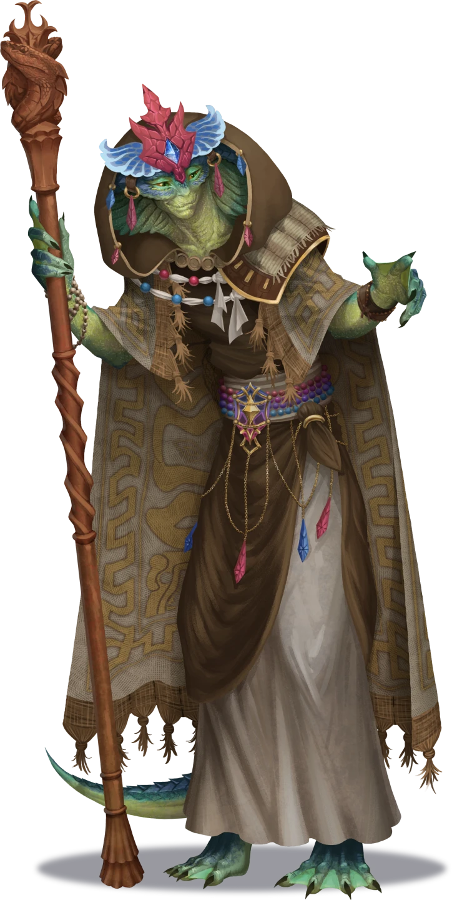

# Flash of Insight

> [!warning] Gamemaster
> #### Gamemaster's Summary
>
> This Social and Exploration Event occurs in the [[Communal Quarter]] of Tajar after the party completes [[Firewalled]] or [[Trial by Fire]]. By visting the city of Tajar in the aftermath of an attack by Abyssal fire elementals, the characters can:
>
> - Reunite with [[Flamewarden Tiga]], if the party is not traveling with her.
> - Meet with [[Vekaris Ossa]], matriarch of Tajar, and learn how Kess's ritual went wrong.
> - Take a job for Vekaris to seek the aid of [[Sorak the Stormheart]], a powerful acolyte of the storm god [[Katu]].
> - Pitch in to the collective effort to help Tajar recover from the attack.
>
> This Event is depicted using the [[Vista: Tajar]] Vista.

### Entering Tajar

The party's entrance into Tajar depends on whether they are accompanied by [[Flamewarden Tiga]].

Party Traveling with TigaIf the party is traveling with Flamewarden Tiga, she reacts strongly to the sight of Tajar burning, and guides them into the city. Read or paraphrase the following:

> [!quote] Read Aloud
> Witnessing the sight of Tajar burning, Tiga cries out in distress.
>
> > No. **No!** Not again. First the Great Burning, and now … by the seasons, not again …

Party not Traveling with TigaIf the party is **not** traveling with Flamewarden Tiga, they encounter her entering Tajar through another road before witnessing the same reaction. Read or paraphrase the following:

> [!quote] Read Aloud
> As the roads into Tajar join together, you come across Flamewarden Tiga, her face stricken with grief, and the calm which you remember from her missing entirely.
>
> > No. **No!** Not again. First the Great Burning, and now … by the seasons, not again …

Regardless, afterward, Tiga speaks with a Flamewarden and retells what she learned:

> [!quote] Read Aloud
> Tiga hurries your pace into the city, and flags down another Flamewarden wearing her same colors. After a brief exchange, Tiga turns back towards you.
>
> > This wasn't just a fire. Itwas an **attack.** They seemed like fire elementals but … unlike any that have visited the Savanna before, even during Ragen's zenith. Their flames burned violet, and they attacked on sight. Something is **very** wrong here.
>
> Tiga looks out over the wreckage. Buildings reduced to skeletons of pale-brown fireproof stone, the rest of the edifice burned away, like the skin of the Tajarins that stumble wounded through streets. Tiga exhales sharply.
>
> > I want to stay and help, but … if we don't fix the root cause, this could just happen again. We need to get to Vekaris. Gather any information you think may be pertinent, then follow me.

The party may take a moment to inspect the smoldering wreckage for clues, if they so choose.

### Clues in the Wreckage

Citizens asked about what happened here will explain that dozens of purple fire-creatures manifested spontaneously and ravaged the city before the Flamewardens beat them back. Additionally, some can be convinced to share more.

> [!info] Social
> #### Peering into the Void
>
> Any character who makes a successful **Diplomacy (DC 12)** check notices that some citizens appear nervous, as if holding something back about what happened during the fire.
>
> Any character aware of this and who succeeds on a further successful **Diplomacy (DC 14)** check can convince the citizens to reveal that some people — who had been burned by the strange violet fire — became enraged, spiteful, or even jealous, and turned on their fellow Tajarins, leaving them to suffer over petty grievances. Those who behaved this way are now embarrassed about it, and do not understand why they did.

Between the stone pavilions and rocky skeletons of buildings lie patches of smoldering embers, where once grew foliage, or sat rooftops made of straw. Those who inspect them may discover the Abyssal nature of the attackers.

> [!tip] Exploration
> #### The Void Stares Back
>
> Any character with **Arcana (DC 14, Passive)** notices a tinge of Abyssal energy to the smoldering embers, suggesting that whoever or whatever set the fires were not simple fire elementals from [[Ragen]] — whatever they were, they were clearly connected to The Abyss.
>
> - **Attunement: The Abyss**: The character automatically succeeds on this check.
> - **Knowledge: Abyssals**: The character gains **+2 Boons** on this check.
>
> Any character made aware of this fact and who makes a successful **Arcana (DC 16)** or **Science (DC 16)** check recalls that the Wild God Fiyara was once the Elemental Sovereign of Ragen, but became corrupted by The Abyss and was deposed — making her influence a likely candidate for anything involving Abyss-tinged fire elementals.
>
> - **Knowledge: Gods**: The character gains **+2 Boons** on this check.

### Meeting with Vekaris

Vekaris Ossa, matriarch and leader of Tajar's governing council of Wise-Women, immediately makes time to listen to the party's story. Afterward, she asks them to beseech the aid of [[Sorak the Stormheart]] in order to penetrate the [[Citadel of Fire]] and restore balance to the Savanna.

> [!warning] Gamemaster
> #### Portrait Reveal: Vekaris Ossa
>
> Vekaris begins **Hidden** in the Scene. When you are ready for Vekaris to appear, right click her Token to open the Token HUD, and click **Show** .

> [!abstract] Vekaris Ossa
> **[[Vekaris Ossa]]**
>
> Level 1 · Unknown Unknown
>
> 

> [!quote] Read Aloud
> When you finally find Vekaris, the matriarch of Tajar is comforting a badly burned young Ashka, before guiding the boy to a Flamewarden medic. Afterward, she spots Tiga, and the matriarch turns to your group with a tilt of her head. Tiga speaks first:
>
> > Matriarch, I know you're shouldering many responsibilities, but I must request your immediate attention. I believe my compatriots and I have critical information about the source of this devastation.
>
> Despite the furor around you, Vekaris' creaky old voice is calm and patient.
>
> > I trust your judgement, young one. Speak, and I will listen.
>
> Tiga turns towards you all as she replies.
>
> > I'll report my findings from the citadel in a moment, matriarch, but first, I believe these adventurers have crucial insight. Please, share what you witnessed, and what you've learned?

Vekaris listens patiently to the party's explanation of their observations, and any potential connections the party has drawn.

> [!warning] Gamemaster
> #### Guiding the Investigation
>
> As the players share what they have learned, you are welcome to have Vekaris ask follow-up questions. While doing so:
>
> - Avoid having Vekaris share her own conclusions; she does so later in the Event.
> - Feel encouraged to ask leading questions which prompt the players to interrogate connections between the information they have gathered.
>
> For each of the following pieces of information the party conveys (whether in their initial answer to Tiga, or answers to questions from Vekaris) they receive better-quality rewards during [[Flash of Insight]] below. Track which of the following the party mentions:
>
> - **The citadel:** The citadel appeared just after Kess's ritual caused her to disappear in fire.
> - **The dome of fire:** A dome of fire is preventing access to the citadel on Mount Sitara.
> - **The incorrect ritual:** Kess's ritual clearly failed to account for one or more specific important elements (such as Sedyri opposites, balanced magical formulae, and so on).
> - **The Abyss:** The fires (whether those at Mount Sitara, or those of the elementals that attacked Tajar) are tinged with Abyssal corruption.
> - **Divine flames:** The flames seem to originate from a divine source.
> - **Fiyara:** The flames seem linked to Fiyara, a corrupted Wild God.

The more information the party has gathered or intuited, the more clearly impressed Vekaris is. Regardless, afterward, Tiga fills in some additional information, if the party did not share it.

> [!info] Social
> #### Filling in the Cracks
>
> Tiga shares any of the following not already shared by the party:
>
> - A dome of fire springs to life around the citadel on Mount Sitara when you approach it.
> - The dome is immeasurably thick, and seemingly impenetrable.
> - Tiga also attempts to retell anything the party told her about Kess and Kess's ritual, if the party has not yet recounted it to Vekaris.

Afterwards, Vekaris shares her conclusions, asks the party for their assistance. Vekaris' reply assumes that the party shares at least some of what they witnessed with Kess — if they have not, you are encouraged to continue having Vekaris ask targeted follow-up questions.

> [!quote] Read Aloud
> As she speaks, the look on the matriarch's face is grave.
>
> > Thank you — each and every one of you. We are in far greater danger than even I realized. I wish young Kess had come to me before trying this ritual of hers. I know she thinks we are too careful … but we have reason to be.
> >
> > There is a song of the ancient Sedyri that speaks — yes — of Kess's "Spark of the Savanna" … but so too the "Ripple of the Rivers." It is a song of fire **and** water — of cinders and waves. Had I still my voice, I would sing it, but what matters is this:
> >
> > By summoning the Spark without its counterpart, the young firemage has upset the balance of this land. She has allowed Ragen to eclipse Mayis, and in so doing, I fear she has invited the power of Ragen's fallen Sovereign — the Abyss-touched wild god Fiyara.
> >
> > Until the Spark within young Kess is banished, these fires will only get worse. Someone must go to the citadel and confront what they find there, but I believe that to pierce the divine flames protecting it, we will need divinity of our own.
> >
> > Adventurers, I must stay with my citizens, but for the safety of all the Plateau, might you journey east for me, to the worshippers of the storm god Katu? Beseech the aid of Katu's champion, Sorak the Stormheart? With his god's magic, some brave heroes like you may still yet pierce the citadel's fires, and strike at the seat of Fiyara's newfound influence. I promise to see you rewarded for any and all assistance you can provide.
>
> She gazes behind you at the citadel on the horizon, the lines of her face knit with worry.

> [!info] Social
> #### Tajar Calls for Aid
>
> Vekaris wishes the party to go to the [[Katino Shrine]] and petition [[Sorak the Stormheart]] and his god [[Katu]] for help penetrating the dome of fire around the citadel — and offers the rewards outlined in [[Flash of Insight]] below. To this end, she is eager to share that:
>
> - It seems likely Kess is at the citadel. The party may have to kill her; though properly completing the ritual and summoning the Ripple of the Rivers may also suffice.
> - Fiyara is the Elemental Mistress of Hatred, who once ruled Ragen, before she was corrupted by The Abyss and deposed by her siblings. Now her Voidfire burns the very kindness from mortal hearts.
> - The Acolytes of the Tempest worship Katu, a fickle and angry storm god. They do not often play well with others, but their leader Sorak is best equipped to breach the citadel.
> - Vekaris knows little about the Ripple of the Rivers, besides its existence; Katu's followers may know more.
>
> Any character who makes a successful **Diplomacy (DC 11)** check determines Fiyara is earnestly sharing everything she can think of that might help this situation.
>
> #### Payment for Information
>
> The amount of information uncovered by the party about the Savanna's plight determines just how much Vekaris trusts the party to handle this task, and as such, how powerful of a Sedyri artifact from Tajar's archives she (verbally) decides to entrust them with; if they successfully penetrate the citadel and confront what is inside, they may keep it.
>
> Based on the amount of information the party provided in [[Flash of Insight]] above, she offers the following. You may also count unlisted pieces of information which you deem pertinent to the investigation:
>
> - **2+ topics:** [[Sedyri Fire Pendant]]
> - **3+ topics:** [[Sedyri Elemental Pendant]]
> - **5+ topics:** [[Sedyri Moon Pendant]]
>
> #### Payment for Work
>
> Vekaris notes Tajar is richer in labor than coin, but that she can still offer the following:
>
> - **For successfully enlisting the aid of Sorak:**  **25** from her personal coffers.
> - **For penetrating the citadel and confronting whatever is found inside:** an additional  **25** from her personal coffers, and an assortment powerful magical artifacts of the ancient Sedyri recovered from Tajar's [[Historic Quarter]], which are listed in the final Event of this Quest, [[Smoldering Embers]].
>
> If players return to Tajar after enlisting Sorak's aid, but before penetrating the citadel, no specific Event will trigger, but they can trivially locate Vekaris to receive the first payment.

> [!question] Q&A
> **Q:** About Kess / banishing the Spark?
>
> **A:**
>
> > Given the timing you described, it seems likely that Kess has been transported to the citadel on Mount Sitara — if you are to bring back the balance that the young firemage upset, that is where you must go.
> >
> > What to do once you're there … all paths concern me.
> >
> > I knew Kess as a young child, and I know she only wanted to help us. I'd hate to see her punished for it. Summoning the Ripple of the Rivers might return balance to the elements — perhaps even allow us to control the seasons as the Sedyri once did. But who is to say such an attempt might not have equally disastrous consequences?
> >
> > It pains me to say this but … I believe you must be prepared to strike her down, lest the Spark within her consume not just the Savanna, but the whole of the Arctus Plateau.
>
> Tears well in the Ashka's eyes, and for a moment, she looks through you.
>
> > Kess, dear, why didn't you come to me … you know I would have listened …

> [!question] Q&A
> **Q:** About Fiyara?
>
> **A:**
>
> > The Elemental Mistress of Hatred. Few songs dare speak of her, but those that do say she once governed Ragen with a protective, maternal ferocity … until, during the Shattering, The Abyss took her. Now, Fiyara burns with Voidfire — violet flames that consume a mortal's motivations to be kind and patient, leaving nothing but spite.
> >
> > Afterward, her siblings Lorgi and Ravela deposed her, and banished Fiyara from their moon. To where … even I do not know.

> [!question] Q&A
> **Q:** About Sorak / Katu / the Acolytes of the Tempest?
>
> **A:**
>
> > Sorak and his Acolytes of the Tempest worship Katu — though "worship" is a complicated concept, in Katu's case. He is an angry god, and not even his followers escape his wrath. In fact, the duty of Katu's chosen "Stormheart" is bear some of Katu's own anger, taking the shard god's emotion into themself to prevent Katu's rage from battering Ember with storm and flood.
> >
> > Naturally, the acolytes he attracts are a tempestuous and independent bunch/ However, Sorak is the most tempered of them, and maintains a direct relationship with Katu. If Sorak can be convinced to enlist Katu's aid, the storm god should be able to extinguish the flames preventing access to the citadel.

> [!question] Q&A
> **Q:** About the Ripple of the Rivers?
>
> **A:**
>
> > I wish I knew more — I have nothing more than a passing reference in an old song. I would have taken it as metaphor, if not for what you told me about Kess's ritual.
> >
> > Perhaps Katu's followers will know more? But I apologize, I can do little other than set you on the trail — you'll have to walk the path yourselves.

After the party has finished speaking with Vekaris, she shows them the location of the Katino Shrine on a map of the Caryx Savanna, and urges them to make haste, before the fires worsen.

Tiga, meanwhile, explains that she is needed in Tajar for the recovery effort and must part with the party here — the party has a brief opportunity to lend their hands to that effort, before Tiga urges them to move on, and do the work they are uniquely suited to do.

### Helping the Townsfolk

Before they leave, each member of the party can attempt to lend a hand helping Tajar recover from the attack in one of four ways: putting out fires, assisting with construction, healing the wounded, or comforting the scared. Doing so earns a relevant Attunement Point, and potential other rewards.

After each character takes the time to engage in one activity, Tiga urges them to move forward with the task Vekaris has asked of them — she believes the party uniquely capable of it, and reminds them that until that is done, this could all happen again.

Any character can help put out fires by running buckets of water to places in Tajar's Communal Quarter that still burn — and earn a relevant Attunement Point without a check. However, especially skilled assistance with firefighting earns particular gratitude from the Flamewardens.

> [!tip] Exploration
> #### Putting Out Fires
>
> Any character who makes a successful **Wilderness (DC 16)** check can demonstrate particular leadership in directing collective firefighting efforts, impressing the Flamewardens helping coordinate it, and earning the [[Flash of Insight]].
>
> Additionally, any characters who use water magic to extinguish the fires earn the [[Flash of Insight]].

#### Mayis Attunement: Putting Out Fires

Any character who contributes to the effort to put out the remaining fires advances their **Attunement: Mayis (+1)** at the conclusion of the Event.

Characters with medicinal skills or healing magic can tend to the wounded, while those good with people can help comfort scared and traumatized Tajarin citizens, whether that be young children, or simply adults traumatized by such a catastrophe.

> [!tip] Exploration
> #### Healing the Wounded
>
> Any character who makes a successful **Medicine (DC 12)** check can provide burn care to injured Tajarins, and earn the [[Flash of Insight]] via Flamewarden medics.
>
> #### Comforting the Scared
>
> Any character who speaks with frightened Tajarins and makes a successful **Diplomacy (DC 12)** or ]]**Diplomacy (DC 12)** check can comfort, cheer up, or distract traumatized Tajarins, and earn the [[Flash of Insight]] in the process. Characters who provide comfort to adult Tajarins are relayed stories about the Great Burning, which Tajarins say was worse than this — a decade ago, it completely collapsed all of what is now known as Tajar's Flooded Quarter. However, this attack is the worst fire since, and uncomfortably reminiscent of that experience.

#### Heart Attunement: Healing and Comforting Tajarins

Any character who successfully provides medical care or emotional support to Tajarins advances their **Attunement: Heart of Ember (+1)** at the conclusion of the Event.

Those who impress or earn particular gratitude from the Flamewardens are rewarded by them.

> [!info] Social
> #### Gratitude of the Flamewardens
>
> Any characters who especially impress the Flamewardens or earn their particular gratitude are gifted a [[Flamewarden Smoke-Mask]] as thanks, and future Flamewardens remember them and display particular friendliness.
>
> The Flamewardens explain the smoke-mask is woven with fibers extracted from the feathers of feviar — a beast native to the Caryx Savanna that adapted to the Savanna's weather by developing plumage that absorbs harmful smoke particles. Such masks are in short supply, as the Flamewardens only harvest from feviar who died of natural causes, but they wish to make a significant gesture of gratitude.

Any character can assist with transporting construction supplies, and earn a relevant Attunement Point in the process. It is clear that Tajar is used to rebuilding, and the barrel-chested civil engineer Palla Cern (Lawful Good, Arcturian Ashka, she/her), who can usually be found attempting to rebuild the [[Flooded Quarter]], has already begun reconstruction efforts here — before the last embers of fire have even gone out.

Particularly strong or crafty characters can assist directly with efforts to reconstruct Tajar's buildings, impressing Palla and earning a reward.

> [!tip] Exploration
> #### Assisting with Construction
>
> Any character who makes a successful a **Athletics (DC 16)** check can help lift heavy roof beams into place and restack collapsed stone columns, impressing Palla Cern and earning the [[Flash of Insight]].
>
> Any character with **Knowledge: Crafts** or **Path: Natural Artisan** can apply their knowledge to the skilled tasks of reconstructing walls and rooftops, impressing Palla Cern and earning the [[Flash of Insight]].

#### Akon Attunement: Assisting with Construction

Any character who contributes to the effort to rebuild Tajar advances their **Attunement: Akon (+1)** at the conclusion of the Event.

Palla Cern personally rewards characters who impress her.

> [!info] Social
> #### Gratitude of the Engineer
>
> Palla Cern explains to those who particularly impress her that while Tajar's wealth is in its people, not its coffers, she wishes to see them compensated for their skills — the same way Tajarin citizens are compensated via the city's construction cooperative. She pays each person  **2** from her own money.

### Concluding the Event

> [!warning] Gamemaster
> #### Milestone
>
> Completing this Event earns the party 1 [[Milestone Progression]], potentially advancing them in Level.
>
> #### Next Steps
>
> Once the party has finished speaking with Vekaris Ossa and lending a hand in Tajar, they must journey east to meet with the Acolytes of the Tempest at the [[Katino Shrine]] and petition [[Sorak the Stormheart]] during [[Eye of the Storm]].
