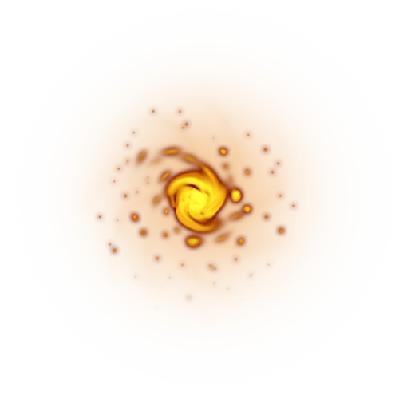
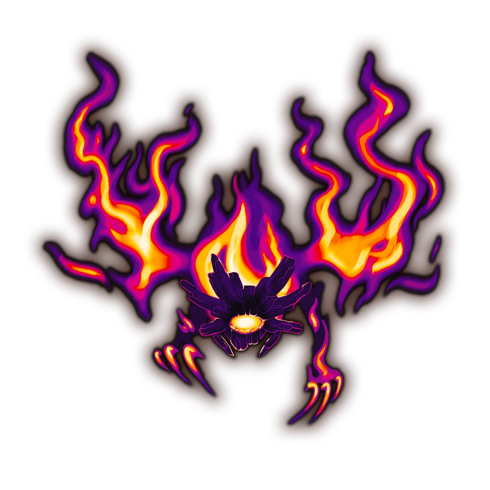
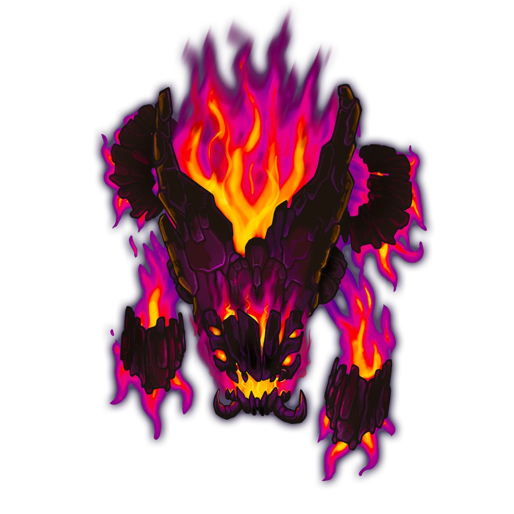

# Spontaneous Combustion

> [!warning] Gamemaster
> #### Gamemaster's Summary
>
> This repeatable Combat Event can occur anywhere in the [[Caryx Savanna]] that does not have a notable Location. In this Event, the characters can:
>
> - Battle enraged elementals corrupted by [[Fiyara]] and her Voidfire.
> - Investigate the aftermath of the battle for clues.
>
> This Event can repeat up to every 48 hours, any time between [[Summoning the Spark]] and [[Burning Hearts]], and is significantly more likely in hexes experiencing a Wildfire Weather System. It also becomes significantly more likely the closer [[Ragen]] is to Full.
>
> This Event is depicted using the "Burnt" Level of the [[Caryx Savanna]] Area Map.

### Environmental Conditions

The battlefield is obscured by dark smoke.

> [!danger] Hazard
> #### Smoke Inhalation
>
> During the day. treat the Scene as having &reference[Dim Light]. Areas of smoke are &reference[Lightly Obscured].
>
> Additionally, a creature that enters an area of smoke or begins its turn inside an area of smoke begins to &reference[suffocating]{Suffocate} unless they have taken specific precautions against smoke inhalation (such as by wearing a [[Flamewarden Smoke-Mask]]).
>
> An area of smoke can be dispersed by a wind of moderate or greater speed (at least 10 miles per hour), such as by the [[Unknown]] spell.

### Raging Elementals

As soon as the elemental creatures detect the characters, combat begins.

> [!abstract] Voidfire Cinder
> **[[Voidfire Cinder]]**
>
> Level 1 · Unknown Unknown
>
> 

> [!abstract] Voima
> **[[Voima]]**
>
> Level 1 · Unknown Unknown
>
> 

> [!abstract] Lithovore
> **[[Lithovore]]**
>
> Level 1 · Unknown Unknown
>
> 

> [!danger] Hazard
> #### Voidfire Cinder Tactics
>
> At the start of combat, the [[Voidfire Cinder]] will move toward the closest enemy and [[Detonate]].
>
> Over the course of combat, the Voidfire Cinder will prioritize the following actions and abilities:
>
> - If the Voidfire Cinder is attacked, it can use its [[Flicker]] Reaction to impose **-2 Banes** on the attack roll and potentially move toward the closest enemy in preparation to [[Detonate]].
>
> The Voidfire Cinders fight until destroyed.
>
> #### Voima Tactics
>
> At the start of combat, the [[Voima]] will use its [[Void Stealth]] Bonus Action (if able) and attempt to flank a ranged enemy.
>
> Over the course of combat, the Voima will prioritize the following actions and abilities:
>
> - It will position itself among enemies to inflict as much damage as possible with its [[Voidfire Aura]] feature.
> - In melee, it will use its [[Voidfire Claw]] Action.
> - When in danger, it will attempt to &reference[Disengage] to an area of &reference[Dim Light] or &reference[Darkness] and use its [[Void Stealth]] Bonus Action.
>
> The Voima fights until destroyed.
>
> #### Lithovore Tactics
>
> At the start of combat, the [[Lithovore]] will use its [[Voidfire Charge]] Action to engage the nearest enemy, then use its [[Kindle Hatred]] Bonus Action.
>
> - It will position itself among enemies to inflict as much damage as possible with its [[Voidfire Aura]] feature and affect as many enemies as possible with its [[Aberrant Ground]] feature.
> - In melee, it will use its [[Multiattack]] Action to make two [[Voidjaw]] attacks.
> - It will use its [[Voidfire Charge]] Action and [[Kindle Hatred]] Bonus Action whenever able.
>
> The Lithovore fights until destroyed.

### Investigating the Aftermath

If the party has not already learned of the elementals' Abyssal origins or their connection to Fiyara through the [[Flash of Insight]] Event, they may glean that information now by investigating the elementals' remains.

> [!tip] Exploration
> #### The Void Stares Back
>
> Any character with **Arcana (DC 14, Passive)** notices a tinge of Abyssal energy to the smoldering embers, suggesting that whoever or whatever set the fires were not simple fire elementals from [[Ragen]] — whatever they were, they were clearly connected to The Abyss.
>
> - **Attunement: The Abyss**: The character automatically succeeds on this check.
> - **Knowledge: Abyssals**: The character gains **+2 Boons** on this check.
>
> Any character made aware of this fact and who makes a successful **Arcana (DC 16)** or **Science (DC 16)** check recalls that the Wild God [[Fiyara]] was once the Elemental Sovereign of Ragen, but became corrupted by The Abyss and was deposed — making her influence a likely candidate for anything involving Abyss-tinged fire elementals.
>
> - **Knowledge: Gods**: The character gains **+2 Boons** on this check.

### Concluding the Event

> [!warning] Gamemaster
> #### Next Steps
>
> Once the party has defeated the elementals and investigated the battle's aftermath to their satisfaction, they are free to continue on their journey.
