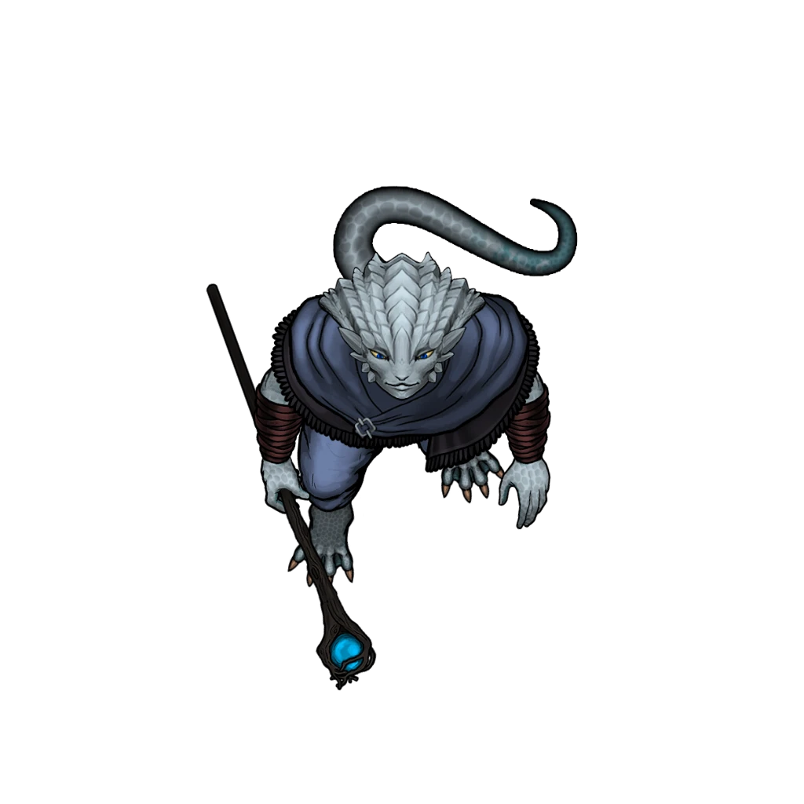

# Tidebound Temple

> [!warning] Gamemaster
> #### Gamemaster's Summary
>
> This Combat and Exploration Event is guaranteed to occur when the party visits the [[Temple of the Tides]] after completing [[Eye of the Storm]]. By delving into the submerged water temple, the characters can:
>
> - Overcome an ancient maze trial by manipulating the currents of water flowing through the temple.
> - Battle the enraged elemental guardians awakened by the recent disturbances.
> - Learn more about the Sedyri's history and culture.
> - Save Fesira Inari, and learn from her the procedure for summoning the Ripple of the Rivers and balancing the Spark of the Savanna.
>
> #### Area Walkthrough
>
> Exploration of this Event takes place on [[Temple of the Tides]] Area Map. A complete description of its contents can be found in the Area Walkthrough, [[Temple of the Tides]].
>
> The party begins their exploration at the [[Chasm]] in front of the temple.

### Debriefing with Fesira

If the party successfully rescues Fesira Inari, they have the opportunity to discuss with her what she learned in the temple, before she makes her own separate way in [[Tidebound Temple]] below.

First, however, they must make introductions with a rather tempestuous young initiate.

> [!abstract] Fesira Inari
> **[[Fesira Inari]]**
>
> Level 1 · Unknown Unknown
>
> 

> [!quote] Read Aloud
> After retreating to a place of relative safety, the Kiska fixes you with an intense glare.
>
> > I— Who are you? I mean, thank you for saving me, but— I don't recognize you. You're not Acolytes, that's clear as rain.

> [!info] Social
> #### A Turbulent Start
>
> Any character who makes a successful **Diplomacy (DC 12)** check can tell that Fesira's somewhat hostile demeanor is a product of embarrassment that she allowed herself to end up in such a predicament and required rescue — and that she can be put at ease by complimenting her tenacity and ability to survive the situation.

After the party introduces themselves, Fesira asks follow-up questions about the party and their mission. Use leading questions to encourage discussion of Kess, the ritual, the Spark of the Savanna, and the Ripple of the Rivers. Upon such topics arising, read or paraphrase the following:

> [!quote] Read Aloud
> > Well, if you want to know more about the Ripple …
>
> The initiate crosses her arms and purses her lips in a pout.
>
> > I suppose I owe it to you. And … seems like it might help out the Savanna too, which is important, I guess. Not to mention …
>
> Fesira lets out a frustrated sigh.
>
> > Right before the waters rose, I pieced together the last of the summoning ritual for the Ripple, and it seems like really **does** need you to summon that fire-thingy too — to balance it or whatever. I **hate** fire. Maybe I should just let you all do it …

> [!info] Social
> #### Begrudging Revelations
>
> Fesira Inari is, has accepted, to her own frustration, that she will not wield the Ripple of the Rivers, and thus is willing to impart what she has learned onto the party. To that end, she will grumpily share:
>
> - The Ripple of the Rivers purportedly gives the wielder the ability to control the tides of the Savanna's many bodies of water, and even stem the rains.
> - Fesira determined the magical formulae for summoning the Ripple of the Rivers, and will provide the party with her notes on it — the party might notice or correct mistakes in these formulae via [[Tidebound Temple]].
>
> Any character who makes a successful **`[[/skill diplomacy 14]]`** check can tell that Fesira is being open with everything she knows about the Ripple — if anything, that openness is what she does not want to admit, embarrassed by her own resignation and the end of her dream of wielding the Ripple.

> [!question] Q&A
> **Q:** About the function of the Ripple of the Rivers?
>
> **A:**
>
> A glint enters the young Ashka's eyes.
>
> > The stories are ***incredible**. A single individual, with control over the tides of every river, lake, and coastline in the Caryx Savanna. It's said they could even **move rainstorms** so that they'd miss big Sedyri cities during flood season. Can you imagine, Katu has one of his fits and I just … send the storm somewhere else?*
>
> She breaks out into laughter, then sobers, remembering.
>
> > But formulae are clear … without the Spark, you can't hope to control the Ripple. I was just a kid during Tajar's Great Burning, but even still … I don't want that much fire anywhere near me, let alone **inside me.**

> [!question] Q&A
> **Q:** About summoning the Ripple of the Rivers?
>
> **A:**
>
> Fesira reaches into a leather satchel just like the ones Sorak provided you, and opens up a messy notebook.
>
> > Here, these are all the formulae for the summoning. Or … for the Ripple half, at least, I didn't even realize I was missing the Spark bits until I found the last bit of the process while down in the temple. Okay, let me walk you through it…
>
> She begins to narrate the mechanics of the ritual — quite similar to the steps of Kess's ritual — getting more animated and excited as she talks, until she's practically bouncing.

Immediately upon hearing Fesira's explanation of the ritual formulae (or after), the party may notice (and even correct) mistakes in Fesira's work — this task is less challenging if they productively analyzed the bas reliefs in the [[Iconostasis]].

> [!tip] Exploration
> #### Analyzing Fesira's Formulae
>
> Any character who pays attention to Fesira's explanation and makes a successful **Arcana (DC 12)** check notices a few mistakes in the young initiate's work, though the corrections are not necessarily obvious.
>
> - **Knowledge: Rituals**: The character gains **+2 Boons** on this check.
> - **Character** **knows the** [[Rune: Storm]] **Rune** : The character gains **+2 Boons** on this check.
> - **Critical Success**: The character is able to correct the mistakes, feeling confident they now have a complete and correct procedure for the summoning ritual.
>
> If the party successfully derived the magical formulae and techniques for balancing the arcane energies of fire and water from the bas reliefs in the [[Iconostasis]], then they automatically notice Fesira's mistakes, and any character who makes a successful **Arcana (DC 12)** check can correct those mistakes, feeling confident they now have a complete and correct procedure for the summoning ritual.
>
> - **Knowledge: Rituals**: The character gains **+2 Boons** on this check.
> - **Character** **knows the** [[Rune: Storm]] **Rune** : The character gains **+2 Boons** on this check.

If the party corrects Fesira's mistakes and obtains a **correct** procedure for summoning the Ripple of the Rivers, mark the following Event Outcome:

`[[/outcome ritualObtained]]`

### Parting with Fesira

Having shared what she learned with the Fesira, the fiercely independent Fesira parts with the party, but offers them proof of her rescue to take back to Sorak.

> [!quote] Read Aloud
> The antsy-looking Kiska glances to horizon, then back to you.
>
> > Well, if the Ripple's a dead end, I guess it's back to sucking up to Katu. I'll be on my way then — good luck out there. I'm sure Sorak will want to know I'm alive, so …
>
> Fesira hands you her notebook, complete with all her research on the summoning ritual for the Ripple of the Rivers.
>
> > There's a letter to Sorak in there, show him and he'll know it was me. May the storms grant you strength, and uh— thanks again for the rescue.

Place [[Fesira's Notebook]] into the inventory of any party member.

### Concluding the Event

> [!warning] Gamemaster
> #### Next Steps
>
> Once the party has attempted their rescue of Fesira Inari — regardless of whether Fesira survived — the party must reunite with Sorak the Stormheart on Mount Sitara, southeast of the [[Citadel of Fire]], to open a gap in the dome of fire during [[Dousing the Flame]].
