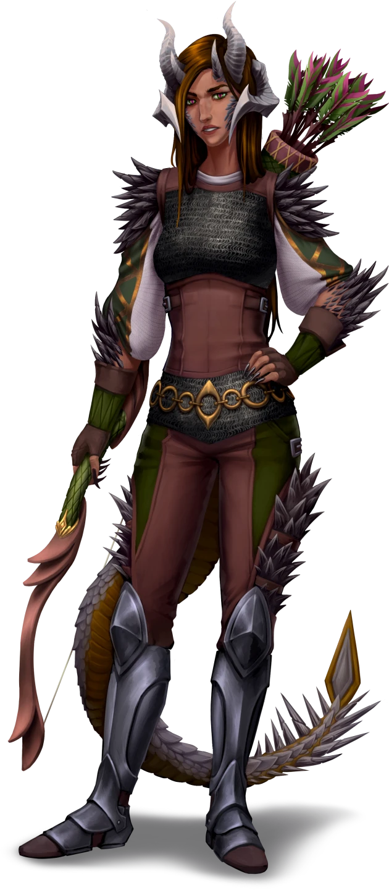

# Trial by Fire

> [!warning] Gamemaster
> #### Gamemaster's Summary
>
> This Exploration and Social Event occurs in the [[Caryx Savanna]] in any hex without a notable Location. In it, the characters can:
>
> - Weather the smoke and fire of an increasingly unstable Caryx Savanna.
> - Aid other travelers in overcoming the ravaging elements, and receive a small reward.
> - If the party has not yet encountered [[Flamewarden Tiga]], they do so here, and learn from her about the city of Tajar and its matriarch [[Vekaris Ossa]], who Tiga believes can assist the party in their efforts.
>
> This Event can occur any time at least 1 day from completing of [[Summoning the Spark]]. It can repeat up to once every 2 days until [[Burning Hearts]] is resolved, and is significantly more likely to occur if neither this Event nor [[Firewalled]] have been previously completed. It also becomes significantly more likely the closer [[Ragen]] is to Full.

### Encountering Tiga

If this is the first time the party has experienced this Event, and they have not yet met [[Flamewarden Tiga]] during [[Firewalled]], this Event takes a specific deterministic path:

- Instead of a random result on [[Trial by Fire Weather Hazards]] in [[Trial by Fire]] below, treat result the as a 1 — the hazard the party encounter is always the choking smog.
- Instead of rolling a random traveler via [[Trial by Fire]] to determine who the party finds, the traveler that they find after escaping the smog is always Tiga.

### Random Fire-Weather Hazard

Each time the party experiences this Event, roll or choose a random fire-related weather hazard on the [[Trial by Fire Weather Hazards]], skipping previously encountered results, if possible — each description continues where [[Trial by Fire]] above left off.

After the party overcomes the hazard, they also encounter a random traveler in a similar predicament. Each result on the hazard table ends with the details of the situation the traveler faces; consult [[Trial by Fire]] further below to decide the form the traveler takes.

| Range | #### Trial by Fire Weather Hazards |
| --- | --- |
| 1 | > … black, choking smog manifesting as if from nowhere, enveloping you so completely that you lose both sight and breath.  Each character must make a successful TODO or else take `[[/damage 1d6]]` damage and gain @Condition[Exhausted] due to smoke inhalation. Each time a character fails a check below to exit the smog, they repeat this save attempt.  After each save attempt, the character hears a whisper from the [[Kess the Corrupted Whispers]] Table. Party members who stay together in a group all hear the same whisper. They are obviously in Kess's voice, but attempts to speak back garner no response.  To escape the smog, a character can use any of the following methods:  - **Wilderness (DC 14)** or **Awareness (DC 14)** to find their way to the edge of the cloud. The character gains **+2 Boons** if another party member who has escaped the smoke calls out to direct them. - **Wilderness (DC 14)** or **Awareness (DC 14)** to locate another character within the smog; doing so requires them to remain in the smog and face the typical save for smoke inhalation, but as long as that character maintains physical contact with one or more other characters, they may use a future successful check to guide the entire group out of the smoke. - A sufficiently clever original solutions, including but not limited to the use of air-related magic to blow the smog away. The supernatural smog always rolls back in to fill the space, but blowing the smoke away can temporarily clear an area and allow one or more characters located there to quickly escape outside the edge of the self-repairing cloud.  Afterward, the party hears another person coughing and choking in the smog. If the party has not yet met Flamewarden Tiga during this Event or [[Firewalled]], it is always Tiga. Otherwise, a random traveler from the [[Trial by Fire Travelers]] Table is trapped.  Either way, party members may reenter the cloud to save them via the above procedure outlined above for locating and guiding characters.  - If the traveler is Tiga, she finds her way out with or without the party's help (though in worse shape, if not assisted) and play continues at[[Trial by Fire]]. - If the party instead encounters a random traveler, play continues as specified by the result on the [[Trial by Fire Travelers]] Table. |
| 2 | > … red, as a sudden flashover alights the twisting acacia trees that dot the Savanna … including the low canopy of the acacia directly overhead.  Each character must make a successful `[[/save dex 14]]` save to immediately dodge out from under the burning tree canopy, or else take `[[/damage 1d6 fire average]]` damage and `[[/damage 1d6 bludgeoning average]]` damage as flaming branches fall from overhead.  - **Knowledge: Weather**: The character gains **+2 Boons** on this check, having predicted the possibility of a flashover.  Afterward, the party encounters a random traveler from the [[Trial by Fire Travelers]] Table, pinned by the burning trunk of a toppled tree, which narrowly avoided crushing the traveler outright. The party must douse the fire and/or dislodge the traveler, via any of the following methods:  - [/skillCheck wilderness 14]] to skillfully douse the burning trunk, giving the party time to team-lift the trunk off of the traveler without a check. - [/skillCheck athletics 16]] to rapidly lift the burning trunk off of the traveler, taking `[[/damage 1d6]]` Fire damage in the process. If assisted by another party member, the character gains **+2 Boons** on this check, but assisting characters take the same damage. - Any sufficiently clever original solution, including the use of magic to douse the flame, create sufficient quantities of water, or translocate the traveler. |
| 3 | > … orange, as a ring of arcane fire surrounds your party, leaving barely enough room for you to maneuver without stumbling directly into the scorching flames.  Characters may use any of the following methods to escape the flames:  - [/skillCheck wilderness 18]] to fashion a temporary fire-barrier from available supplies — enough to allow one character to pass through the flames unharmed if they move quickly. - [/skillCheck athletics 14]] to dart quickly to the other side of the four-foot thick wall of flame, taking a reduced `[[/damage 1d6 fire average]]` damage. On a failure, they take a full `[[/damage 3d6 fire average]]` damage. - Dispellingthe magical ring of flames with the **Talent: Counterspell** Talent and freeing the entire party in the process. - Any sufficiently clever original solution, including the use of magic to shape a hole in the flames, create sufficient quantities of water, or translocate themselves or others on the other side.  After exiting the ring, the party spots another ring of flame a short distance away, hearing shouting (or bellowing) from a random traveler from the [[Trial by Fire Travelers]] Table, trapped within the ring. The party may employ any of the above methods to assist the traveler, with the exception that no random travelers would survive darting directly through the four-foot thick wall of flame without some sort of protection from the party. |
| 4 | > … violet, as tendrils of otherworldly purple flame spiral upwards from the ground, grabbing for you — the same violet flames you saw surround Kess prior to her disappearance.  Each character must make a successful `[[/save dex 14]]` saving throw to dodge the tendrils, or else take `[[/damage 1d4 fire average]]` damage as the flames wreath their hands.  Notably, those damaged by the flames:  - Notice that the flames are far less hot than a typical fire. - Immediately feel a strange hollowness within themselves. - Must make a successful `[[/save wisdom 12]]` saving throw or feel an immediate hostility to their fellow party members. The flames (now entirely heatless) persist, dancing around their hands and reflected as a flickering purple in their pupils. How this hostility expresses itself is up to the player — ask the player to provide reasons way they might feel angry, spiteful, or jealous of a party member, and encourage them to play it in a way and to a degree that feels comfortable and dramatically interesting to themselves and the party.  This hostility lasts until the flames are extinguished via any of the following means:  - One hour passes, after which they may attempt the `[[/save wisdom 12]]` saving throw again. - The flames are extinguished with water. - A character dispels the flames by knowing the **Talent: Counterspell** Talent and making a successful **Arcana (DC 14)** check. Characters who choose the [[Rune: Flame]] Rune for that action gain **+2 Boons**.  After a natural lull in the action, the players spot a random traveler from the [[Trial by Fire Travelers]] Table, standing a short distance away. Their hands (or talons) are wreathed in violet flames, and the same flames flicker in their pupils. They are uncharacteristically hostile until the party members put out the flames via any of the strategies established above. If they are unable to extinguish the flames, the traveler leaves, still hostile. |

[[Trial by Fire Weather Hazards]]If the party attempts to help Tiga or the random traveler, if they have not yet gained Heart Attunement from a prior instance of this Event, they gain Heart Attunement. If the party ignores them, and have not yet gained Abyss Attunement from a prior instance of this Event, they gain Abyss Attunement.

#### Heart Attunement: Helped Traveler

If the party attempts to help the traveler they encounter, each character advances their **Attunement: Heart of Ember (+1)** at the conclusion of the Event.

#### Abyss Attunement: Ignored Traveler

If the party ignores the traveler they encounter, each character advances their **Attunement: The Abyss (+1)** at the conclusion of the Event.

### Random Traveler

If the party has already met Flamewarden Tiga, they encounter a random traveler experiencing a similar weather hazard to the one they just faced. Choose or roll a random traveler below, and insert them into the circumstances described in [[Trial by Fire]] above.

| Range | #### Trial by Fire Travelers |
| --- | --- |
| 1 | ***A lone feviar.***  The feathered beast is trapped and terrified. After being saved, the creature is still frightened, and clearly in need of medical care for the burns that have torn away its plumage and the skin beneath. However, if not calmed, it will immediately attempt to run from the party.  A character who makes a successful **Wilderness (DC 14)** check can calm the feviar, after which it to allow the party to approach and touch it.  Once the feviar is calmed, if a party member takes any action that would restore Health to the feviar, that party member may bond with the feviar, and it will allow that party member to mount it, and will follow and fight with them indefinitely.  Once the feviar is healed, if a party member other than the one who provided healing would like to bond with and mount the feviar instead, they can do so by making a successful **Wilderness (DC 16)** check. |
| 2 | ***Lena Kanit, an anxious middle-aged Ashka trader.***  Lena has a nervous tic of repeated fast blinking, and is traveling without her typical mount and packbeast — a feviar named Lara, who she left in Tajar after the animal suffered wounds in a wildfire.  If saved, she offers the party a [[Potion of Healing]] as thanks.  Additionally, while most of her trade goods were damaged and she cannot spare much, she does offer the mutually beneficial opportunity to replenish her stock by purchasing from the party up to 50 gp worth of goods they would like to sell — for their full price, rather than the usual 50% of their purchase price. |
| 3 | ***Rinn Perata, a young Ashka survivalist.***  Rinn challenges herself to survive alone in the harsh environment of the Savanna. The recent increase in fire-related hazards has taxed her resources and destroyed her usual supplies, leaving her more helpless than she has ever felt.  As such, she has few resources to offer, but can provide advice on how to make peace with the formidable beasts of the Caryx Savanna, such as the feathered feviar. Anyone who spends 1 hour listening to the lesson gains **+2 Boons** on Wilderness checks to interact with creatures with the Beast Creature Category encountered in the Caryx Savanna. Drag [[Unknown]] onto their character sheets. |
| 4 | ***Garra Primrose, a pompous Ordani Human trade envoy.***  Garra is an envoy from House Lilifeld. He came to the Caryx Savanna to investigate the possibility of a trade relationship between the Flooded Fishery — a Tajar fishing collective — and House Lilifeld. He was knocked off his route by repeated fire-weather, and the annoyed man is openly disparaging of the Caryx Savanna as a whole.  If saved, he offers  **5** as thanks — or  **8** if someone flatters his ego or validates his hatred of the Savanna. |

[[Trial by Fire Travelers]]After the party has finished speaking with the random traveler (or chosen to ignore the traveler's plight), proceed to [[Trial by Fire]].

### Speaking with Tiga

If this is the first time the party has experienced this Event, and they have not yet met [[Flamewarden Tiga]] during [[Firewalled]], they meet her here. Optionally, you may load the [[Savanna Base]] Level of the [[Vista: Caryx Savanna]] Vista, and place [[Flamewarden Tiga]] on the Vista.

Read or paraphrase the following. If the party assisted Tiga, she also expresses gratitude for their help, and that she was lucky they were here.

> [!quote] Read Aloud
> The tall Drakon continues to choke and cough as she stumbles out of the smog, before calming her diaphragm with a clearly-practiced breathing technique. When she speaks, its with unexpected softness.
>
> > That was … unpleasant. As a Flamewarden, a smoke-storm is something I prepare for, but the onslaught of fire striking the Savanna as of late has left us short on supplies, and I gave smoke-mask away to an elderly traveler I met on the road.
> >
> > I'm Tiga, by the way, Flamewarden of Tajar — the city I was **supposed** to be returning to, before smoke and wildfire knocked me off course.
> >
> > You look like capable adventurers … do you know anything about that citadel that appeared on Mount Sitara? I was sent to investigate, but a wall of fire appeared to block my path up the mountain, and for all my skills, I couldn't pierce it.

> [!abstract] Flamewarden Tiga
> **[[Flamewarden Tiga]]**
>
> Level 1 · Unknown Unknown
>
> 

After the party has finished telling their story — presuming they speak of their experience with Kess and her ritual — Tiga urges the party to come with her to Tajar and tell their story to the matriarch, [[Vekaris Ossa]]. If players do not opt not to share details about Kess and the ritual, have Tiga ask the party leading followup questions, or, if needed, modify the following narration accordingly.

> [!quote] Read Aloud
> The Drakon nods, deep in thought, then speaks with firm assurance.
>
> > I'm glad we stumbled upon each other. I believe what you know may be of great importance to determining the exact source of this sudden spike in fire activity across the Savanna — not to mention what sort of threat this strange citadel may be to the Savanna and its people.
>
> She unfurls a map, tracing a line from your location to a city that sits on the Savanna's southern coast.
>
> > I'd appreciate it if you joined me at the Communal Quarter of the city of Tajar. There, we can consult with the other Flamewardens, and Tajar's matriarch, Vekaris Ossa. She is as wise and weathered as they come, and if anyone will know how to make use of our combined knowledge, it's most certainly her. If you'd like, I can travel there with you.

> [!info] Social
> #### A Warden's Responsibility
>
> Tiga wishes the party to join her in the [[Communal Quarter]] of Tajar and present what they know — about Kess, the ritual, and anything they have learned about the citadel and sudden fires — to matriarch [[Vekaris Ossa]], who leads the council of Wise-Women that govern Tajar. To that end, Tiga will also readily discuss:
>
> - Tiga was sent by the Flamewardens to investigate the appearance of the citadel, but as she approached it, an impenetrable flame wall blocked her path.
> - The Flamewardens are an organization of skilled rangers who train in traditional techniques for protecting the people of the Caryx Savanna from its many natural hazards.
> - Vekaris Ossa leads the Savanna's largest city, and is a former bard, with unparalleled knowledge of this place and its history, dating back to the ancient [[Sedyri]].
> - Tajar is Caryx Savanna's largest city, and despite the disasters that have befallen it, through the work of the Flamewardens, its people persist.
>
> Specific dialogue for Tiga on the above topics can be found immediately below this block.
>
> Any character who makes a successful **Diplomacy (DC 11)** check determines Tiga is being as open and earnest as she can, for the good of the Savanna's people.

> [!question] Q&A
> **Q:** About the citadel?
>
> **A:**
>
> > It appeared at the top of Mount Sitara at almost the same time that wildfires and strange, sourceless smoke-storms started appearing all over the Savanna. Even when Ragen is at its zenith, the fires aren't usually this bad. The Flamewardens sent me to investigate the citadel, while the others try to beat back the fires.
> >
> > But, when I approached the plateau under the citadel, a wall … no, a **dome** of fire sprung to life. It was impossible to tell just how thick it was, but it seemed like dozens of feet, maybe hundreds. Despite every technique the Flamewardens taught me, I couldn't make it through. I'm hoping that with the information you have, Vekaris can help us figure out a way to bring to it down.

> [!question] Q&A
> **Q:** About the Flamewardens?
>
> **A:**
>
> > We are a small organization of rangers dating all the way back to the first Arcturians that settled the Caryx Savanna. All Flamewardens train in traditional techniques for protecting the Savanna's people from its difficult environment — the fire season first and foremost, though some have deemed our name a misnomer, as we also oversee efforts like evacuations and rescues during the flooding season.
> >
> > In the end, Flamewardens are those who recognize that people are but small in the face of the great Savanna, and take responsibility for adapting our way of life to be compatible with this place's awesome nature.

> [!question] Q&A
> **Q:** About Vekaris Ossa?
>
> **A:**
>
> > The head matriarch of the elderly Wise-Women that lead Tajar.
> >
> > In her younger years, Vekaris was a renowned bard, and her encyclopedic knowledge of the Savanna's songs and stories makes her one of the most knowledgeable sources about Tajar's history and traditions. Her tales retell our past all the way back to the Sedyri who once inhabited these lands. You may know her daughter Fernis, famed scholar of the Anachraenum — it's said Vekaris' stories are what inspired her daughter's scholarship.
> >
> > If anyone in the Savanna can shed light on what magics may be are at work here, it's her — not to mention, she'll want to know anything that can better equip her to protect Tajar's citizens.
> >
> > She may also be able to answer **your** questions about all this, if you have any?

> [!question] Q&A
> **Q:** About Tajar?
>
> **A:**
>
> > The Savanna's largest city, and my home. Originally built on top of ancient Sedyri ruins, and now on our own ruins, I suppose, after the Great Burning brought down half the city a decade ago. We are a tenacious people — if you'll permit me a moment of pride. As a Flamewarden, I've dedicated my life to protecting that legacy, and carrying on the traditions that have long allowed us to weather this land.

If the party assents to having Tiga join them, she will accompany the party through the Caryx Savanna as long as they stay reasonably focused on reaching Tajar's Communal Quarter, and she will fight alongside the party in combat encounters.

Regardless, before departing, Tiga asks the party about the whispers in the smoke, if the topic has not already arisen. Tiga herself heard a whisper of (at least) the following:*"I tried to tell you, but none of you listened. You'll listen now, I'll make **sure** of it!"*

> [!quote] Read Aloud
> Tiga pauses for a moment, looking unsure of herself for practically the first time:
>
> > One last question … did any of you hear … whispers, while in the smoke? I believe I did, and they were quite concerning. Angry. Hateful. A bad sign about whoever is behind this, surely?

Tiga encourages the party to report what they heard — and what they think it means — to Vekaris.

### Concluding the Event

> [!warning] Gamemaster
> #### Next Steps
>
> Once the party has borne the brunt of the weather and saved (or ignored) any fellow victims, they have multiple avenues for continuing this Quest:
>
> - Travel to Tajar's [[Communal Quarter]] and meet with [[Vekaris Ossa]] in [[Flash of Insight]].
> - Investigate the citadel and the dome of fire blocking access to it in [[Firewalled]].
> - Stumble into an attack by enraged fire elementals in [[Spontaneous Combustion]].
>
> If the party encountered Tiga and opted to have her travel with them, add [[Flamewarden Tiga]] to the [[DreamTeam]].
